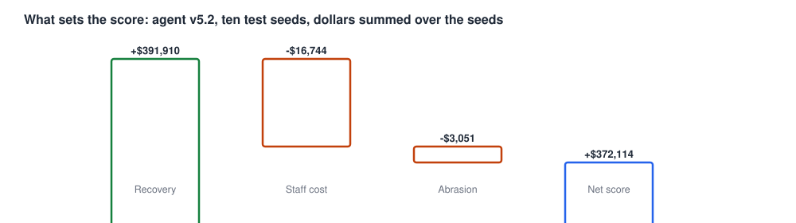
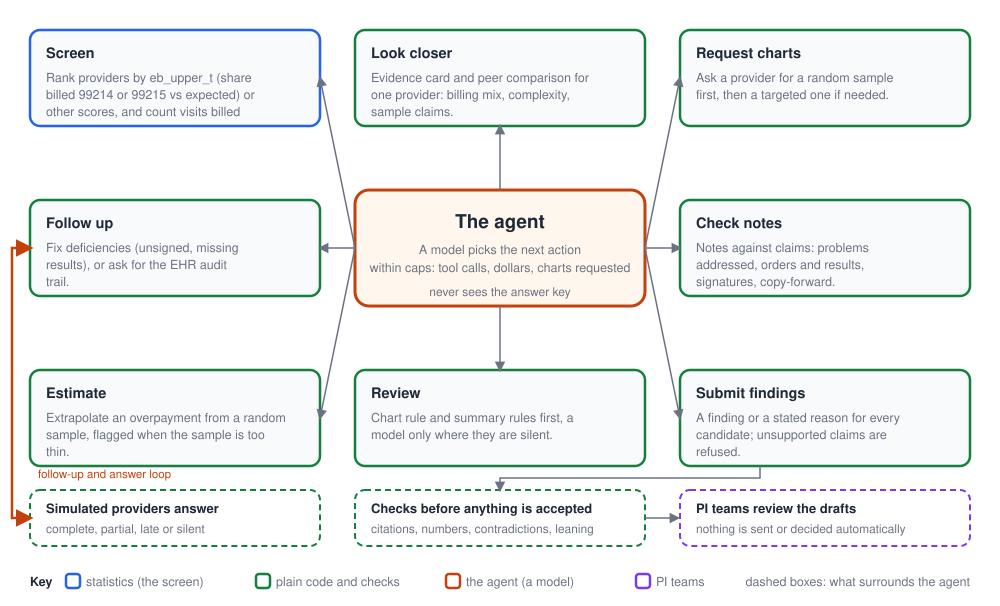
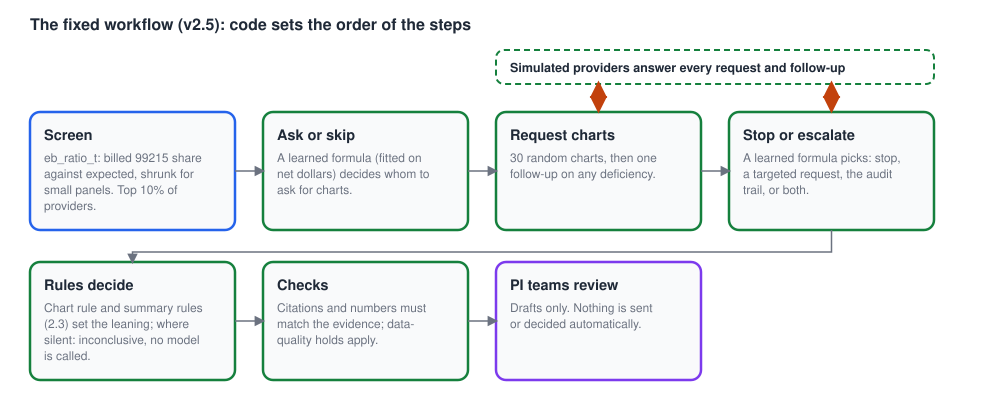

# Agentic E/M upcoding detection

A postpay upcoding investigator for payment integrity (PI) teams: it audits claims to recover wasteful U.S. healthcare spending by:

- 📄 **Claims:** reviewing synthetic Medicare-style paid claims for E/M (Evaluation and Management) upcoding (billing an office visit above the level it supported) and for visits billed that never happened;
- 🔽 **Screen:** ranking providers whose billing is highest against what their patients predict, and counting visits billed per day;
- 📁 **Charts:** asking the providers it picks for charts and following up on what comes back;
- ✏️ **Summaries:** checking the charts against the claims and drafting case summaries, with code writing the facts and a model only where the rules are silent;
- 🧭 **Who decides:** choosing its own next steps within caps, then handing drafts to PI teams to review;
- 📊 **Headline results:** scoring in net dollars (formula below) against the answer key.

Two designs are built side by side on the same data:

- ⚙️ **[Workflow](docs/concepts/workflow-and-agent.md):** code fixes the order of the steps, and a learned formula decides whom to ask for charts.
- 🤖 **[Agent](docs/concepts/workflow-and-agent.md):** a model chooses its own steps within caps and gets the same formula as advice.

Both are scored by the **RL score** ([score 4.2](docs/score_42.md)), in net dollars per seed (the reinforcement learning (RL) reward the policies are trained on):

```
RL score = Recovery - Staff cost - Abrasion

Recovery   = conservative (90% lower bound) estimate of the overpayment a random chart sample supports, per provider sent a demand;
             a visit the office has no record of counts as overpaid
Staff cost = hours x wage for triage, requests, chart review and demands; model dollars
Abrasion   = $43.84 per request round + $2,000 per demand, weighted by how honest the provider is
```



<!-- score:start -->
- **Recovery +$391,910:** $370,474 of it from the visits-per-day check (30 of its demands), the rest from reviewing billing levels; 36 demands in all.
- **Staff cost -$16,744:** chart review $4,079 (474 charts), requests $1,546 (100 rounds), demand work $9,924, triage and model dollars $1,196.
- **Abrasion -$3,051:** the cost to providers of requests and demands, weighted by how little they overbilled.
- **Net score $372,114** over ten seeds.
<!-- score:end -->

## Results
<!-- tldr:start -->
Every row of the table uses one score (score 4.2); the data 4.0 rows are re-scored from the stored runs, so rows on different data are not directly comparable. On data 4.2, which adds fraud, ten test seeds give: workflow v4.1 scores $17,713; workflow v4.2 ($375,031) and agent v5.2 ($372,114) add a check on visits billed per day, which gives 94% of their recovery. That signal is clean by construction in the synthetic data: read the gain as what a reviewer does with a clean signal, not as a forecast for real claims. Earlier data 4.0 results are in the linked pages.
<!-- tldr:end -->

<!-- release23:start -->
| Version | [Data, seeds](docs/glossary.md#results-columns "Data version and the ten test seeds. Rows on different data are not directly comparable.") | [Upcoders found](docs/glossary.md#results-columns "Providers whose true net level rate is 15% or more that were sent a demand, of all such providers in the ten datasets.") | [Impossible-day billing found](docs/glossary.md#results-columns "Providers who billed an impossible number of visits in a day that were sent a demand (data 4.2 only).") | [Score 4.2](docs/glossary.md#results-columns "Recovery minus staff cost minus provider abrasion, no records copy fee, a visit the office has no record of counted as overpaid (docs/score_42.md). The same formula on every row (data 4.0 rows re-scored from the stored runs). Dollars summed over ten seeds.") |
|---|---|---|---|---|
| Workflow v4.0 | 4.0, test | 4% | n/a | -$6,212 |
| Workflow v4.1 | 4.0, test | 11% | n/a | $15,791 |
| Workflow v4.1 | 4.2, test | 9% | 0% | $17,713 |
| Workflow v4.2 | 4.2, test | 9% | 83% | $375,031 |
| Agent v5.0 | 4.0, test | 4% | n/a | -$3,762 |
| Agent v5.1 | 4.0, test | 12% | n/a | $11,206 |
| Agent v5.2 | 4.2, test | 7% | 83% | $372,114 |

Hover over a column title for its definition ([glossary](docs/glossary.md#results-columns)). Every run and release: [results](docs/results.md), [v4.0 and v5.0](docs/v4_v5_results.md), [v4.1](docs/w41_fresh_result.md), [v5.1](docs/a51_fresh_result.md), [v4.2 and v5.2](docs/v42_test_result.md); releases 1 to 5: [release 1](docs/eval61.md), [5](docs/release5_results.md).
<!-- release23:end -->

## How it works




The agent starts from the full claims book with no pre-screened list; code refuses findings the evidence does not support. [Operating model](docs/operating_model.md) · [eight-step walkthrough](docs/how-it-works.md) · [tools and guardrails](docs/agent_tools.md) · [the simulated providers](docs/provider_sim.md)

v1.x, v2.x and v4.x are workflows; v3.x and v5.x are agents. Every release changed both; the [progression slide](docs/images/progression.svg), [version history](docs/versioning.md), [releases](https://github.com/simmyhundal/em-upcoding-agent/releases) and [roadmap](docs/roadmap.md) show how. Everything is synthetic ([limitations](docs/limitations.md)).

## Next (v4.3 and v5.3)
A messier volume signal and bigger datasets ([#197](https://github.com/simmyhundal/em-upcoding-agent/issues/197)); reaching level upcoding, 92% of justified providers untouched ([#198](https://github.com/simmyhundal/em-upcoding-agent/issues/198)); fraud with no volume signal ([#199](https://github.com/simmyhundal/em-upcoding-agent/issues/199)); a sourced score 4.3 ([#200](https://github.com/simmyhundal/em-upcoding-agent/issues/200)).

## Explore
[Results and evaluation](docs/results-and-evaluation.md) · [limitations](docs/limitations.md) · [E/M background](docs/background.md) · [glossary](docs/glossary.md) · [concepts](docs/concepts/README.md) · [design](docs/design.md) · [version 1, archived](docs/archive-version-1.md) · [about](docs/about.md) · [for contributors](CLAUDE.md) · [MIT license](LICENSE)
