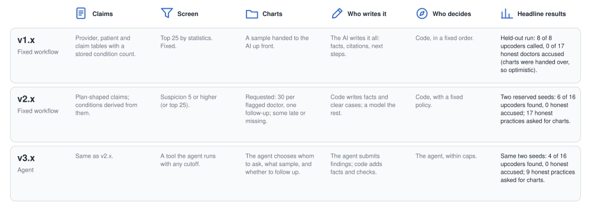

# Agentic E/M upcoding detection

An upcoding investigator agent for payment integrity (PI) teams to reduce wasteful spending in the American healthcare system by:

- 📄 **Claims:** reviewing synthetic Medicare-style claims for E/M (Evaluation and Management) upcoding, billing an office visit at a higher level than the visit supported;
- 🔽 **Screen:** ranking providers whose billing is highest against what their patients' conditions predict;
- 📁 **Charts:** asking the providers it picks for charts and following up on what comes back (the providers are simulated too);
- ✏️ **Summaries:** checking the charts against the claims and drafting case summaries, with code writing the facts and a model only where the rules are silent;
- 🧭 **Who decides:** choosing its own next steps within caps, then handing drafts to PI teams to review;
- 📊 **Headline results:** scoring in net dollars (see the RL score formula below) against the answer key.

Two designs are built side by side on the same data:

- ⚙️ **Workflow:** code fixes the order of the steps, and learned formulas decide whom to ask and when to stop.
- 🤖 **Agent:** a model chooses its own steps within caps and gets the same formulas as advice.

Both are scored by the **RL score**, in net dollars per seed (the reinforcement learning (RL) reward the policies are trained on):

```
RL score = Recovery - c_round x Rounds - c_burden x HonestRounds - c_review x Reviewed - c_false x HonestAccused

Recovery = 90% lower bound of the overpayment the records samples support, for providers called upcoding
c_round = $90 per request or follow-up (copying fees)       c_burden = $43.84 per round sent to an honest provider
c_review = $158 per provider reviewed                       c_false = $2,000 per honest provider accused (an assumption)
```

## Results TL;DR
<!-- tldr:start -->
A fixed workflow and an AI agent both screen providers, request charts and draft cases for PI teams. On ten fresh seeds (79 planted upcoders), the latest agent (v3.5) and workflow (v2.5) each earn about $32k net per seed and are not reliably different; the release 3 workflow earned $24k on the same seeds. The gain is lower cost (fewer requests and fewer false accusations), not more catches: each still finds under half of the upcoders (37 and 36 of 79), far from the 12.5% miss-rate target.
<!-- tldr:end -->

| The test | Per release |
|---|---|
| Providers per seed | 216, of which 8 are planted upcoders and 8 are honest look-alikes |
| Seeds | 10 fresh, so 78 to 80 upcoders in all: the most any version can find |
| Dollars possible | not yet sized; measuring what the missed upcoders are worth is [#117](https://github.com/simmyhundal/em-upcoding-agent/issues/117) |

<!-- release23:start -->
| Version | [Data model](docs/glossary.md#results-columns "Easy: release 1, data 2.1, clean coding and planted clone signs. Hard: releases 2 to 5, data 2.2, adds honest coding noise, group and incident-to billing, truncated diagnoses, claims lag, level-changing corrections and injected data defects.") | [Upcoders found (recall)](docs/glossary.md#results-columns "Upcoders found out of those planted.") | [Calls that were upcoders (precision)](docs/glossary.md#results-columns "Upcoders found out of all providers called upcoding.") | [Net $ per seed (RL score)](docs/glossary.md#results-columns "Overpayment a records sample supports for the upcoders found (90% lower bound) minus request and false-accusation costs. Compare rows within one seed set only.") |
|---|---|---|---|---|
| Workflow v2.0 | Easy | 24% | 86% | $988 |
| Workflow v2.1 | Easy | 40% | 100% | $14,984 |
| Agent v3.0 | Easy | 22% | 100% | $2,299 |
| Agent v3.1 | Easy | 34% | 100% | $13,931 |
| Workflow v2.2 (release 2) | Hard | 27% | 91% | $368 |
| Agent v3.2 | Hard | 15% | 92% | $1,325 |
| Workflow v2.2 (release 3) | Hard | 30% | 92% | $4,362 |
| Workflow v2.3 | Hard | 47% | 97% | $4,923 |
| Agent v3.3 | Hard | 43% | 97% | $12,666 |
| Workflow v2.4 | Hard | 61% | 96% | $32,245 |
| Agent v3.4 | Hard | 50% | 93% | $26,505 |
| Workflow v2.5 | Hard | 47% | 92% | $31,888 |
| Agent v3.5 | Hard | 46% | 97% | $32,159 |

Hover over a column title for its definition (the same text is in the [glossary](docs/glossary.md#results-columns)). Each release has its own ten seeds, so compare rows within one release only: [1](docs/eval61.md), [2](docs/release2_results.md), [3](docs/release3_results.md), [4](docs/release4_results.md), [5](docs/release5_results.md); [every run](docs/results.md).
<!-- release23:end -->

## How it works


The agent starts from the full claims book with no pre-screened list; code refuses findings the evidence does not support. [Eight-step walkthrough](docs/how-it-works.md) · [tools and guardrails](docs/agent_tools.md) · [the simulated providers](docs/provider_sim.md)

## How it has changed


v1.x and v2.x are workflows; v3.x is the agent. Each release changes both: note checks (v2.1, v3.1; cloned-note upcoders found went from 3 to 10 of 40 for the workflow and 1 to 8 of 40 for the agent, though the generator plants the clone signs, so real notes are harder), harder data (v2.2, v3.2), rules for providers that clone notes (v2.3, v3.3), a learned rule for when to stop asking (v2.4, v3.4), and learned choices of whom to ask, trained on net dollars (v2.5, v3.5). What has not moved is recall: no version meets the 12.5% miss-rate target, and the workflow and the agent are not reliably different. Everything is synthetic, ten seeds per release, and dollars rank versions at simulated scale. The claims are Medicare-style; E/M level rules are the same for Medicare Advantage and commercial plans, but patient mix and record and recovery rules differ ([limitations](docs/limitations.md)). [Version history](docs/versioning.md) · [releases](https://github.com/simmyhundal/em-upcoding-agent/releases) · [roadmap](docs/roadmap.md)

## Next (release 6)
Fix the agent's written summaries ([#116](https://github.com/simmyhundal/em-upcoding-agent/issues/116)); size the dollars in missed upcoders, then retry providers that never answer ([#117](https://github.com/simmyhundal/em-upcoding-agent/issues/117)); test whether the agent should obey the policy's stop advice ([#118](https://github.com/simmyhundal/em-upcoding-agent/issues/118)).

## Explore
[Results and evaluation](docs/results-and-evaluation.md) · [limitations](docs/limitations.md) · [E/M background](docs/background.md) · [glossary](docs/glossary.md) · [design](docs/design.md) · [version 1, archived](docs/archive-version-1.md) · [about](docs/about.md) · [for contributors](CLAUDE.md)
