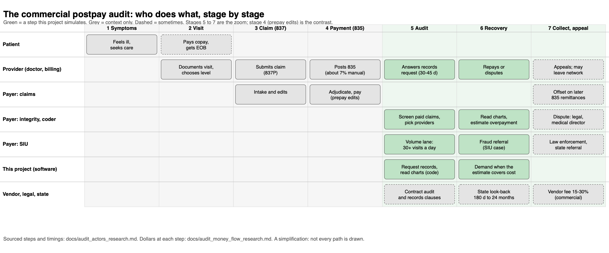

# The audit in context: who takes part, where the dollars go

[Back to the README](../README.md) · [actors, stages, KPIs and timeline (research notes)](audit_actors_research.md) · [dollar funnel (research notes)](audit_money_flow_research.md) · [diagram reference](audit_diagram_reference.md)

**What this page is.** A health plan pays a visit's claim first and checks it later. This page shows what that later check looks like in the real world (who does what, how long each hand-off takes, who keeps the money) so a reader can see which part of it this project simulates. It is a summary of two research notes written on 2026-10-27; every figure there carries a source and a fit grade (A commercial, B Medicare or Medicaid analog, C context). Almost no commercial figure is published, so most numbers are analogs, and the page says so where it matters.

(Vector version: [audit_workflow.svg](images/audit_workflow.svg).)

The diagram is hand-written SVG, shown here as a 2400-pixel PNG so it stays sharp on a tablet. An editable copy for diagrams.net or Miro is not drawn yet; the structure follows the reference in [audit_diagram_reference.md](audit_diagram_reference.md).

## The seven stages
1. The patient has symptoms and seeks care. 2. The provider sees the patient and documents the visit. 3. The provider submits the claim (an 837P). 4. The plan adjudicates (prepay edits, then payment and an 835 remittance): the provider's happy path. 5. The plan audits paid claims. 6. The plan recovers incorrect payments: the plan's happy path. 7. Collections, appeals and vendor fees. This project simulates 5 to 7; stage 4's edits are the contrast (the prepay line of work).

## Who is in stages 5 to 7, and how they are measured
- **Payment integrity team** picks providers from the paid-claims history (billing against peers, tips, complaints). Measured by savings and recoveries net of cost.
- **Coders and clinical reviewers** read the charts. Measured by accuracy and charts an hour; no published standard was found (10 to 15 an hour is from job ads).
- **SIU** (special investigations unit; state law requires one in New York and California) takes suspected fraud. New York plans reported about $3.5B in "savings" against $40.3M in recoveries: the value is mostly prevention.
- **Medical director and legal** hear disputes (30 days to dispute, 30 to answer in the one commercial policy read in full, Blue Cross VT).
- **Provider side:** practice administrator and compliance answer the records request (30 days, up to 45); the billing office repays, disputes or appeals.
- **Vendors** find or recover for a contingency fee: commercial 15% to 30%, government 8% to 17%.
- **Employer** (two-thirds of covered workers are in self-funded plans) owns the recovery; the administrator or vendor takes a fee, and courts have asked whether that is a fiduciary matter.
- **Regulators** set look-back limits (180 days in Texas to 24 months in New York) and watch recoupment practice.

## How long each hand-off takes (assumptions marked)
Records request to response 30 to 45 days; review 30 to 60 days (assumption); findings meeting and written notice 2 to 4 weeks (assumption); so about 2.5 to 4.5 months from request to written finding. Undisputed repayment adds one month; a disputed one adds two to four; an appeal or fraud referral takes one to two years or more. In Texas the plan must select the provider and send the request within roughly a quarter of payment. The simulation has no payment-to-demand clock yet, so these limits are not in the score.

## Where $100 of paid claims goes (central case)
| Step | Per $100 | Status |
|---|---|---|
| Paid in error, all causes | $6.50 | analog (Medicare CERT 2025) |
| E/M visits paid | $9.00 | analog, derived |
| E/M overpaid by upcoding | $0.41 | analog |
| Share of that a postpay program reaches | 5% | **assumption, no source** |
| Upcoding found postpay | $0.02 | assumption |
| Collected (about 60%, already net of appeals) | $0.012 | analog |
| After fees and cost (20%) | **$0.010** | assumption |

Range for the last line: $0.001 to $0.18 per $100. Even if every upcoded dollar were found, a postpay program would recover about $0.17 per $100 at the central values. Prevention before payment is far larger (New York: about 87 dollars of prepay "savings" per dollar recovered), which is the argument for the prepay repository. The one number that moves everything is the share of upcoded dollars a postpay program reaches, and it has no source; this project's simulation is the only estimate available.

## Who keeps the recovered dollar
Self-funded plan: the employer's plan, less the fee. Fully insured plan: the insurer, unless its medical loss ratio is below the floor (80% individual and small group, 85% large group), in which case enrollees get it as a rebate. Under the loss-ratio rule, recoveries from providers lower the ratio; fraud recoveries are added back up to the fraud work's cost. Medicare: the trust funds (52% of 2021 Recovery Audit collections). Medicaid managed care: set by the state contract.

## What else to think about (not modelled, or only partly)
1. **Which plan, which law.** Self-funded plans escape state recoupment limits (ERISA); fully insured plans do not. The simulation has one rule for everyone.
2. **Provider abrasion.** Automatic downcoding (Cigna's R49, Aetna's program) drew regulators and societies; a records-based sample is the defensible alternative, but abrasion is a modelled assumption (score weights), not a measurement. Network adequacy limits how hard a plan can push.
3. **Vendor incentives.** A contingency fee rewards finding and collecting, and the check is the appeal and the refund. A vendor can also pass cost to the employer.
4. **Payer incentives under the loss-ratio rule.** A plan above the floor keeps the recovery; one near it gives part back, so the same finding is worth less. Not in the score.
5. **Timing.** State clocks, payment-to-audit lag and appeal durations are research findings, not simulation inputs.
6. **Patient impact.** Members see an explanation of benefits and can report services not received; downcoding can change what they owe. Not modelled.
7. **Prepay versus postpay.** Most value is created before payment; the postpay product is the part left when prevention fails, and the dollar gap in the table is the opportunity and the difficulty.
8. **Data sources.** The payer holds claims history, not charts; charts come only by request, and only about a third of attachments move electronically. The project's data are synthetic and cover one year.
9. **Evidence quality.** No published commercial improper-payment rate, collection rate on E/M demands, reviewer productivity standard or share of dollars audited. The research notes list each gap and how it could be closed (interviews, state filings, a pilot sample).
10. **Who the customer is.** Budget owner (payment integrity, claims operations, network management) decides which of these matters; the prepay discovery note lists the questions for the people who know.
