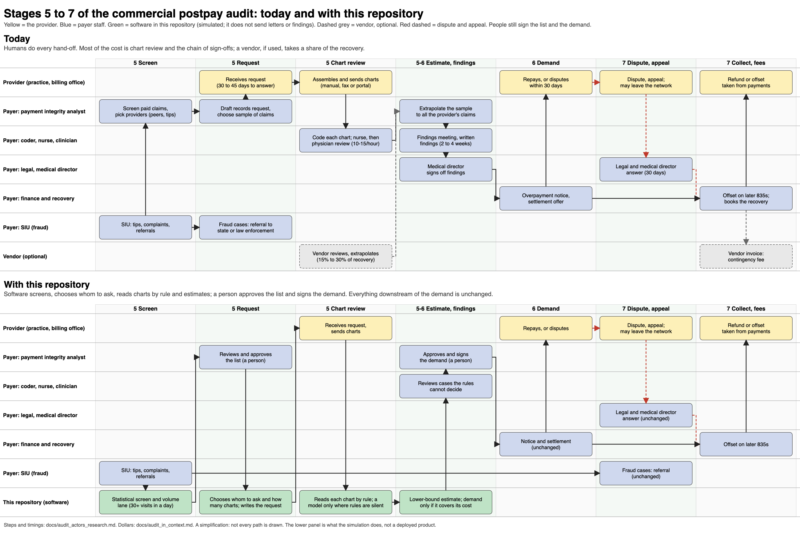

# Stages 5 to 7 up close: who does what, and where the $100 goes

[Back to the README](../README.md) · [the audit in context](audit_in_context.md) · [actors and timeline (research)](audit_actors_research.md) · [money flow (research)](audit_money_flow_research.md) · [operating model](operating_model.md)

**What this page is.** After a health plan has paid a visit's claim, three things can happen: it audits the claim (stage 5), recovers any overpayment (stage 6), and collects, hears appeals and pays any vendor (stage 7). The diagram below zooms into those three stages twice, as they run today and as the simulation in this repository runs them, so a reader can see who hands what to whom and which steps software takes over. The tables answer two questions: what changes in the steps, and where each dollar of a $100 base ends up for the payer, the provider and a vendor. Everything on the "with this repository" side is simulated on synthetic claims.

Vector version: [audit_postpay_zoom.svg](images/audit_postpay_zoom.svg), drawn by [make_audit_zoom.py](make_audit_zoom.py).

## 1. What changes in the steps
| | Today | With this repository (simulated) |
|---|---|---|
| Choosing whom to audit | An analyst screens paid claims against peers, tips and complaints | Software runs the statistical screen and the volume lane (30 or more visits in a day); an analyst approves the list |
| Records request | An analyst drafts the request and picks the claim sample | Software chooses whom to ask and how many charts, and writes the request |
| Reading charts | A coder codes each chart, then a nurse and a physician review (10 to 15 charts an hour is the figure in job ads) | Rules read each chart; a model only where the rules are silent; a person reviews the cases the rules cannot decide |
| Estimate | An analyst or vendor extrapolates the sample to all the provider's claims | Software computes the lower-bound estimate and proposes a demand only when it covers its cost |
| Findings and sign-off | Findings meeting, written findings, medical director sign-off (2 to 4 weeks) | A person approves and signs the demand |
| Demand, dispute, offset, fees | Finance, legal and the medical director; a vendor invoice if outsourced | Unchanged |
| Human hand-offs from screen to demand | 6 (screen, draft request, code chart, extrapolate, findings meeting, sign-off) | 3 (approve list, review undecided cases, sign demand) |

The project removes steps in the middle of the chain, between the screen and the demand. It does not change the payer's downstream steps, the provider's side, or the law. It sends no letters and writes no findings.

## 2. Where $100 of E/M payments ends up
The base and the 4.5% upcoded share are the ones in [the audit in context](audit_in_context.md): $100 the plan paid for E/M visits, of which $4.50 was paid at too high a level. All figures are dollars per $100.

| | Today (Medicare-based analog) | With this repository (simulated) |
|---|---|---|
| Upcoded and paid | $4.50 | $4.50 (same base) |
| Collected from providers | $0.062 (1.4% of upcoded; Recovery Auditors against measured improper payments, FY2021) | $0.062 (the simulated arm collects 1.4% of upcoded dollars) |
| **Provider** repays | $0.062 | $0.062 |
| **Vendor** fee, if outsourced | $0.012 (20% of collected; commercial range 15% to 30%) | $0 in the simulation (in-house); $0.012 if it were outsourced on the same terms |
| **Payer** cost of the audit | Not published for a commercial plan. Medicare's contractors and CMS administration took 25% of collected, about $0.016 | $0.043 (staff time, charts, requests at the score's assumed prices) |
| **Payer** keeps | $0.050 after a 20% vendor fee, or about $0.047 after the Medicare cost share; own staff cost not included | $0.019 |
| Provider abrasion (assumed cost units) | Not measured | $0 (the arm touched no honest provider in these seeds) |

Reading it honestly:
- **Not like for like.** The "today" column leaves out the payer's own staff cost, because nobody publishes it (a gap in the research). The simulated column includes it, at assumed prices ($8.61 a chart review and $13.13 to triage a provider, among others).
- **Same recovery ratio.** On the data 4.0 test seeds the arm (workflow v4.1) collected $15,107 of $1,090,695 upcoded dollars, 1.4%, the same ratio as Medicare's. The simulation does not show the project recovering more.
- **The case rests on cost, and the table does not prove it.** On these assumptions the arm's cost is 69% of what it collects, higher than a vendor's 20% fee. It still nets a profit ($4,603 over ten seeds, 21% of the oracle's best conceivable $8,778) while earlier arms lose money, but whether it beats today's real cost per recovered dollar cannot be said until someone measures a payer's audit cost.
- **The upcoding rate differs.** The synthetic data hold upcoded dollars at 1.3% of payments, not 4.5%, so the simulated column is scaled to the Medicare-like base through its recovery and cost ratios (1.4% recovered, 0.96% of upcoded dollars spent on staff).
- **A drive for fewer steps is a design claim.** The step counts above come from the design, not from timing a payer's staff.

Sources: simulated figures are `experiments/yardstick_s43.json` (score 4.3, workflow v4.1, ten data 4.0 test seeds) and the answer keys; today's figures are in the two research notes.
