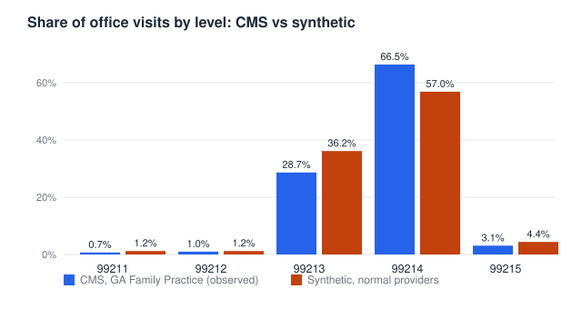

# Background: how office-visit levels are chosen

[Back to the README](../README.md)

## How the level is chosen and checked
In practice nobody grades a visit when it is billed. The doctor picks the level, the claim is paid, and any checking happens later.

Since 2021 the level (99212 to 99215) comes from **either** the medical decision making in the visit (two of three elements: problems, data, risk) **or** the doctor's total time that day. Later, contractors and auditors re-score a sample of notes against the same rules. Most errors found this way are notes that do not support the level billed, not proven fraud, and borderline calls (99214 versus 99215) are where reviewers disagree most. Thresholds change over time, so check the current CPT and CMS guidance before relying on the numbers above. This project uses a simpler stand-in for step 1 (see the figure's footnote and the limitations).

Office visits are mostly 99213 and 99214. The synthetic mix is fitted to the CMS one, not copied; it runs a little more 99213 and 99215 and less 99214.

