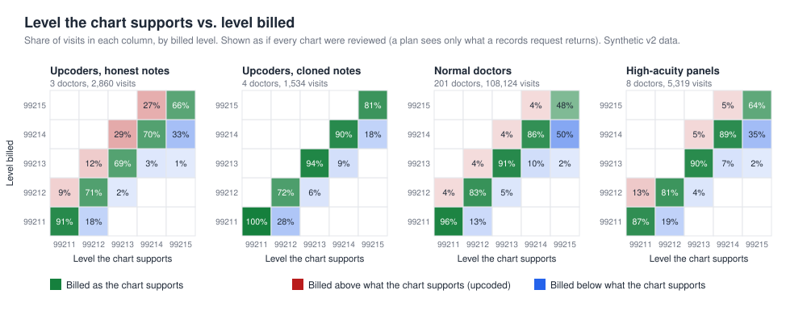

# Data 2.2: realism and data defects

[Back to the README](../README.md)

Release 2 pairs data 2.2 with workflow `v2.2` and agent `v3.2` (see [versioning.md](versioning.md)). Data 2.2 is data 2.1 plus the changes below, each
behind its own option of `src/generate_v2.py --data-version 2.2`. Claims, the records universe and the note package of data 2.0 and 2.1 are never changed:
with every 2.2 option at zero a 2.2 build reproduces the 2.1 files byte for byte (`tests/test_v22.py`).

## Honest coding noise and an upcoder defined as above the honest baseline (issue 74)

Before, honest providers billed exactly the justified level; the only noise was a coder disagreeing when a chart was read. Now every provider, upcoders
included, miscodes a share of its visits (a separate random stream, so nothing else moves).

| Option | Default | Meaning |
|---|---|---|
| `--honest-miscode-rate` | 0.08 | mean share of an honest provider's visits billed one level off the justified level |
| `--honest-up-share` | 0.5 | share of those slips that go up; the rest go down |
| `--honest-miscode-spread` | 0.4 | provider-to-provider coefficient of variation of the rate (a Beta distribution), so some doctors are careful and some are aggressive but defensible |
| `--honest-miscode-max` | 0.12 | cap on any provider's rate |
| `--upcoder-fraction LO HI` | 0.15 0.40 | share of visits an obvious upcoder bills one level up (unchanged from before) |
| `--subtle-upcoder-share` | 0.25 | share of upcoders drawn from the subtle range |
| `--subtle-upcoder-fraction LO HI` | 0.08 0.12 | the subtle range |
| `--upcoder-margin` | 0.06 | an upcoder's upcoding rate must exceed the honest baseline by at least this many points of visits |

**The defaults are illustrative.** They are not calibrated to a published coding-error rate (none was used). They were chosen on the development seed 42 for
plausibility and so that honest noise stays below the margin; the sweep below is the check, and it was not used to tune toward a result.

**Answer key (evaluation only).** Each provider records its `planted` role, whether it is `subtle`, its `honest_miscode_rate`, and its realised `upcode_rate`
and `downcode_rate` (share of visits billed above and below the justified level). The key's top level records `honest_baseline_upcode_rate` (the mean
`upcode_rate` of providers planted honest) and the margin. The `role` that every evaluation reads is now **`upcoder` if the provider's `upcode_rate` exceeds
the baseline by at least the margin**; otherwise `hard_negative` (a planted high-acuity panel) or `normal`. Consequences, said plainly:

- A planted upcoder whose realised rate falls short of the margin is labeled `normal`. In seed 42 one of eight planted upcoders (a subtle one at a 9.6% rate)
  is therefore not counted: the data has 7 upcoders, not 8.
- An honest provider whose luck pushes it over the margin would be labeled `upcoder`. None did in seed 42 (highest honest rate 9.6% against a threshold of
  10.0% = baseline 4.0% + margin 6 points); a margin closer to the honest spread would produce such cases.
- Everything that reads `role` (screen, scoreboard, judges) keeps working; the number of upcoders can now differ from the number planted.
- Cloned notes still apply to every visit a cloning provider bills above the justified level, including honest slips upward. Small, and only for cloners.

### What honest noise does (development seed 42, free, one draw per row)

<!-- sweep:start -->
| Honest miscode rate | Counted upcoders (of 8 planted) | Honest baseline upcoding | `riskadj` top 25: upcoders / honest | `eb_ratio` top 25: upcoders / honest | Chart rule on screened doctors: upcoders / honest accused |
|---|---|---|---|---|---|
| 0% | 8 | 0.0% | 8 / 17 | 8 / 17 | 1 / 0 (of 11 sent) |
| 4% | 8 | 2.1% | 8 / 17 | 8 / 17 | 1 / 0 (of 11 sent) |
| 8% | 7 | 4.0% | 7 / 18 | 6 / 19 | 1 / 1 (of 10 sent) |
| 16% | 7 | 5.5% | 6 / 19 | 6 / 19 | 1 / 0 (of 10 sent) |
<!-- sweep:end -->

Read with care: one dataset per row, 7 to 8 upcoders, so a difference of one doctor is noise. The rate column is the rate asked for; the cap
(0.12) holds the 16% row to a lower realised rate, which the baseline column shows (5.5% of visits billed above the justified level). What the table
supports: the screen still ranks planted upcoders high under honest noise (it works on the 99215 share, which honest slips both raise and lower), with
`riskadj` and `eb_ratio` each missing about one upcoder from the top 25 once noise is on.

What it changes more clearly is the evidence from charts. Honest doctors now bill about 4% of visits above the level the chart supports (and about 4%
below), so **a chart that supports a lower level than billed is no longer proof of upcoding**. The earlier zero-false-accusation result for the chart rule
was partly built in: with noise on, the chart rule in this run accused one honest doctor (at 8%; none in the other rows, where it selected only the one
upcoder it faced). Those counts are too small to estimate a rate from; that belongs to the release 2 evaluation on fresh seeds.

### Figure

`docs/images/expected_billed_2_2.svg`: the same expected-versus-billed grids as `expected_billed.svg`, on seed 42 data 2.2. Normal and high-acuity
doctors now show visits billed above the supported level.

## Billing provider is the group; rendering NPI omitted when it equals billing (issue 75)

Real professional claims are usually billed by the group (an organizational NPI) with the treating clinician as rendering provider, and the rendering
field is often left blank when it equals billing. Before, `billing_npi` equalled `rendering_npi` on every claim and `group_tin` was never used.

| Option | Default | Meaning |
|---|---|---|
| `--group-billing` / `--no-group-billing` | on | clinicians sharing a `group_tin` with at least one other clinician bill under an organizational NPI (starts with 2); single-clinician groups bill under their own NPI |
| `--rendering-omitted-share` | 0.3 | share of single-clinician claims (billing equals rendering) with the rendering NPI left blank; its own random stream, so changing it moves no billed level |

`src/derive.py` (the detector view) attributes each visit to the **clinician who saw the patient**: the rendering NPI, or the billing NPI when rendering is
blank and billing is an individual. A blank rendering NPI under an organizational billing NPI cannot be attributed; that visit is dropped and counted.
When any visit used the fallback, was group billed, or was unattributed, the view gets `attribution.json` with the counts, the share of visits that
fell back to billing, and `billing_entity` (clinician to the NPI that receives actions). Views of earlier data get no such file and are byte-identical.

- **Scoring is never done at the group level.** The screen, the metrics and every finding are per clinician. Seed 42: 187 of 216 clinicians bill under an
  organizational NPI that is not their own; 3.3% of visits (3,899) fell back to billing; 0 were unattributed.
- **Actions go to the billing entity.** `derive.billing_entity(view_dir)` gives the NPI a records request or recovery would be addressed to. The simulated
  provider office (`provider_sim.py`) still behaves per clinician; modelling a group office that answers for several clinicians is not built.
- What this does not do: the claims are not otherwise harder to read. It tests that the pipeline attributes visits correctly when the rendering field is
  absent or the biller is an organization, and it is the plumbing the data-quality check (issue 81) reports on ("share of claims missing a rendering NPI").

## Diagnosis-code truncation in the plan's extract (issue 77)

`claims_header` carries `dx1` to `dx6` (an 837P allows 12) and nothing tested what happens when a plan's warehouse or extract keeps fewer. Truncation lowers
derived condition counts, so sick panels look healthier and honest high-acuity doctors look like upcoders.

| Option | Default | Meaning |
|---|---|---|
| `--dx-cap N` | 0 (off) | keep only the first N diagnosis positions in the delivered `claims_header` (the claim, and the visit note, had more) |
| `--dx-cap-months M ...` | all | service months the cap applies to (a re-extract of some months only) |

The answer key records the defect under `defects.dx_truncation` (cap, months, number of claims shortened) so a data-quality check can be graded
(issue 81). Truncation uses no random numbers: nothing else in the data moves.

**Measured on the development seed 42** (`python eval/dx_cap_effect.py --write`; free; one draw per row):

<!-- dxcap:start -->
| Diagnosis positions kept | Claims shortened | Mean derived conditions per patient | High-acuity doctors: 99215 share / expected | Doctors with suspicion >= 5 | `riskadj` top 25: upcoders / high-acuity / ordinary | `riskadj` AUPRC | `eb_ratio` top 25: upcoders / high-acuity / ordinary | `eb_ratio` AUPRC |
|---|---|---|---|---|---|---|---|---|
| 6 (no cap) | 0 | 1.54 | 1.17 | 10 | 7 / 1 / 17 | 0.457 | 6 / 1 / 18 | 0.754 |
| 4 | 9,118 | 1.49 | 1.21 | 8 | 6 / 2 / 17 | 0.456 | 6 / 1 / 18 | 0.779 |
| 3 | 19,294 | 1.38 | 1.35 | 8 | 6 / 2 / 17 | 0.458 | 6 / 2 / 17 | 0.738 |
| 2 | 38,696 | 1.16 | 1.57 | 10 | 5 / 4 / 16 | 0.413 | 6 / 2 / 17 | 0.583 |
<!-- dxcap:end -->

Reading it: a cap of 4 or 3 changes little (the mean derived count falls from 1.54 to 1.49 and 1.38, one more high-acuity doctor enters the top 25); a cap of
2 is clear: the mean count falls to 1.16, the high-acuity doctors' 99215 share rises from 1.17 to 1.57 times what the model expects, four of them reach the
top 25 (one before), and `riskadj` loses two upcoders from its top 25. `eb_ratio` is affected less in the top 25 but its AUPRC falls from 0.75 to 0.58.
One dataset, 8 high-acuity doctors and 7 upcoders, so single doctors move these counts; the direction (sicker panels look healthier, honest
high-acuity doctors look worse) is what the generator guarantees and the table confirms. Only the first `N` positions survive, and the generator puts
chronic conditions first, so a low cap removes chronic conditions before acute ones; a plan that orders diagnoses differently would truncate differently.

**Response when truncation is suspected** (built with the data-quality check, issue 81): findings that rely on risk adjustment are held or marked
low-confidence, and a person asks the plan for a full-fidelity re-extract from its original claim records. The agent does not request data itself.

## Not yet built

Items 79 and 80 of the milestone are listed here when built.
