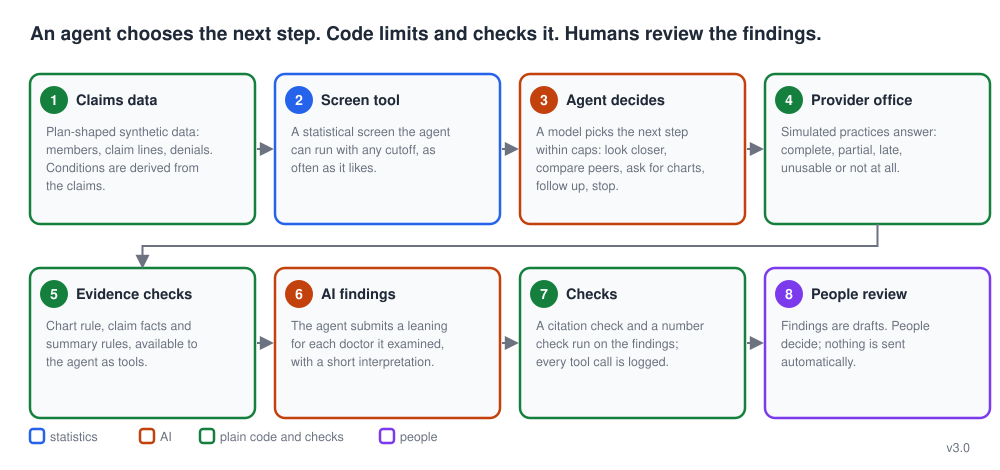

# How it works (version 3)

[Back to the README](../README.md)

The agent design in eight steps, and how each version differs.

## The eight steps

1. **Claims data.** A fake (synthetic) population of 216 family doctors in Georgia and about 120,000 office visits, shaped like what a health plan holds: members, claim lines, denials, replacements and voids, with conditions derived from the claims. Eight doctors are planted upcoders (half of them clone their notes so the charts match the bill), eight are honest but treat unusually sick patients, and the rest are typical. Because the answer is known, the tools can be graded.
2. **Screen tool.** Statistics rank doctors by how often they bill the top visit code compared with what their patients' conditions explain. The agent can run this screen with any cutoff, as often as it likes. It is a wide net: it catches the upcoders but also many honest doctors.
3. **Agent decides.** A model (Claude Opus 5.5) chooses the next step within hard limits (tool calls, dollars, a budget of records requests): look at a doctor's evidence, compare with peers, ask for charts, follow up, or stop. **This is the second filter: the doctors it calls upcoding are the suspected upcoders.**
4. **Provider office.** Simulated practices answer records requests: complete, partial, late, unusable, an objection or silence. Silence is never treated as evidence of upcoding.
5. **Evidence checks.** Plain code the agent can call: a rule that checks whether the returned charts support the level billed, a check of the notes against the claims, and rules that settle the clear-cut cases.
6. **AI findings.** The agent submits a leaning for each doctor it examined (looks like upcoding, like a sicker patient base, or unclear) with a short interpretation. Only the suspected upcoders move on to recovery packets.
7. **Checks.** Plain code rejects any finding that cites a visit that does not exist or belongs to another doctor, and checks every number against the evidence. Every tool call is logged, and case pages show the cited visits against peers.
8. **People review.** SIU reviewers read the drafts, payment integrity decides which records to request, and people make every real decision. Nothing is sent or decided automatically.

In short: statistics cast a wide net, an agent chooses what to examine and decides who the suspected upcoders are, code limits and checks it, and people decide what happens next. This is version 3. Version 2 does the same job as a fixed workflow where code, not a model, chooses each step, and the evaluation below compares them honestly: on the reserved test seeds the workflow found more upcoders than the agent, and neither is good enough yet.

### How it has changed

Each tagged version has its own figure: [v1.0](images/how_it_works_v1.0.svg), [v2.0](images/how_it_works_v2.0.svg), [v3.0](images/how_it_works_v3.0.svg). What each version fixes and what it does not: [docs/versioning.md](versioning.md).

## How it has changed

Each tagged version has its own figure: [v1.0](images/how_it_works_v1.0.svg), [v2.0](images/how_it_works_v2.0.svg), [v3.0](images/how_it_works_v3.0.svg). What each version fixes and what it does not: [docs/versioning.md](versioning.md).

