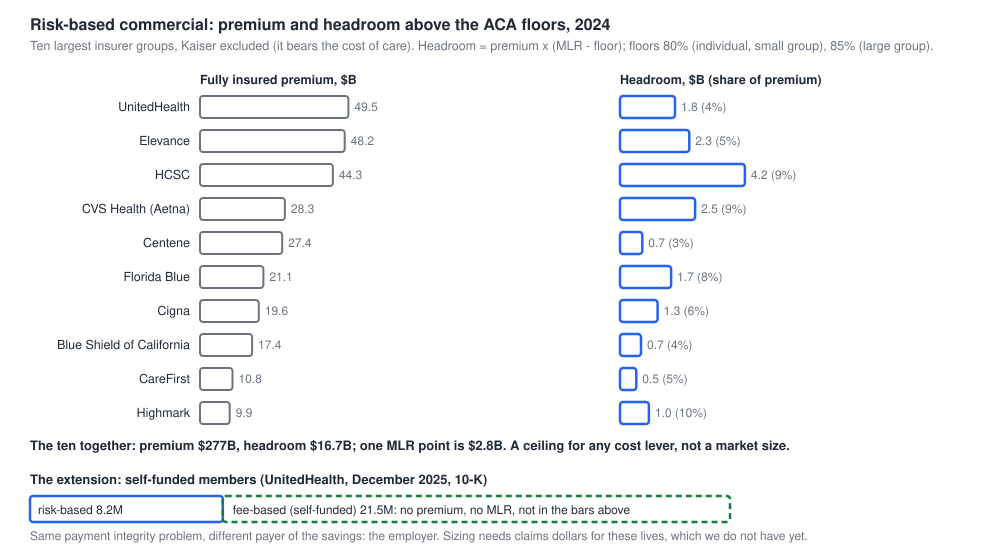

# Market size ceiling: headroom of the top 10 commercial insurers above the ACA medical loss ratio floors

[Back to the README](../README.md)

Research note, 2026-10-21. Question: how much more profit could the largest commercial insurers have kept if their medical loss ratio (MLR) had been at the legal minimum? This is a ceiling, not a market size: it is an upper bound on what *any* cost lever could be worth, before asking how much of it E/M upcoding is. Method and caveats first, numbers after.

## Method

- Data: CMS medical loss ratio public use file, reporting year **2024** (the latest posted; "as of September 12, 2025"; no 2025 file was posted when this was run). Source: https://www.cms.gov/files/zip/mlr-public-use-file-2024.zip (7.3 MB, public). Code: `eval/mlr_headroom.py`; per-insurer output: `experiments/mlr_headroom_2024.csv`.
- For every insurer, state and market (individual, small group, large group), MLR = numerator (claims and quality improvement) over denominator (premium after taxes and fees), current year, from `Part3_MLR_Rebate_Calculation.csv`. State rows are rolled up to the NAIC group; the file's 'Grand Total' rows are dropped because they repeat the state rows.
- Headroom of a submission-market = denominator x (MLR - floor) when positive. Floors: 80% individual and small group, 85% large group. The statutory test uses a three-year average and a credibility adjustment, which this does not apply, so the numbers show how far above the floor a year of claims sat, not what a rebate would be.
- "Top 10" = the ten insurer groups with the most fully insured commercial premium in this file, after leaving out Kaiser (below); the eleventh is BCBS of Michigan ($9.1B).

## Result (2024, fully insured commercial only)

| Insurer group | Premium $B | MLR indiv. | MLR small grp | MLR large grp | Headroom to floors $B |
|---|---|---|---|---|---|
| UnitedHealth | 49.5 | 82.2% | 83.3% | 88.4% | 1.8 |
| Elevance | 48.2 | 85.9% | 82.9% | 89.8% | 2.3 |
| HCSC (Blues, nonprofit) | 44.3 | 88.9% | 90.4% | 94.3% | 4.2 |
| CVS Health (Aetna) | 28.3 | 91.7% | 89.5% | 91.7% | 2.5 |
| Centene | 27.4 | 80.0% | 90.8% | 90.5% | 0.7 |
| Florida Blue (nonprofit) | 21.1 | 88.6% | 88.9% | 92.0% | 1.7 |
| Cigna | 19.6 | 87.8% | 102.1% | 90.5% | 1.3 |
| Blue Shield of California (nonprofit) | 17.4 | 84.5% | 82.2% | 89.4% | 0.7 |
| CareFirst (nonprofit) | 10.8 | 82.8% | 81.5% | 91.1% | 0.5 |
| Highmark (nonprofit) | 9.9 | 91.5% | 91.0% | 93.9% | 1.0 |
| **Ten together** | **276.6** | | | | **16.7** |

All insurers in the file: premium $517.5B, headroom $37.1B (about 7% of premium); aggregate MLR 87.1% individual, 87.6% small group, 91.2% large group. Insurers below a floor owe rebates: the shortfall is $2.4B across all insurers (about $0.3B at UnitedHealth, $0.5B at Centene), the same order as the $1.6B of rebates KFF reports issued in 2025 (one year, no averaging or credibility adjustment here). The ten hold 53% of all premium and 45% of all headroom (with Kaiser, which is excluded from the market, the top 10 would hold 64% and 60%).

Reading the table:
- **One MLR point on the ten insurers' fully insured commercial premium is about $2.8B** ($1.7B for the five publicly traded ones: UnitedHealth, Elevance, CVS, Centene, Cigna).
- **Kaiser is out of scope for the market.** It owns the delivery system, bears the cost of care it renders, and has no reason to bill above what it provides, so there is no upcoding for a payer to find (decision with Simmy, 2026-10-21). The ten others hold $16.7B of headroom.
- **Five of the ten are nonprofit** (HCSC, Florida Blue, Blue Shield of California, CareFirst, Highmark), so shareholder value, the hypothesis behind this exercise, does not apply to them; their incentive is surplus and ratings.
- Cross-check with UnitedHealth's own 10-K (FY2025, provided by Simmy): UnitedHealthcare Employer & Individual domestic revenue was $75.9B in 2025, of which fully insured premium is the part in this table ($49.5B in 2024); 21.5 of its 29.65 million commercial members (72%) are fee-based (self-funded), which this table does not touch. Consolidated medical care ratio was 89.1% in 2025 against 85.5% in 2024 and 83.2% in 2023.

## Delineation: risk-based now, self-funded as the natural extension

- **Risk-based (measured here).** The insurer takes the claims risk and keeps premium minus claims, so savings reach the plan's own medical loss ratio. This is the market in the table.
- **Self-funded (not measured).** The employer pays the claims and the plan administers for a fee. UnitedHealth's 10-K calls this fee-based: 21.5M of its 29.65M commercial members at December 2025 (72%), against 8.2M risk-based. The same payment integrity problem exists on those claims, and the employer, not the plan, keeps the savings. Reasoning to test, not a finding: a plan that lowers an employer's medical losses becomes a more attractive administrator, so the plan has a commercial reason to buy the tool even where it carries no claims risk. Open questions for layer 2: how administrators are paid (flat fee, percent of claims, savings share) and whether that rewards or discourages cutting claims.
- **What is missing for the extension:** claims dollars for self-funded lives. The CMS file has none; the insurers' 10-Ks give member counts and sometimes fees. A first estimate could use member counts times an average commercial claims cost per member, sourced.

## What this does and does not say

- **It is a ceiling.** Getting to the floor would mean cutting claims cost by about 7% of premium, which no single lever does. Hospital prices, drugs and utilization dominate. The headroom is mostly *not* upcoding.
- **E/M share is unmeasured.** UnitedHealth said provider coding intensity in office visits and emergency departments was adding trend, without a figure ([earnings note](market_research_earnings.md)). Illustrative arithmetic only, not findings: if E/M upcoding were worth 5, 10 or 25 basis points of premium, that is about $138M, $277M or $691M a year across the ten ($2.8B per point of premium). Gross savings, before recovery rates, provider friction, our share, or fees.
- **Fully insured only, so far.** About two-thirds of employer coverage is self-funded and has no MLR (see the delineation above). A share of this headroom is also competed away in next year's premium.
- **Year.** 2024, not 2025. KFF's 2025 aggregate simple loss ratios (93% individual, 87% small group, 91% large group) match the file's 2024 large group (91.2%) and small group (87.6%) but not individual (87.1%), so the 2025 individual headroom is likely larger; company-level 2025 data was not available.
- **Floors are minimums.** State floors can be higher; not applied. Nothing here is a statement about any insurer's incentives; pay-metric evidence is a separate exercise.

## Next

- A bottom-up number to sit under this ceiling: professional-services share of claims, E/M share of that, and leakage, each sourced ([#145](https://github.com/simmyhundal/em-upcoding-agent/issues/145) holds the volume and fee-scale side).
- Add self-funded lives (the fee-based side) as a separate line.
- Rerun with the 2025 file when CMS posts it.
