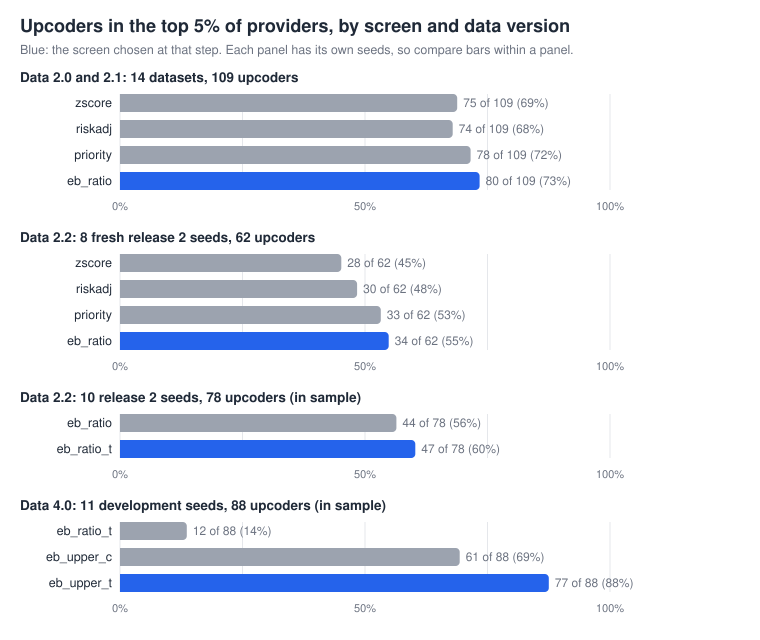

# Screen methods: which screen ranks upcoders highest

[Back to the README](../README.md) · [glossary](glossary.md)

## In short

- **Current screen: `eb_upper_t`** (workflow v4.0, agent v5.0). It shrinks the share of visits billed 99214 or 99215 against what the patients and the test line predict, so upgrades into 99214 count. On the 11 data 4.0 development seeds it put 81 of 88 upcoders in the top 10% of providers against 18 for `eb_ratio_t`, which looks only at 99215 and cannot see the systematic habit (0 of 33 against 33 of 33). The test line is a planted input (see the caveats), and these seeds are development data.
- **Before that: `eb_ratio_t`** (workflow v2.3 to v2.5, agent v3.3 to v3.5), `eb_ratio` with the test line as one more input to the expected 99215 count: 47 of 78 upcoders in the top 5% on the ten release 2 seeds against 44 for `eb_ratio` (in sample).
- **How it got there.** On the 14 datasets of data 2.0 and 2.1, `eb_ratio` put 98 of 109 upcoders in the top 25 against 93 for the risk-adjusted z-score (`riskadj`), and never fewer on any dataset. Release 2 confirmed it on 8 fresh data 2.2 seeds by a rule fixed in advance (34 of 62 upcoders in the top 5% against 30).
- **Not solved.** No screen puts every upcoder in the top 25, and the gains are a few upcoders on synthetic data (see the caveats).
- **Next.** Whether `eb_upper_t` holds on a second fresh set of seeds ([issue](https://github.com/simmyhundal/em-upcoding-agent/issues/132)); the opportunistic habit is the weakest (26 of 33 in the top 10%) ([issue](https://github.com/simmyhundal/em-upcoding-agent/issues/134)).

<b>The numbers behind the chart</b>

Top 5% because the release 2 rule used it and it scales with the number of providers (11 of 216, 30 of 600).

| Data and seeds | Screen | Upcoders in the top 5% |
|---|---|---|
| 2.0 and 2.1, 14 datasets | `zscore` | 75 of 109 |
| 2.0 and 2.1, 14 datasets | `riskadj` | 74 of 109 |
| 2.0 and 2.1, 14 datasets | `priority` | 78 of 109 |
| 2.0 and 2.1, 14 datasets | `eb_ratio` | 80 of 109 |
| 2.2, 8 fresh release 2 seeds | `zscore` | 28 of 62 |
| 2.2, 8 fresh release 2 seeds | `riskadj` | 30 of 62 |
| 2.2, 8 fresh release 2 seeds | `priority` | 33 of 62 |
| 2.2, 8 fresh release 2 seeds | `eb_ratio` | 34 of 62 |
| 2.2, 10 release 2 seeds (in sample) | `eb_ratio` | 44 of 78 |
| 2.2, 10 release 2 seeds (in sample) | `eb_ratio_t` | 47 of 78 |
| 4.0, 11 development seeds (in sample) | `eb_ratio_t` | 12 of 88 |
| 4.0, 11 development seeds (in sample) | `eb_upper_c` | 61 of 88 |
| 4.0, 11 development seeds (in sample) | `eb_upper_t` | 77 of 88 |

## Caveats

- **Synthetic data from one generator.** Data 2.0 and 2.1 are easier than real claims: honest providers bill exactly the justified level, and the justified
  level depends on the patient's chronic-condition count by construction. That flatters every risk-adjusted method and makes extra patient features useless
  (`rich_logit` is essentially `riskadj`). Data 2.2 adds honest coding noise; real claims have more.
- **The first choice was not blind.** The rule that picked `eb_ratio` on the 14 datasets was written down after one look at the table, so that step was
  tuning. The release 2 check on 8 fresh seeds used a rule fixed before any result ([release2_screen_choice.md](release2_screen_choice.md)); `eb_ratio`
  won it by 1 upcoder over `priority` and 4 over `riskadj` of 62, a small margin. `eb_ratio_t`'s gain (47 against 44 of 78) is in sample.
- **The target is not met.** The aim was every upcoder in the top 25; the best method still misses upcoders on 6 of 14 datasets. Most misses sit at ranks
  26 to 55 (a longer list reaches them), and one upcoder (seed 1010) bills 99215 at only 1.2 times expected, so no 99215-only score ranks it high.
- **`eb_ratio` helps by shrinking small panels, not by a new kind of evidence.** Its gain over `riskadj` is a handful of upcoders. At 600 providers it ties
  `riskadj` in the top 25 (15 of 21 each) and gains only in a longer list and in AUPRC; with 3 to 12 upcoders per dataset, that is one provider either way.
- **Whole-distribution scores failed on this data** (`level_z`, `rich_level`, `eb_upper`, `eb_two`). Honest providers differ in coding style, which moves
  the mean billed level and the 99214-or-higher share as much as an upcoder's one-level upgrades. That says a simple level score is too noisy here, not that
  levels never help; data 4.0 plants 99213-to-99214 habits on purpose, so they are tested again there.
- **Data 4.0 is easier for `eb_upper_t` by construction.** The generator draws a visit's lab line from the true complexity, so a screen that uses the test line has a planted input;
  `hi_no_test` (visits billed 99214 or 99215 with no test line) finds 88 of 88 upcoders from that link alone, and the habits are the ones these screens look for.
  `eb_upper_c` leaves the test line out and finds 70 of 88 in the top 10%. A systematic upcoder also carries a planted panel shift, so its gain is checked against honest providers
  with a similar provider effect ([screens_v4.md](screens_v4.md)); `eb_upper_t` outscores them (about 1.00). The 11 seeds are development data: the screen's real test is the fresh seeds.
- **`ensemble` includes the weak `level_z`**, so it is dragged down; it is reported because it was a named candidate.

## The methods

| Method | Family | What it scores | Used in |
|---|---|---|---|
| `zscore` | z-score | share of visits billed 99215 against all providers; no adjustment for how sick the patients are | screen of v1 and v2.0; reference |
| `riskadj` | z-score, risk-adjusted | observed against expected 99215 count, the expectation from each patient's chronic-condition count (logistic fit), rescaled by the typical spread | screen of v2.1 and v3.1 (frozen); reference |
| `priority` | rank average | average of the ranks by ratio to expected and by excess 99215 claims | ordering in v3.1; release 2 candidate |
| `eb_ratio` | empirical Bayes | `riskadj`'s observed over expected 99215 count, shrunk toward 1 for small panels (see below) | screen of v2.2 and v3.2 |
| `eb_ratio_t` | empirical Bayes | `eb_ratio` with one more input to the expected count: whether the claim has a lab or test line | screen of v2.3 to v2.5 and v3.3 to v3.5 (frozen) |
| `eb_upper_t` | empirical Bayes | the same shrinkage on the share billed 99214 or 99215, with the lab or test line as an input, so 99213-to-99214 upgrades count (data 4.0) | **current screen** (workflow v4.0, agent v5.0) |
| `eb_upper_c` | empirical Bayes | `eb_upper_t` without the test line (chronic-condition count only) | candidate only; does not lean on the lab-line link |
| `eb_prob` | empirical Bayes | probability that the true 99215 rate is more than 1.5 times expected | candidate only |
| `eb_excess` | empirical Bayes | shrunk extra 99215 claims: expected count x (shrunk ratio - 1) | candidate only |
| `eb_upper` | empirical Bayes | the same shrinkage on the share billed 99214 or 99215, so 99213-to-99214 upgrades count | candidate only |
| `eb_two` | rank average | `eb_ratio` and `eb_upper` | candidate only |
| `level_z` | whole distribution | mean billed level (99211 to 99215) against the level expected from the chronic-condition count | candidate only |
| `rich_logit` | regression | `riskadj` with more patient features (each condition, age band, risk score, first visit) | candidate only |
| `rich_level` | regression | `level_z` with the same patient features | candidate only |
| `ensemble` | rank average | `riskadj`, `eb_ratio` and `level_z` | candidate only |

**How the empirical Bayes screens work.** A provider's 99215 count is modeled as Poisson with mean θ x expected, where the expected count comes from the patients' chronic conditions (as in `riskadj`) and θ is the provider's true billing ratio. θ gets a Gamma prior with mean 1, its spread fitted by maximum likelihood on providers that are not already extreme, so the upcoders do not widen it. The score is the posterior mean, (a + observed) / (a + expected): a provider with few expected 99215s is pulled toward 1 (billing as the case mix predicts) more than one with many, so a small panel is less likely to top the list by chance. Shrinkage toward a prior fitted to all providers is common to every empirical Bayes method; this Gamma-Poisson form, its target of 1 and the trimmed fit are our choices. `eb_prob` and `eb_excess` read the same posterior differently.

## Data versions

| Data | What changed for the screen | Screen results |
|---|---|---|
| 1 | Stored chronic-condition count; a records sample handed over up front | plain z-score only; not compared here ([archive](archive-version-1.md)) |
| 2.0 | Plan-shaped tables; conditions derived from claims; half the upcoders clone notes | the 14 datasets below |
| 2.1 | Adds the note package; claims are identical to 2.0 for a seed, so the screens score them the same | the 14 datasets below |
| 2.2 | Honest coding noise in both directions; an upcoder must bill above the honest baseline by a margin; group billing and data defects | seed 42 below; fresh seeds on the release 2 and 3 pages |
| 4.0 | Every provider has an upcoding rate; upcoders get a habit (systematic 99213-to-99214, opportunistic borderline-only, EHR template); wider honest noise | 11 development seeds below; [screens_v4.md](screens_v4.md) |

## Results by data version

<b>Data 2.0 and 2.1: 14 datasets (109 upcoders): `eb_ratio` 98 in the top 25, `riskadj` 93</b>

**How the first choice was made (rule stated after a first look, so not blind):** most upcoders in the top 25 over the 14 datasets, among methods that put no more honest providers in the top 25 than `riskadj` (257); ties go to the simpler method. It picks **`eb_ratio`**: 98 of 109 upcoders against 93 for `riskadj`, with 10 high-acuity panels in the top 25 against 13. Paired by dataset, `eb_ratio` finds more upcoders than `riskadj` on 5 datasets, the same on 9 and fewer on 0.

| Method | Upcoders in the top 25 (of 109) | High-acuity panels in the top 25 | Other honest providers in the top 25 | AUPRC |
|---|---|---|---|---|
| `zscore` | 90 (83%) | 25 | 235 | 0.50 |
| `riskadj` | 93 (85%) | 13 | 244 | 0.54 |
| `priority` | 96 (88%) | 12 | 242 | 0.58 |
| `eb_ratio` | 98 (90%) | 10 | 242 | 0.65 |
| `eb_prob` | 93 (85%) | 12 | 245 | 0.42 |
| `eb_excess` | 73 (67%) | 18 | 259 | 0.29 |
| `level_z` | 43 (39%) | 10 | 297 | 0.19 |
| `rich_logit` | 93 (85%) | 13 | 244 | 0.54 |
| `rich_level` | 43 (39%) | 10 | 297 | 0.19 |
| `eb_upper` | 35 (32%) | 7 | 308 | 0.18 |
| `eb_two` | 64 (59%) | 7 | 279 | 0.36 |
| `ensemble` | 79 (72%) | 12 | 259 | 0.43 |

<b>Full table, all 14 datasets (11 columns, with a legend)</b>

Columns: **upcoders in the top 25**, summed over the datasets; **datasets with every upcoder in the top 25**; honest providers in the top 25, split into **high-acuity panels** (honest providers whose sicker patients justify more 99215s, the hard cases) and **ordinary** ones; **matched volume**: upcoders in the top K, where K is how many providers `riskadj`'s suspicion score of 5 or more flags on that dataset; **z >= 5**: upcoders found / providers flagged by that cutoff (z-score methods only); **AUPRC** and **ROC AUC**: how well the whole ranking separates upcoders from honest providers (1.0 is perfect; AUPRC is the stricter one when upcoders are rare); **precision at 10 and 25**: the share of upcoders among the first 10 and 25 providers listed. Means are over datasets.

| Method | Upcoders in top 25 (of 109) | Datasets with every upcoder in the top 25 (of 14) | High-acuity panels in top 25 | Other honest in top 25 | Upcoders at matched volume (same K as z >= 5) | z >= 5 (found / flagged) | AUPRC (mean) | ROC AUC (mean) | Precision at 10 | Precision at 25 |
|---|---|---|---|---|---|---|---|---|---|---|
| `zscore` | 90 (83%) | 5 | 25 | 235 | 75 | 4 / 14 | 0.498 | 0.962 | 0.46 | 0.26 |
| `riskadj` | 93 (85%) | 6 | 13 | 244 | 78 | 78 / 209 | 0.541 | 0.970 | 0.44 | 0.27 |
| `priority` | 96 (88%) | 8 | 12 | 242 | 80 | n/a | 0.579 | 0.974 | 0.49 | 0.27 |
| `eb_ratio` | 98 (90%) | 8 | 10 | 242 | 84 | n/a | 0.654 | 0.978 | 0.53 | 0.28 |
| `eb_prob` | 93 (85%) | 7 | 12 | 245 | 76 | n/a | 0.424 | 0.968 | 0.42 | 0.27 |
| `eb_excess` | 73 (67%) | 1 | 18 | 259 | 41 | n/a | 0.291 | 0.934 | 0.20 | 0.21 |
| `level_z` | 43 (39%) | 0 | 10 | 297 | 26 | 8 / 41 | 0.193 | 0.829 | 0.17 | 0.12 |
| `rich_logit` | 93 (85%) | 6 | 13 | 244 | 78 | 78 / 212 | 0.542 | 0.970 | 0.44 | 0.27 |
| `rich_level` | 43 (39%) | 0 | 10 | 297 | 26 | 8 / 41 | 0.193 | 0.830 | 0.17 | 0.12 |
| `eb_upper` | 35 (32%) | 0 | 7 | 308 | 22 | n/a | 0.175 | 0.754 | 0.14 | 0.10 |
| `eb_two` | 64 (59%) | 1 | 7 | 279 | 51 | n/a | 0.360 | 0.894 | 0.28 | 0.18 |
| `ensemble` | 79 (72%) | 2 | 12 | 259 | 63 | n/a | 0.433 | 0.943 | 0.34 | 0.23 |

<b>216 providers, 3.7% upcoders (11 datasets)</b>

| Method | Upcoders in top 25 (of 88) | Datasets with every upcoder in the top 25 (of 11) | High-acuity panels in top 25 | Other honest in top 25 | Upcoders at matched volume (same K as z >= 5) | z >= 5 (found / flagged) | AUPRC (mean) | ROC AUC (mean) | Precision at 10 | Precision at 25 |
|---|---|---|---|---|---|---|---|---|---|---|
| `zscore` | 76 (86%) | 4 | 21 | 178 | 61 | 2 / 4 | 0.567 | 0.961 | 0.53 | 0.28 |
| `riskadj` | 78 (89%) | 5 | 11 | 186 | 63 | 63 / 131 | 0.605 | 0.968 | 0.49 | 0.28 |
| `priority` | 80 (91%) | 7 | 9 | 186 | 64 | n/a | 0.644 | 0.972 | 0.55 | 0.29 |
| `eb_ratio` | 83 (94%) | 7 | 7 | 185 | 67 | n/a | 0.703 | 0.975 | 0.56 | 0.30 |
| `eb_prob` | 79 (90%) | 6 | 10 | 186 | 61 | n/a | 0.481 | 0.966 | 0.48 | 0.29 |
| `eb_excess` | 67 (76%) | 1 | 15 | 193 | 33 | n/a | 0.337 | 0.934 | 0.25 | 0.24 |
| `level_z` | 42 (48%) | 0 | 8 | 225 | 24 | 7 / 21 | 0.217 | 0.818 | 0.21 | 0.15 |
| `rich_logit` | 78 (89%) | 5 | 11 | 186 | 63 | 63 / 133 | 0.607 | 0.969 | 0.49 | 0.28 |
| `rich_level` | 42 (48%) | 0 | 8 | 225 | 24 | 7 / 21 | 0.217 | 0.819 | 0.21 | 0.15 |
| `eb_upper` | 32 (36%) | 0 | 6 | 237 | 19 | n/a | 0.194 | 0.736 | 0.16 | 0.12 |
| `eb_two` | 54 (61%) | 0 | 6 | 215 | 41 | n/a | 0.391 | 0.884 | 0.30 | 0.20 |
| `ensemble` | 66 (75%) | 1 | 10 | 199 | 50 | n/a | 0.492 | 0.938 | 0.38 | 0.24 |

<b>600 providers, 0.5%, 1% and 2% upcoders (3 datasets, one draw each)</b>

| Method | Upcoders in top 25 (of 21) | Datasets with every upcoder in the top 25 (of 3) | High-acuity panels in top 25 | Other honest in top 25 | Upcoders at matched volume (same K as z >= 5) | z >= 5 (found / flagged) | AUPRC (mean) | ROC AUC (mean) | Precision at 10 | Precision at 25 |
|---|---|---|---|---|---|---|---|---|---|---|
| `zscore` | 14 (67%) | 1 | 4 | 57 | 14 | 2 / 10 | 0.246 | 0.966 | 0.23 | 0.19 |
| `riskadj` | 15 (71%) | 1 | 2 | 58 | 15 | 15 / 78 | 0.307 | 0.977 | 0.27 | 0.20 |
| `priority` | 16 (76%) | 1 | 3 | 56 | 16 | n/a | 0.342 | 0.981 | 0.30 | 0.21 |
| `eb_ratio` | 15 (71%) | 1 | 3 | 57 | 17 | n/a | 0.477 | 0.986 | 0.40 | 0.20 |
| `eb_prob` | 14 (67%) | 1 | 2 | 59 | 15 | n/a | 0.215 | 0.975 | 0.20 | 0.19 |
| `eb_excess` | 6 (29%) | 0 | 3 | 66 | 8 | n/a | 0.124 | 0.935 | 0.03 | 0.08 |
| `level_z` | 1 (5%) | 0 | 2 | 72 | 2 | 1 / 20 | 0.105 | 0.870 | 0.03 | 0.01 |
| `rich_logit` | 15 (71%) | 1 | 2 | 58 | 15 | 15 / 79 | 0.307 | 0.977 | 0.27 | 0.20 |
| `rich_level` | 1 (5%) | 0 | 2 | 72 | 2 | 1 / 20 | 0.105 | 0.870 | 0.03 | 0.01 |
| `eb_upper` | 3 (14%) | 0 | 1 | 71 | 3 | n/a | 0.104 | 0.822 | 0.03 | 0.04 |
| `eb_two` | 10 (48%) | 1 | 1 | 64 | 10 | n/a | 0.246 | 0.930 | 0.20 | 0.13 |
| `ensemble` | 13 (62%) | 1 | 2 | 60 | 13 | n/a | 0.219 | 0.960 | 0.17 | 0.17 |

<b>Per dataset (selected methods)</b>

| Dataset | Providers | Upcoders | `riskadj` in top 25 | `eb_ratio` in top 25 | `priority` in top 25 | `ensemble` in top 25 | `riskadj` z >= 5 |
|---|---|---|---|---|---|---|---|
| x1_s42 | 216 | 8 | 8 | 8 | 8 | 7 | 6 |
| e404 | 216 | 8 | 7 | 8 | 8 | 6 | 6 |
| e505 | 216 | 8 | 6 | 7 | 6 | 5 | 4 |
| e606 | 216 | 8 | 8 | 8 | 8 | 8 | 8 |
| e707 | 216 | 8 | 6 | 6 | 6 | 5 | 4 |
| e808 | 216 | 8 | 8 | 8 | 8 | 7 | 7 |
| e909 | 216 | 8 | 6 | 7 | 6 | 6 | 6 |
| e1010 | 216 | 8 | 6 | 7 | 6 | 5 | 5 |
| e1111 | 216 | 8 | 7 | 8 | 8 | 7 | 7 |
| e1212 | 216 | 8 | 8 | 8 | 8 | 5 | 4 |
| e1313 | 216 | 8 | 8 | 8 | 8 | 5 | 6 |
| e1414_r05 | 600 | 3 | 3 | 3 | 3 | 3 | 3 |
| e1414_r1 | 600 | 6 | 4 | 4 | 5 | 3 | 4 |
| e1414_r2 | 600 | 12 | 8 | 8 | 8 | 7 | 8 |

<b>Flagging a percentile of providers (how payers do it)</b>

| Method | top 5%: upcoders found / honest flagged | top 10%: upcoders found / honest flagged |
|---|---|---|
| `zscore` | 75 of 109 / 136 | 93 of 109 / 329 |
| `riskadj` | 74 of 109 / 137 | 99 of 109 / 323 |
| `priority` | 78 of 109 / 133 | 100 of 109 / 322 |
| `eb_ratio` | 80 of 109 / 131 | 100 of 109 / 322 |

The top 5% is 11, 30 providers on these datasets (216 and 600 providers); the top 10% is double that.

<b>A longer list</b>

600-provider datasets (21 upcoders):

| Method | top 25 | top 30 | top 40 | top 50 | top 75 |
|---|---|---|---|---|---|
| `riskadj` | 15 of 21 | 15 of 21 | 17 of 21 | 20 of 21 | 21 of 21 |
| `priority` | 16 of 21 | 16 of 21 | 19 of 21 | 20 of 21 | 21 of 21 |
| `eb_ratio` | 15 of 21 | 18 of 21 | 20 of 21 | 21 of 21 | 21 of 21 |

All 14 datasets (109 upcoders):

| Method | top 25 | top 30 | top 40 | top 50 | top 75 |
|---|---|---|---|---|---|
| `riskadj` | 93 of 109 | 99 of 109 | 104 of 109 | 107 of 109 | 108 of 109 |
| `priority` | 96 of 109 | 101 of 109 | 106 of 109 | 107 of 109 | 108 of 109 |
| `eb_ratio` | 98 of 109 | 104 of 109 | 107 of 109 | 108 of 109 | 108 of 109 |

<b>Where `riskadj`'s misses rank under the other screens</b>

| Dataset | Upcoder | `riskadj` rank | `eb_ratio` rank | `priority` rank | `ensemble` rank |
|---|---|---|---|---|---|
| e404 | 1000000193 | 26 | 24 | 25 | 61 |
| e505 | 1000000153 | 30 | 21 | 28 | 58 |
| e505 | 1000000215 | 36 | 28 | 35 | 70 |
| e707 | 1000000171 | 32 | 26 | 31 | 70 |
| e707 | 1000000210 | 27 | 29 | 29 | 37 |
| e909 | 1000000008 | 27 | 24 | 27 | 32 |
| e909 | 1000000216 | 31 | 32 | 30 | 46 |
| e1010 | 1000000136 | 28 | 23 | 28 | 74 |
| e1010 | 1000000147 | 98 | 99 | 101 | 131 |
| e1111 | 1000000207 | 26 | 19 | 21 | 57 |
| e1414_r1 | 1000000145 | 45 | 32 | 35 | 86 |
| e1414_r1 | 1000000421 | 31 | 26 | 23 | 47 |
| e1414_r2 | 1000000145 | 39 | 27 | 35 | 75 |
| e1414_r2 | 1000000463 | 42 | 28 | 38 | 52 |
| e1414_r2 | 1000000558 | 49 | 36 | 41 | 53 |
| e1414_r2 | 1000000578 | 55 | 50 | 53 | 118 |

Of these 16 upcoders that `riskadj` leaves outside its top 25, the top 25 of each method holds: `eb_ratio` 5, `priority` 3, `ensemble` 0.

<b>Data 2.2: seed 42 here; fresh seeds in the release 2 and 3 pages</b>

One development dataset (run `261016_1_code`: 216 providers, 8 planted upcoders of which 8 count under the payer-based definition; honest mean true rate 3.9%, 95th percentile 5.9%, margin 6 points). One draw, so a single provider moves any count. `riskadj` and `priority` have all 8 upcoders in their top 25, `eb_ratio` 7, while `eb_ratio` ranks the whole list better (higher AUPRC).

| Method | Upcoders in the top 25 (of 8) | High-acuity panels in the top 25 | Other honest providers in the top 25 | AUPRC |
|---|---|---|---|---|
| `zscore` | 7 (88%) | 4 | 14 | 0.62 |
| `riskadj` | 8 (100%) | 1 | 16 | 0.47 |
| `priority` | 8 (100%) | 1 | 16 | 0.66 |
| `eb_ratio` | 7 (88%) | 1 | 17 | 0.78 |
| `eb_prob` | 8 (100%) | 1 | 16 | 0.39 |
| `eb_excess` | 6 (75%) | 3 | 16 | 0.31 |
| `level_z` | 2 (25%) | 1 | 22 | 0.22 |
| `rich_logit` | 8 (100%) | 1 | 16 | 0.47 |
| `rich_level` | 2 (25%) | 1 | 22 | 0.22 |
| `eb_upper` | 4 (50%) | 0 | 21 | 0.25 |
| `eb_two` | 5 (62%) | 1 | 19 | 0.55 |
| `ensemble` | 6 (75%) | 1 | 18 | 0.39 |

Where each planted upcoder ranks:

| Planted upcoder | Kind | True rate / realised rate | Counted as upcoder | `riskadj` rank | `priority` rank | `eb_ratio` rank |
|---|---|---|---|---|---|---|
| 1000000041 | obvious, cloned notes | 38.4% / 39.7% | yes | 4 | 2 | 2 |
| 1000000095 | obvious, cloned notes | 30.7% / 29.6% | yes | 8 | 4 | 3 |
| 1000000215 | obvious, honest notes | 29.7% / 28.4% | yes | 13 | 10 | 6 |
| 1000000143 | obvious, honest notes | 24.2% / 24.8% | yes | 1 | 1 | 1 |
| 1000000002 | obvious, honest notes | 22.1% / 23.6% | yes | 21 | 18 | 17 |
| 1000000064 | subtle, cloned notes | 16.0% / 14.2% | yes | 25 | 25 | 26 |
| 1000000161 | obvious, cloned notes | 14.5% / 12.4% | yes | 11 | 6 | 5 |
| 1000000088 | subtle, honest notes | 10.5% / 9.6% | yes | 12 | 8 | 7 |

**Fresh seeds on data 2.2.** The release 2 check (8 fresh seeds, rule fixed in advance) chose `eb_ratio`: [release2_screen_choice.md](release2_screen_choice.md). Release 3 added the test-line input (`eb_ratio_t`, 47 against 44 of 78 upcoders in the top 5% on the ten release 2 seeds, in sample): [dev_release3.md](dev_release3.md).

<b>Data 4.0: 11 development seeds (88 upcoders): `eb_upper_t` 81 in the top 10%, `eb_ratio_t` 18</b>

Upcoders in the top 10% of providers (22 of 216), by habit, 11 development seeds (88 upcoders):

| Screen | All | Systematic | Opportunistic | Template-driven | Honest in list | AUPRC |
|---|---|---|---|---|---|---|
| `eb_ratio_t` | 18 of 88 | 0 of 33 | 17 of 33 | 1 of 22 | 224 | 0.114 |
| `eb_upper_c` | 70 of 88 | 33 of 33 | 18 of 33 | 19 of 22 | 172 | 0.719 |
| `eb_upper_t` | 81 of 88 | 33 of 33 | 26 of 33 | 22 of 22 | 161 | 0.882 |

`eb_ratio_t` is the frozen screen of v2.3 to v2.5; it looks at 99215 only, and data 4.0's systematic habit moves 99213 to 99214. [screens_v4.md](screens_v4.md) has every candidate screen, dollar-weighted capture and the check against honest providers with a similar provider effect; [screens_v4_pipeline.md](screens_v4_pipeline.md) has the pipeline after the list.

## Decisions so far

- **Release 2:** Simmy chose `eb_ratio` and `priority` as candidates for both designs, with `riskadj` (frozen) and `zscore` as comparisons; the fresh-seed check picked `eb_ratio` ([release2_plan.md](release2_plan.md), [release2_screen_choice.md](release2_screen_choice.md)). Wired in as `flagging.py --method` and the agent's `screen_providers` method.
- **Release 3:** `eb_ratio_t` adds the test-line input and becomes the screen of both designs ([dev_release3.md](dev_release3.md)).
- **Workflow v4.0 and agent v5.0:** `eb_upper_t` replaces `eb_ratio_t` in both designs, chosen on the 11 development seeds ([screens_v4.md](screens_v4.md), [screens_v4_pipeline.md](screens_v4_pipeline.md)). The screen gets the right providers onto the list; rules 4.0 and the ask model decide what happens next, and the fresh-seed result shows the list is no longer the limit ([v4_v5_results.md](v4_v5_results.md)).

---

Generated by `python eval/screen_methods_eval.py --write` (also writes the chart); methods in `src/screen_methods.py`, ranking metrics in `eval/screen_metrics.py`. Free: claims and patients only, no model; the answer key only scores.
