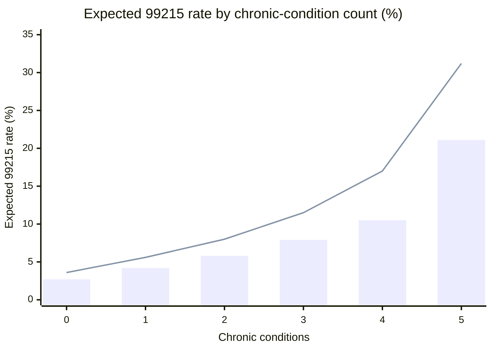
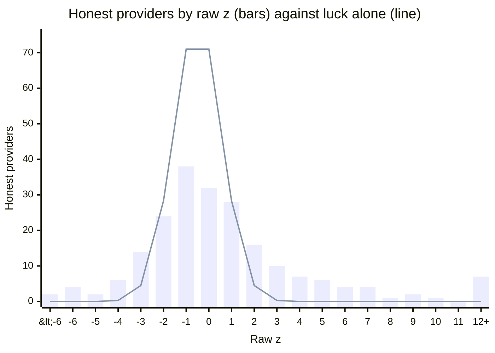
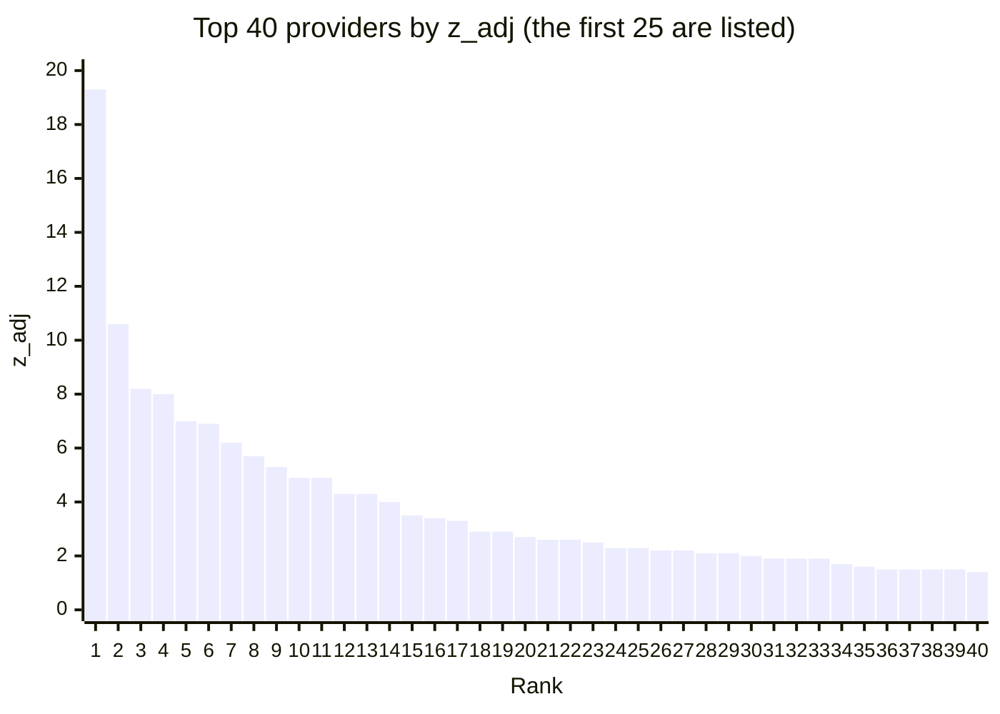

# Statistics review: how the screens score providers

[Back to the README](../README.md) · [screen methods](screen_methods.md) · [glossary](glossary.md)

This page walks through each screen's arithmetic step by step, using real numbers from one dataset. It explains how a score is calculated; [screen_methods.md](screen_methods.md) compares how well the screens rank upcoders.

**Worked dataset:** seed 42 on data 2.2 (run `261016_1_code`): 216 providers, 117,837 visits, 8 upcoders, 8 high-acuity panels. Roles come from the answer key and are used only to colour the examples; the screens never see them.

## `riskadj`: risk-adjusted z-score

Code: [src/baseline_riskadj.py](../src/baseline_riskadj.py). It was the screen of workflow v2.1 and agent v3.1 and is frozen there. Later screens reuse its expected counts.

**The idea:** work out how many 99215s a provider should bill, given how sick their patients are, then measure how far above that they billed.

### Step 1: an expected 99215 rate for every visit

Each visit goes into a bucket by the patient's chronic-condition count (0, 1, … 6 or more; nobody in this dataset has 6). A logistic regression with one intercept per bucket estimates P(billed 99215 | bucket). With only bucket intercepts, this is simply the share of visits in that bucket that were billed 99215. The rate rises steeply with how sick the patient is.

### Step 2: refit without the extreme providers

Upcoders inflate the rates they are compared against. So the script scores everyone once, drops the providers whose raw z (step 3) is above 3, and fits again. Here that drops 27 providers: all 8 upcoders, 18 other honest providers and 1 high-acuity panel. Everyone, including those dropped, is then scored against the second, cleaner fit.

Bars: the second fit, which is the one used. Line: the first fit, with every provider in.

| Chronic conditions | Visits | First fit (all providers) | Second fit (27 left out; used) |
|---|---|---|---|
| 0 | 31,838 | 3.6% | 2.7% |
| 1 | 35,485 | 5.6% | 4.2% |
| 2 | 24,445 | 8.0% | 5.8% |
| 3 | 13,629 | 11.5% | 7.9% |
| 4 | 6,610 | 17.0% | 10.5% |
| 5 | 5,830 | 31.2% | 21.1% |

### Step 3: observed against expected, per provider

- **Expected count** = the sum of each of the provider's visits' expected rates, so it follows that provider's own case mix.
- **Raw z** = (observed − expected) / √(Σ p(1 − p)): how many standard errors above expected the provider is, *if only chance made providers differ*.

Worked example, provider …041 (an upcoder, 302 visits): expected 12.1 99215s, observed **83**. The variance Σ p(1 − p) ≈ 11.5, so the standard error is 3.39 and raw z = (83 − 12.1) / 3.39 ≈ **20.9**.

| Provider | Role | Visits | Expected 99215s | Observed | Observed ÷ expected | Raw z | Rank |
|---|---|---|---|---|---|---|---|
| …143 | upcoder | 2,372 | 159.4 | 757 | 4.7 | 49.7 | 1 |
| …181 | other honest | 2,402 | 300.7 | 738 | 2.5 | 27.6 | 2 |
| …112 | other honest | 1,360 | 150.2 | 391 | 2.6 | 21.3 | 3 |
| …041 | upcoder | 302 | 12.1 | 83 | 6.9 | 20.9 | 4 |
| …016 | high-acuity panel | 2,378 | 189.0 | 426 | 2.3 | 18.3 | 5 |
| …095 | upcoder | 242 | 9.8 | 56 | 5.7 | 15.1 | 8 |
| …088 | upcoder | 241 | 25.7 | 80 | 3.1 | 11.6 | 12 |

### Step 4: rescale for honest variation (overdispersion)

**What raw z assumes.** Raw z measures distance from expected in units of *luck*. If every honest provider flipped the same fair coin on each visit to decide 99215 or not, their counts would differ from expected only by chance, and about 95% of them would land between −2 and +2.

**What actually happens.** Honest providers do not differ only by chance: some code a little higher by habit, every time, as if each had a slightly weighted coin. Statisticians call this extra variation *overdispersion*. Among the 208 honest providers here, 41% fall outside ±2 and 42 are above 3. Measured against luck alone, a raw z of 4 looks alarming, yet plenty of honest providers have one.

Each bin covers raw z from its label up to the next whole number ("-1" means −1 to 0).

**The fix: compare each provider with other providers, not with luck.**
1. Find the typical provider: the median raw z is **0.52**.
2. Find the typical distance from it: the median of every provider's distance from 0.52 is about 1.72. Multiplying by **1.4826**, a standard constant that puts a median distance on the same scale as a standard deviation, gives **2.55**.
3. Re-express each score: **z_adj = (raw z − 0.52) ÷ 2.55**, meaning "how many typical-provider spreads above the typical provider".
   - Upcoder …041: raw 20.9 becomes **8.0**.
   - An honest provider at raw 4 becomes **1.4**, unremarkable.

**Why medians, not the mean and standard deviation.** The upcoders and a few extreme providers would inflate an ordinary standard deviation: it is 5.81 across all providers, against the robust 2.55. A median ignores a handful of extreme values, so the yardstick reflects typical providers.

**This step does not change the ranking.** Every provider gets the same subtract-and-divide, so the order is identical before and after. It matters only for a fixed cutoff, such as the older "flag everyone at 5 or more" rule. A top-25 list comes out the same either way.

### Step 5: the list

The screen lists the top 25 by z_adj, or, under the older rule, everyone at 5 or more.

**Result on this dataset:** all 8 upcoders are in the top 25, at ranks 1, 4, 8, 11, 12, 13, 21 and 25. The other 17 places go to 16 other honest providers and 1 high-acuity panel (rank 5). The remaining high-acuity panels rank 29, 31, 86, 148, 149, 173 and 195.

### What `riskadj` gets wrong: volume

Raw z grows with volume. Provider …181 is honest, with 2,402 visits: it billed 2.5 times its expected 99215s, a smaller multiple than upcoder …041's 6.9 times. Its large volume makes the excess very *certain*, though, so its raw z is 27.6 and it ranks **2nd**. Several of the honest providers in the top 10 are large practices like it.

`riskadj` measures how *certain* it is that a provider bills more than expected, not *how much* more. Big honest practices with a modest excess therefore outrank small upcoders with a large one. [`eb_ratio`](screen_methods.md#the-methods) ranks on the ratio itself (observed ÷ expected) and pulls small panels toward 1 so chance spikes do not dominate; it was chosen over `riskadj` in release 2.

### Caveats

- **Built into the synthetic data:** a visit's level depends only on the chronic-condition count plus a provider's coding style. That flatters a model that adjusts for chronic count alone. Real claims have many more reasons for a 99215 (diagnoses, procedures, new patients, time).
- **One dataset:** every number on this page comes from one dataset and one draw.
- **Reproducing the numbers:** the functions in `src/baseline_riskadj.py` (`load`, `design`, `fit_logistic`, `provider_scores`, `rank`) on `data/synthetic_v2_261016_1_code/view` (gitignored; seed 42 with the data 2.2 defaults, made by `src/generate_v2.py --seed 42 --data-version 2.2`).
