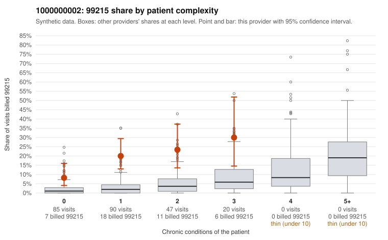

# 1000000002: 1000000002: 3 of 4 documented 99215 claims (75%) are documented below the billed level

**Leaning (advisory):** Pattern consistent with upcoding

## Why

1000000002 billed 99215 on 17.4% of 242 claims against an expected 2.2% given patient complexity (risk-adjusted score 5.21; plain z-score vs peers 1.91). 60% of this provider's 99215 claims were on patients with 0 or 1 chronic conditions. Records came back for 17 claims. Of 4 documented 99215 claims, 3 (75%) were documented below the billed level, against 14% for the comparison providers. 0 of 6 notes claiming moderate-or-higher data reviewed had no lab or test line on the claim. This pattern is consistent with upcoding. It is a reason to review the records, not a finding. Examples: C0000417: billed 99215; documented MDM level moderate, minutes not recorded. C0000484: billed 99215, patient aged 71 with 1 chronic condition(s) (depression); documented MDM level moderate, 33 minutes. C0000608: billed 99215; documented MDM level moderate, 35 minutes. C0000401: billed 99215, patient aged 57 with 1 chronic condition(s) (depression). C0000409: billed 99215, patient aged 80 with 1 chronic condition(s) (atrial fibrillation). C0000440: billed 99215, patient aged 71 with 1 chronic condition(s) (depression).

## Evidence chart

## Cited claims

`C0000417`, `C0000484`, `C0000608`, `C0000401`, `C0000409`, `C0000440`

## Suggested next steps

- Request the full records for the cited claims and have a certified coder re-score each against current E/M documentation rules (medical decision making or total time).
- If the re-scoring confirms the pattern, use the sampling plan in the recovery packet to review a statistical sample of this provider's 99215 claims.
- Check whether notes for the cited claims look copied forward, and whether documented minutes repeat from visit to visit.

---
Citations checked: 6/6 valid. Synthetic data. The leaning is advisory; the flag comes from the statistical screen, and no clinical documentation is available beyond the sampled records-review facts shown in the packet.
