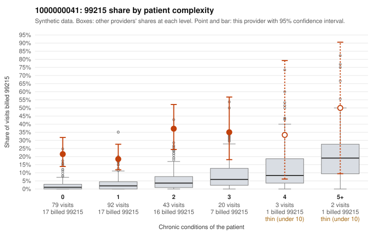

# 1000000041: 1000000041: 3 of 3 documented 99215 claims (100%) are documented below the billed level

**Leaning (advisory):** Pattern consistent with upcoding

## Why

1000000041 billed 99215 on 24.7% of 239 claims against an expected 2.4% given patient complexity (risk-adjusted score 7.37; plain z-score vs peers 3.07). 58% of this provider's 99215 claims were on patients with 0 or 1 chronic conditions. Records came back for 18 claims. Of 3 documented 99215 claims, 3 (100%) were documented below the billed level, against 14% for the comparison providers. 2 of 9 notes claiming moderate-or-higher data reviewed had no lab or test line on the claim. This pattern is consistent with upcoding. It is a reason to review the records, not a finding. Examples: C0025633: billed 99215; documented MDM level moderate, 37 minutes. C0025750: billed 99215; documented MDM level moderate, minutes not recorded. C0025756: billed 99215; documented MDM level moderate, 36 minutes. C0025599: billed 99215, patient aged 48 with 1 chronic condition(s) (type 2 diabetes). C0025600: billed 99215, patient aged 33 with 0 chronic condition(s). C0025613: billed 99215, patient aged 18 with 0 chronic condition(s).

## Evidence chart

## Cited claims

`C0025633`, `C0025750`, `C0025756`, `C0025599`, `C0025600`, `C0025613`

## Suggested next steps

- Request the full records for the cited claims and have a certified coder re-score each against current E/M documentation rules (medical decision making or total time).
- If the re-scoring confirms the pattern, use the sampling plan in the recovery packet to review a statistical sample of this provider's 99215 claims.
- Check whether notes for the cited claims look copied forward, and whether documented minutes repeat from visit to visit.

---
Citations checked: 6/6 valid. Synthetic data. The leaning is advisory; the flag comes from the statistical screen, and no clinical documentation is available beyond the sampled records-review facts shown in the packet.
