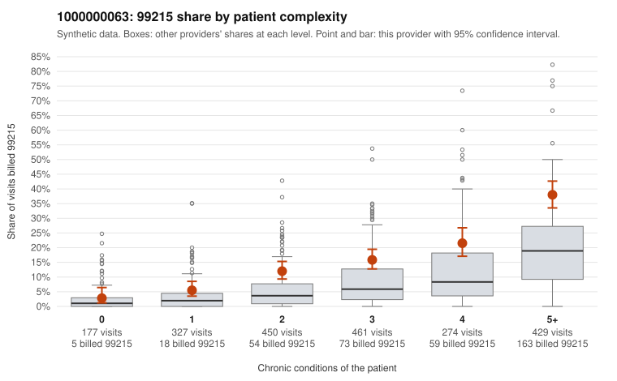

# 1000000063: Provider 1000000063 bills 99215 well above expectation in every complexity stratum, but with only one documented 99215 claim the records cannot yet distinguish upcoding from a sicker panel.

**Leaning (advisory):** Inconclusive

## Why

1000000063 billed 99215 on 17.6% of 2,118 claims against an expected 6.7% given patient complexity (risk-adjusted score 6.69; plain z-score vs peers 1.94). 6% of this provider's 99215 claims were on patients with 0 or 1 chronic conditions. Records came back for 20 claims. Of 1 documented 99215 claims, 0 (0%) were documented below the billed level, against 14% for the comparison providers. 3 of 13 notes claiming moderate-or-higher data reviewed had no lab or test line on the claim. The elevation is not confined to complex patients: the by-complexity table shows this provider's 99215 share exceeds the all-provider share in every condition band, roughly doubling it from two conditions upward, and the low-complexity sample includes 99215s on simple presentations such as back pain or a single condition (e.g., C0037739, C0038438, C0039090). That is a pattern consistent with upcoding. Against that, most 99215s fall on patients with many conditions, the low-complexity share of 99215s is small, and the code mix leans heavily on 99214, which could reflect practice style or a sicker panel. The documentation is too thin to judge: only one 99215 chart came back (C0038390, supported at high MDM), and no reviewed claim was documented below its billed level. The few notes claiming moderate-or-higher data review with no lab or test line on the claim are weak evidence of templated notes, not proof. A reviewer should first request charts for the sampled low-complexity 99215 claims, including repeat patients M0016070, M0016511 and M0015830, and check whether MDM and time actually support level 5. Examples: C0037281: billed 99215, patient aged 53 with 1 chronic condition(s) (hypertension). C0037347: billed 99215, patient aged 74 with 1 chronic condition(s) (type 2 diabetes).

## Evidence chart

## Cited claims

`C0037281`, `C0037347`

## Suggested next steps

- Request records for a larger sample of this provider's 99214 and 99215 claims; what came back is too thin to judge.
- Re-screen the provider once the records arrive.

---
Citations checked: 2/2 valid. Synthetic data. The leaning is advisory; the flag comes from the statistical screen, and no clinical documentation is available beyond the sampled records-review facts shown in the packet.
