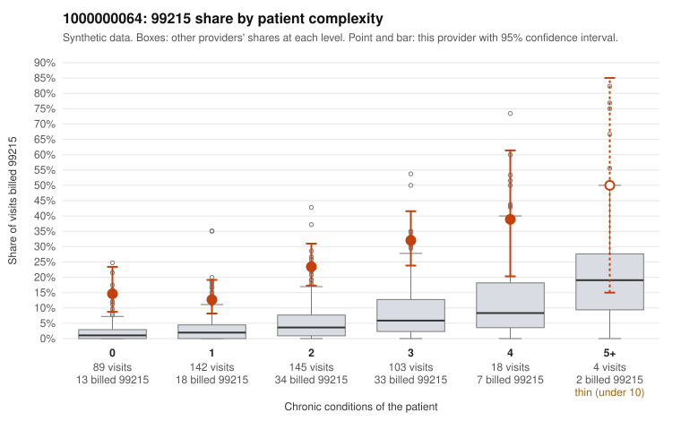

# 1000000064: 1000000064: 7 of 9 documented 99215 claims (78%) are documented below the billed level

**Leaning (advisory):** Pattern consistent with upcoding

## Why

1000000064 billed 99215 on 21.4% of 501 claims against an expected 3.3% given patient complexity (risk-adjusted score 7.45; plain z-score vs peers 2.54). 29% of this provider's 99215 claims were on patients with 0 or 1 chronic conditions. Records came back for 24 claims. Of 9 documented 99215 claims, 7 (78%) were documented below the billed level, against 14% for the comparison providers. 1 of 15 notes claiming moderate-or-higher data reviewed had no lab or test line on the claim. This pattern is consistent with upcoding. It is a reason to review the records, not a finding. Examples: C0039655: billed 99215; documented MDM level moderate, minutes not recorded. C0039786: billed 99215, patient aged 65 with 0 chronic condition(s); documented MDM level moderate, 33 minutes. C0039858: billed 99215; documented MDM level moderate, minutes not recorded. C0039376: billed 99215, patient aged 52 with 0 chronic condition(s). C0039401: billed 99215, patient aged 44 with 0 chronic condition(s). C0039405: billed 99215, patient aged 64 with 1 chronic condition(s) (type 2 diabetes).

## Evidence chart

## Cited claims

`C0039655`, `C0039786`, `C0039858`, `C0039376`, `C0039401`, `C0039405`

## Suggested next steps

- Request the full records for the cited claims and have a certified coder re-score each against current E/M documentation rules (medical decision making or total time).
- If the re-scoring confirms the pattern, use the sampling plan in the recovery packet to review a statistical sample of this provider's 99215 claims.
- Check whether notes for the cited claims look copied forward, and whether documented minutes repeat from visit to visit.

---
Citations checked: 6/6 valid. Synthetic data. The leaning is advisory; the flag comes from the statistical screen, and no clinical documentation is available beyond the sampled records-review facts shown in the packet.
