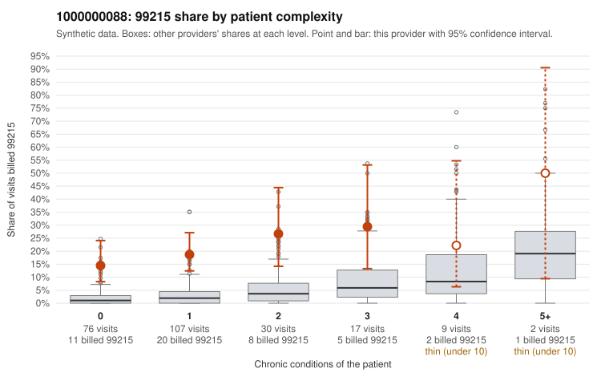

# 1000000088: Provider 1000000088 bills 99215 far above risk-adjusted expectation, mostly on low-complexity patients, but too few charts came back to confirm or refute upcoding.

**Leaning (advisory):** Inconclusive

## Why

1000000088 billed 99215 on 19.5% of 241 claims against an expected 2.4% given patient complexity (risk-adjusted score 5.64; plain z-score vs peers 2.25). 66% of this provider's 99215 claims were on patients with 0 or 1 chronic conditions. Records came back for 22 claims. Of 2 documented 99215 claims, 1 (50%) were documented below the billed level, against 14% for the comparison providers. 1 of 10 notes claiming moderate-or-higher data reviewed had no lab or test line on the claim. The claims pattern is concerning. The 99215 share exceeds the all-provider share in every complexity stratum, and most 99215s fall on patients with 0 or 1 chronic conditions. Sampled examples include acute or minor presentations billed at the top level, such as upper respiratory infection (C0056250, C0056365), rash (C0056215, C0056338) and low back pain (C0056177). The records review cannot yet settle the question because only two 99215 claims were documented. One, C0056220, was documented at low MDM. The other, C0056221, was supported with high MDM and 40 minutes on a one-condition diabetes patient, which shows that low condition counts do not by themselves rule out a complex visit. The below-billed rates on documented 99213 and 99214 claims are also elevated relative to peers, but those counts are small and the data-reviewed versus lab-line signal is minimal. A reviewer should first request charts for the low-complexity 99215 claims, prioritizing the acute-diagnosis visits listed above, and check whether MDM and time support the billed level. Examples: C0056220: billed 99215; documented MDM level low, minutes not recorded. C0056177: billed 99215, patient aged 39 with 0 chronic condition(s). C0056204: billed 99215, patient aged 28 with 1 chronic condition(s) (type 2 diabetes).

## Evidence chart

## Cited claims

`C0056220`, `C0056177`, `C0056204`

## Suggested next steps

- Request records for a larger sample of this provider's 99214 and 99215 claims; what came back is too thin to judge.
- Re-screen the provider once the records arrive.

---
Citations checked: 3/3 valid. Synthetic data. The leaning is advisory; the flag comes from the statistical screen, and no clinical documentation is available beyond the sampled records-review facts shown in the packet.
