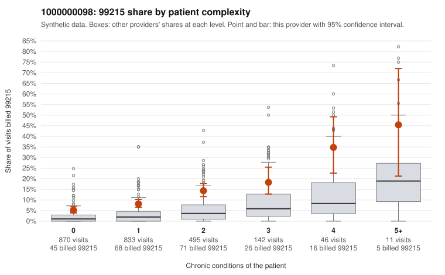

# 1000000098: Elevated 99215 billing is spread across every complexity stratum, including many low-complexity patients, but with no documented 99215 claims the pattern is a strong screening signal rather than a confirmed finding.

**Leaning (advisory):** Inconclusive

## Why

1000000098 billed 99215 on 9.6% of 2,397 claims against an expected 2.3% given patient complexity (risk-adjusted score 7.77; plain z-score vs peers 0.68). 49% of this provider's 99215 claims were on patients with 0 or 1 chronic conditions. Records came back for 15 claims. No documented 99215 claims came back. 1 of 12 notes claiming moderate-or-higher data reviewed had no lab or test line on the claim. The by-complexity table shows this provider's 99215 share running roughly double the all-provider rate in every condition band, including patients with zero or one chronic condition, so a sicker panel does not explain the excess on its own. The low-complexity sample includes 99215s for presentations such as upper respiratory infection, low back pain, rash and follow-up visits (e.g., C0059773, C0060059, C0060461, C0060821), which is a pattern consistent with upcoding, while the high-complexity sample (e.g., C0059990, C0061109) looks clinically plausible for top-level visits. The documentation is too thin to judge: only 15 charts came back, none for a 99215, and the single unsupported 99214 (C0061480) plus one moderate-data note without a lab line are each too few to carry weight. A reviewer should first request records for the sampled low-complexity 99215 claims, especially the zero-condition minor-complaint visits, and check documented MDM and time against the billed level. A comparison set of the high-complexity 99215 charts would show whether documentation differs meaningfully by patient acuity. Examples: C0061480: billed 99214; documented MDM level low, minutes not recorded. C0059773: billed 99215, patient aged 52 with 0 chronic condition(s). C0059971: billed 99215, patient aged 70 with 1 chronic condition(s) (COPD).

## Evidence chart

## Cited claims

`C0061480`, `C0059773`, `C0059971`

## Suggested next steps

- Request records for a larger sample of this provider's 99214 and 99215 claims; what came back is too thin to judge.
- Re-screen the provider once the records arrive.

---
Citations checked: 3/3 valid. Synthetic data. The leaning is advisory; the flag comes from the statistical screen, and no clinical documentation is available beyond the sampled records-review facts shown in the packet.
