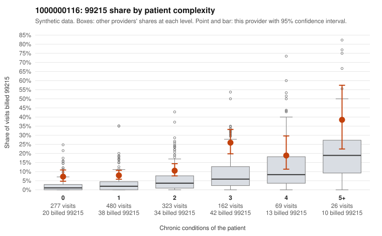

# 1000000116: Provider 1000000116 bills 99215 well above risk-adjusted expectation, including at the lowest complexity tiers, but documentation is too thin to confirm or refute upcoding.

**Leaning (advisory):** Inconclusive

## Why

1000000116 billed 99215 on 11.7% of 1,337 claims against an expected 3.2% given patient complexity (risk-adjusted score 5.93; plain z-score vs peers 1.01). 37% of this provider's 99215 claims were on patients with 0 or 1 chronic conditions. Records came back for 18 claims. Of 3 documented 99215 claims, 0 (0%) were documented below the billed level, against 14% for the comparison providers. 0 of 15 notes claiming moderate-or-higher data reviewed had no lab or test line on the claim. The elevated 99215 share appears in every complexity tier, not just among sicker patients, and over a third of 99215s go to patients with 0 or 1 chronic conditions. The sampled low-complexity 99215s include visits for codes such as rash (R21), unspecified abdominal pain (R10.9), low back pain (M54.50) and follow-up (Z09), for example C0067807, C0067799, C0067821 and C0068249, which is a pattern consistent with upcoding. Against that, the panel is also skewed toward 99214, and the few charts returned do not point toward upcoding: all three documented 99215s (C0068133, C0068167, C0068654) support the billed level. Only one 99214 (C0068459) was documented below the billed level, and no notes claiming substantial data review lacked a lab or test line. Still, the 18 documented claims are too few to judge. A reviewer should first request charts specifically for the low-complexity 99215 claims listed, especially the symptom-only and Z09 visits, and check whether MDM and time support level 5. Examples: C0068459: billed 99214; documented MDM level low, minutes not recorded. C0067799: billed 99215, patient aged 37 with 0 chronic condition(s). C0067807: billed 99215, patient aged 54 with 0 chronic condition(s).

## Evidence chart

## Cited claims

`C0068459`, `C0067799`, `C0067807`

## Suggested next steps

- Request records for a larger sample of this provider's 99214 and 99215 claims; what came back is too thin to judge.
- Re-screen the provider once the records arrive.

---
Citations checked: 3/3 valid. Synthetic data. The leaning is advisory; the flag comes from the statistical screen, and no clinical documentation is available beyond the sampled records-review facts shown in the packet.
