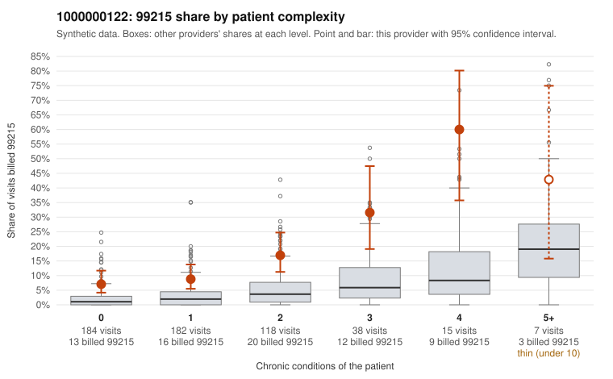

# 1000000122: Provider 1000000122's 99215 rate runs well above what its patient complexity predicts, and the excess shows up in every complexity band, but too few charts came back to confirm or refute upcoding.

**Leaning (advisory):** Inconclusive

## Why

1000000122 billed 99215 on 13.4% of 544 claims against an expected 2.6% given patient complexity (risk-adjusted score 5.24; plain z-score vs peers 1.28). 40% of this provider's 99215 claims were on patients with 0 or 1 chronic conditions. Records came back for 17 claims. Of 3 documented 99215 claims, 1 (33%) were documented below the billed level, against 14% for the comparison providers. 2 of 9 notes claiming moderate-or-higher data reviewed had no lab or test line on the claim. The billing pattern is consistent with upcoding: 99215 share is elevated relative to all providers at every condition count, including patients with zero or one chronic conditions. The low-complexity sample includes 99215 claims for follow-up (Z09), UTI (N39.0) and low back pain (M54.50) visits, such as C0071916, C0072148 and C0072253, which would not usually call for high-complexity decision-making. Against that, the documentation is too thin to judge. Only 3 documented 99215 claims exist, and two low-complexity ones (C0071998, C0072309) were documented at high MDM with 45 to 52 minutes, so a single unsupported claim (C0072484) cannot set a rate. The 2 data-reviewed notes without a lab or test line are weak evidence of note inflation, not proof. A reviewer should first request a larger targeted sample of charts for the 0-1 condition 99215 claims, then check whether those notes show genuine high-complexity decision-making or templated or cloned text. Examples: C0072484: billed 99215; documented MDM level moderate, 38 minutes. C0071916: billed 99215, patient aged 77 with 0 chronic condition(s). C0071951: billed 99215, patient aged 36 with 1 chronic condition(s) (hyperlipidemia).

## Evidence chart

## Cited claims

`C0072484`, `C0071916`, `C0071951`

## Suggested next steps

- Request records for a larger sample of this provider's 99214 and 99215 claims; what came back is too thin to judge.
- Re-screen the provider once the records arrive.

---
Citations checked: 3/3 valid. Synthetic data. The leaning is advisory; the flag comes from the statistical screen, and no clinical documentation is available beyond the sampled records-review facts shown in the packet.
