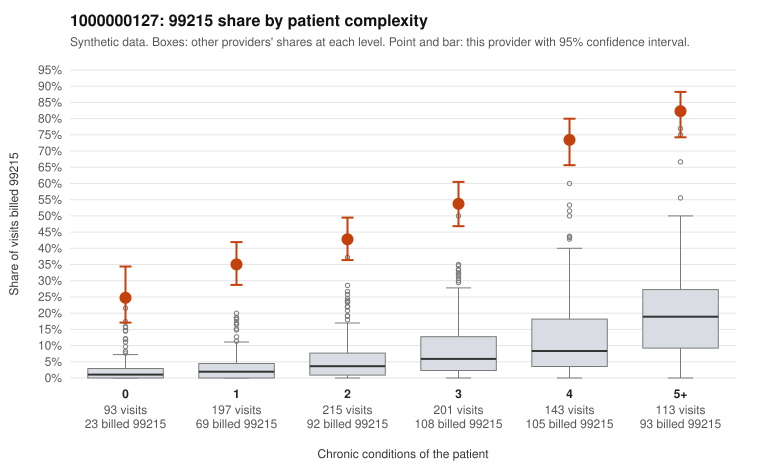

# 1000000127: Provider 1000000127's 99215 rate is far above expectation in every complexity tier, but the few charts returned all support the billed level, so the evidence points in different directions.

**Leaning (advisory):** Inconclusive

## Why

1000000127 billed 99215 on 50.9% of 962 claims against an expected 5.6% given patient complexity (risk-adjusted score 20.58; plain z-score vs peers 7.25). 19% of this provider's 99215 claims were on patients with 0 or 1 chronic conditions. Records came back for 21 claims. Of 9 documented 99215 claims, 0 (0%) were documented below the billed level, against 14% for the comparison providers. 0 of 19 notes claiming moderate-or-higher data reviewed had no lab or test line on the claim. The elevation is not confined to sicker patients. The 99215 share runs roughly ten times the all-provider rate even among patients with zero or one chronic condition, and the sampled low-complexity 99215s carry simple-visit diagnoses such as Z09 follow-up (C0074027, C0074349, C0074389), N39.0 (C0074379, C0074509), M54.50 back pain (C0074587, C0074667) and J06.9 URI (C0074777); billing is also almost entirely 99214/99215 with very few lower codes. Against that, every documented 99215 was supported at high MDM (e.g., C0074542, C0074748, C0074842), and there is no sign of inflated data-reviewed notes on claims without a lab or test line. The key ambiguity is that only about 2% of claims have records, and with 9 documented 99215s even the comparison providers' unsupported rate would predict only about one mismatch, so zero mismatches does not clear the provider. A reviewer should first request charts for the low-complexity 99215s listed in the packet, especially the Z09, URI and back-pain visits, to see whether high MDM is genuinely documented or templated. Examples: C0073928: billed 99215, patient aged 33 with 1 chronic condition(s) (hypertension). C0073955: billed 99215, patient aged 31 with 1 chronic condition(s) (atrial fibrillation).

## Evidence chart

## Cited claims

`C0073928`, `C0073955`

## Suggested next steps

- Request records for a larger sample of this provider's 99214 and 99215 claims; what came back is too thin to judge.
- Re-screen the provider once the records arrive.

---
Citations checked: 2/2 valid. Synthetic data. The leaning is advisory; the flag comes from the statistical screen, and no clinical documentation is available beyond the sampled records-review facts shown in the packet.
