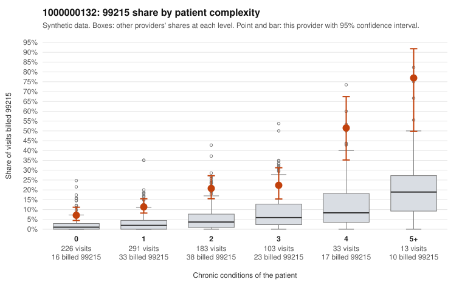

# 1000000132: Provider 1000000132 bills 99215 well above the risk-adjusted expectation across every complexity tier, including many low-complexity visits, but documentation is too thin to confirm or refute upcoding.

**Leaning (advisory):** Inconclusive

## Why

1000000132 billed 99215 on 16.1% of 849 claims against an expected 2.9% given patient complexity (risk-adjusted score 7.54; plain z-score vs peers 1.71). 36% of this provider's 99215 claims were on patients with 0 or 1 chronic conditions. Records came back for 16 claims. Of 4 documented 99215 claims, 0 (0%) were documented below the billed level, against 14% for the comparison providers. 2 of 9 notes claiming moderate-or-higher data reviewed had no lab or test line on the claim. The billing pattern raises concern because the 99215 excess appears in every complexity band, not just among sicker patients. Over a third of 99215s fall on patients with zero or one chronic condition, and the sampled low-complexity claims often carry only minor or self-limited diagnoses, such as follow-up exams (C0078291, C0078450), back pain (C0078442) or upper respiratory infection (C0078461). The high-complexity 99215 samples (e.g., C0078513, C0078838) look clinically plausible, and the few documented 99215s all support the billed level. However, four documented 99215 claims is far too small a sample to offset the statistical signal. The small number of data-reviewed notes with no lab or test line is only weak evidence of possible note inflation. A reviewer should first request charts for the low-complexity 99215 claims, starting with the zero-condition visits coded R10.9, Z09, M54.50 or J06.9, to see whether the documented MDM or time genuinely supports the highest level. Examples: C0078177: billed 99215, patient aged 49 with 1 chronic condition(s) (asthma). C0078204: billed 99215, patient aged 61 with 0 chronic condition(s).

## Evidence chart

## Cited claims

`C0078177`, `C0078204`

## Suggested next steps

- Request records for a larger sample of this provider's 99214 and 99215 claims; what came back is too thin to judge.
- Re-screen the provider once the records arrive.

---
Citations checked: 2/2 valid. Synthetic data. The leaning is advisory; the flag comes from the statistical screen, and no clinical documentation is available beyond the sampled records-review facts shown in the packet.
