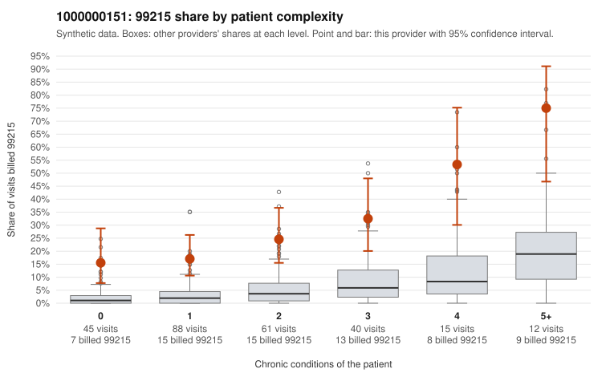

# 1000000151: Provider 1000000151 bills 99215 far above expectation across every complexity level, but the small set of returned records largely supports the billed levels, so the pattern is unresolved.

**Leaning (advisory):** Inconclusive

## Why

1000000151 billed 99215 on 25.7% of 261 claims against an expected 3.7% given patient complexity (risk-adjusted score 6.23; plain z-score vs peers 3.23). 33% of this provider's 99215 claims were on patients with 0 or 1 chronic conditions. Records came back for 21 claims. Of 9 documented 99215 claims, 1 (11%) were documented below the billed level, against 14% for the comparison providers. 0 of 17 notes claiming moderate-or-higher data reviewed had no lab or test line on the claim. The elevated 99215 share appears in every complexity band, including patients with no chronic conditions. A third of the 99215s fall on low-complexity patients. Panel acuity alone does not explain that, and it is the main concern. Against this, the documentation does not show upcoding: the documented 99215 unsupported rate is in line with comparison providers, some low-complexity 99215s were documented as high MDM (C0088286, C0088397), and no data-reviewed claims lacked a lab or test line. However, only 9 documented 99215 claims came back, a small fraction of this provider's charts, which is too thin to clear or confirm the pattern. Note too that matching documentation could reflect templated or inflated notes. A reviewer should first request records for the zero-condition 99215s in the sample, such as the Z09 follow-ups C0088326 and C0088332 and the single-symptom visits C0088281 and C0088486, and check whether the note content and time plausibly reflect high-complexity decision-making. Examples: C0088318: billed 99215, patient aged 40 with 4 chronic condition(s) (type 2 diabetes;obesity;hypertension;osteoarthritis); documented MDM level moderate, minutes not recorded. C0088207: billed 99215, patient aged 56 with 1 chronic condition(s) (hypertension). C0088212: billed 99215, patient aged 80 with 1 chronic condition(s) (hypertension).

## Evidence chart

## Cited claims

`C0088318`, `C0088207`, `C0088212`

## Suggested next steps

- Request records for a larger sample of this provider's 99214 and 99215 claims; what came back is too thin to judge.
- Re-screen the provider once the records arrive.

---
Citations checked: 3/3 valid. Synthetic data. The leaning is advisory; the flag comes from the statistical screen, and no clinical documentation is available beyond the sampled records-review facts shown in the packet.
