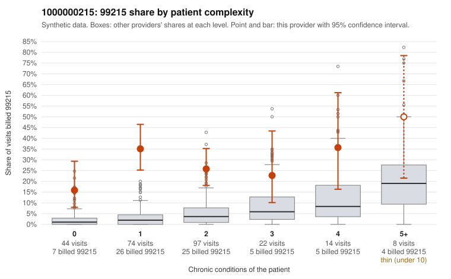

# 1000000215: Provider 1000000215's 99215 rate is elevated in every complexity tier, including low-complexity patients, but only three documented 99215 claims are available, too few to confirm or refute upcoding.

**Leaning (advisory):** Inconclusive

## Why

1000000215 billed 99215 on 27.8% of 259 claims against an expected 3.4% given patient complexity (risk-adjusted score 7.11; plain z-score vs peers 3.57). 46% of this provider's 99215 claims were on patients with 0 or 1 chronic conditions. Records came back for 21 claims. Of 3 documented 99215 claims, 2 (67%) were documented below the billed level, against 14% for the comparison providers. 0 of 12 notes claiming moderate-or-higher data reviewed had no lab or test line on the claim. The claims pattern points away from a sicker panel. The excess 99215 share holds after risk adjustment and appears in every complexity tier. It is starkest on patients with 0 or 1 conditions, such as C0119754 (age 21, hyperlipidemia only) and C0119814 (age 24, obesity only). The documentation is too thin to judge. Two of the three documented 99215 claims fell below the billed level, including C0119709, a 0-condition back-pain visit documented at moderate. One claim, C0119907, was supported at high MDM with 54 minutes, and the rule check notes the pooled documentation result is not lopsided. There is no sign of cloned or inflated notes, since every note claiming moderate-or-higher data review had a matching lab or test line. A reviewer should first request charts for the sampled low-complexity 99215 claims to see whether the notes support high-complexity decision-making or 40+ minutes. This would turn a billing pattern consistent with upcoding into a documented finding, or rule it out. Examples: C0119709: billed 99215, patient aged 66 with 0 chronic condition(s); documented MDM level moderate, minutes not recorded. C0119727: billed 99215; documented MDM level moderate, 39 minutes. C0119684: billed 99215, patient aged 41 with 1 chronic condition(s) (hypertension). C0119692: billed 99215, patient aged 50 with 1 chronic condition(s) (asthma).

## Evidence chart

## Cited claims

`C0119709`, `C0119727`, `C0119684`, `C0119692`

## Suggested next steps

- Request records for a larger sample of this provider's 99214 and 99215 claims; what came back is too thin to judge.
- Re-screen the provider once the records arrive.

---
Citations checked: 4/4 valid. Synthetic data. The leaning is advisory; the flag comes from the statistical screen, and no clinical documentation is available beyond the sampled records-review facts shown in the packet.
