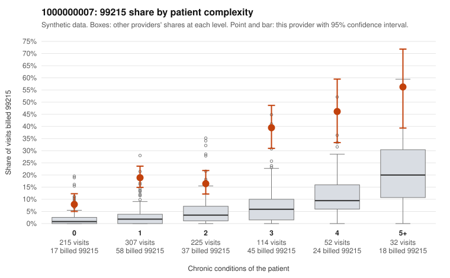

# 1000000007: Provider 1000000007 bills 99215 far above risk-adjusted expectation, with elevated shares even on 0–1 condition patients, but records are too thin to confirm or refute upcoding.

**Leaning (advisory):** Inconclusive

## Why

1000000007 billed 99215 on 21.1% of 945 claims against an expected 3.7% given patient complexity (risk-adjusted score 13.17; plain z-score vs peers 3.07). 38% of this provider's 99215 claims were on patients with 0 or 1 chronic conditions. Records came back for 16 claims. Of 4 documented 99215 claims, 0 (0%) were documented below the billed level, against 0% for the comparison providers. 2 of 11 notes claiming moderate-or-higher data reviewed had no lab or test line on the claim. The claims data lean toward concern. The excess 99215 share holds in every complexity band, not only the sicker patients. A large part of the 99215 volume sits on patients with no or one chronic condition, and the sampled low-complexity claims show single symptom codes such as R10.9, R21 and N39.0 (for example C0001538, C0002102, C0002156). The panel does include genuinely complex patients (for example C0001935, C0002110), and all 4 documented 99215 claims were supported at high MDM. That support is reassuring, but 4 charts out of roughly 200 99215 claims is too few to judge, and none of the documented charts are known to be low-complexity cases. The 2 notes claiming moderate-or-higher data review with no lab or test line on the claim are only weak evidence of possible note inflation. A reviewer should first request records for the low-complexity 99215 claims listed in the packet, checking whether MDM and time genuinely support level 5 and whether the notes look templated or cloned. Examples: C0001503: billed 99215, patient aged 36 with 0 chronic condition(s). C0001508: billed 99215, patient aged 56 with 1 chronic condition(s) (chronic kidney disease).

## Evidence chart

## Cited claims

`C0001503`, `C0001508`

## Suggested next steps

- Request records for a larger sample of this provider's 99214 and 99215 claims; what came back is too thin to judge.
- Re-screen the provider once the records arrive.

---
Citations checked: 2/2 valid. Synthetic data. The leaning is advisory; the flag comes from the statistical screen, and no clinical documentation is available beyond the sampled records-review facts shown in the packet.
