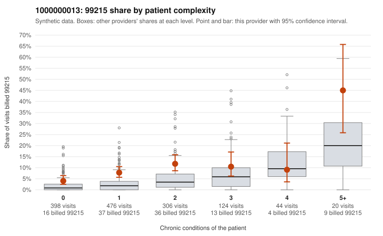

# 1000000013: Provider 1000000013 bills 99215 well above its risk-adjusted expectation, with elevated rates even among patients with few chronic conditions, but no 99215 charts came back to confirm or refute the coding.

**Leaning (advisory):** Inconclusive

## Why

1000000013 billed 99215 on 8.4% of 1,368 claims against an expected 3.0% given patient complexity (risk-adjusted score 5.40; plain z-score vs peers 0.66). 46% of this provider's 99215 claims were on patients with 0 or 1 chronic conditions. Records came back for 18 claims. No documented 99215 claims came back. 0 of 11 notes claiming moderate-or-higher data reviewed had no lab or test line on the claim. The complexity breakdown shows a pattern consistent with upcoding: this provider's 99215 share runs roughly double the all-provider rate in the 0-, 1- and 2-condition strata, and nearly half of its 99215s fall on low-complexity patients. Sampled examples include visits coded only for nonspecific complaints such as R10.9, N39.0, M54.50 or Z09 (e.g., C0005114, C0005641, C0005656, C0005529). Against that, the high-complexity sampled 99215s (e.g., C0005928, C0006316) look clinically plausible, the plain peer z-score is unremarkable, and the 4-condition stratum actually bills below peers. The documentation cannot settle it: only 18 charts returned, none for a 99215, and the single unsupported 99214 (C0006003) is too little to draw on, while the data-reviewed notes all had matching lab or test lines. A reviewer should first request charts for the sampled low-complexity 99215 claims, starting with the symptom-only and follow-up (Z09) visits, to see whether documented MDM or time supports the high level. Examples: C0006003: billed 99214; documented MDM level low, minutes not recorded. C0005114: billed 99215, patient aged 27 with 0 chronic condition(s). C0005128: billed 99215, patient aged 45 with 1 chronic condition(s) (type 2 diabetes).

## Evidence chart

## Cited claims

`C0006003`, `C0005114`, `C0005128`

## Suggested next steps

- Request records for a larger sample of this provider's 99214 and 99215 claims; what came back is too thin to judge.
- Re-screen the provider once the records arrive.

---
Citations checked: 3/3 valid. Synthetic data. The leaning is advisory; the flag comes from the statistical screen, and no clinical documentation is available beyond the sampled records-review facts shown in the packet.
