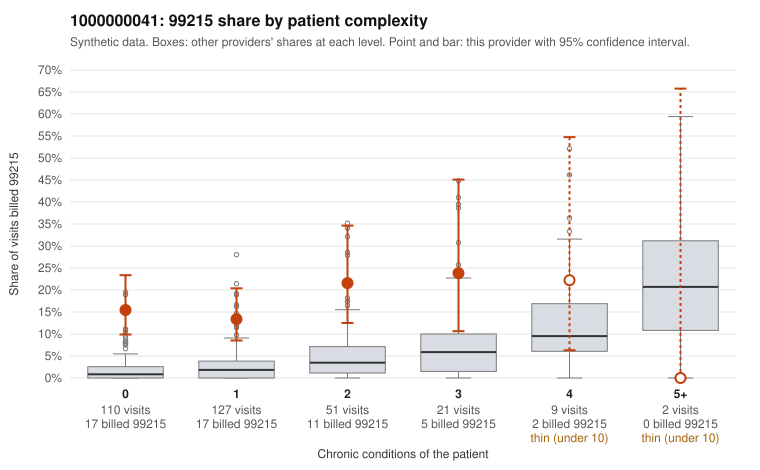

# 1000000041: Provider 1000000041 bills 99215 far above expectation, mostly on patients with few chronic conditions, but too few charts came back to show whether the notes support those levels.

**Leaning (advisory):** Inconclusive

## Why

1000000041 billed 99215 on 16.2% of 320 claims against an expected 2.6% given patient complexity (risk-adjusted score 7.07; plain z-score vs peers 2.15). 65% of this provider's 99215 claims were on patients with 0 or 1 chronic conditions. Records came back for 18 claims. Of 4 documented 99215 claims, 0 (0%) were documented below the billed level, against 0% for the comparison providers. 0 of 13 notes claiming moderate-or-higher data reviewed had no lab or test line on the claim. The billing profile itself is the concern. The 99215 excess is concentrated in the 0- and 1-condition strata, where this provider's share runs several times the all-provider rate, and the code mix is also heavily weighted toward 99214, so the high-level billing looks like a provider-wide habit rather than something driven by sicker patients. The sampled low-complexity 99215s include routine-looking diagnoses such as upper respiratory infection (J06.9), rash (R21), low back pain (M54.50) and follow-up visits (Z09), for example C0019775, C0019751 and C0019807. The documentation does not confirm upcoding: all four documented 99215s, including three on low-complexity patients (C0019746, C0019925, C0020005), were charted at high MDM, and none of the notes claiming moderate-or-higher data review lacked a lab or test line on the claim. With records for only about 6% of claims and just four 99215 charts, the documentation is too thin to judge either way. A reviewer should first request records for the sampled low-complexity 99215s with simple acute diagnoses and check whether the high-MDM narratives fit the problems treated or read as templated or cloned. C0020005 deserves early attention because it has no recorded minutes. Examples: C0019739: billed 99215, patient aged 47 with 1 chronic condition(s) (osteoarthritis). C0019746: billed 99215, patient aged 36 with 1 chronic condition(s) (hyperlipidemia); documented MDM level high, 32 minutes.

## Evidence chart

## Cited claims

`C0019739`, `C0019746`

## Suggested next steps

- Request records for a larger sample of this provider's 99214 and 99215 claims; what came back is too thin to judge.
- Re-screen the provider once the records arrive.

---
Citations checked: 2/2 valid. Synthetic data. The leaning is advisory; the flag comes from the statistical screen, and no clinical documentation is available beyond the sampled records-review facts shown in the packet.
