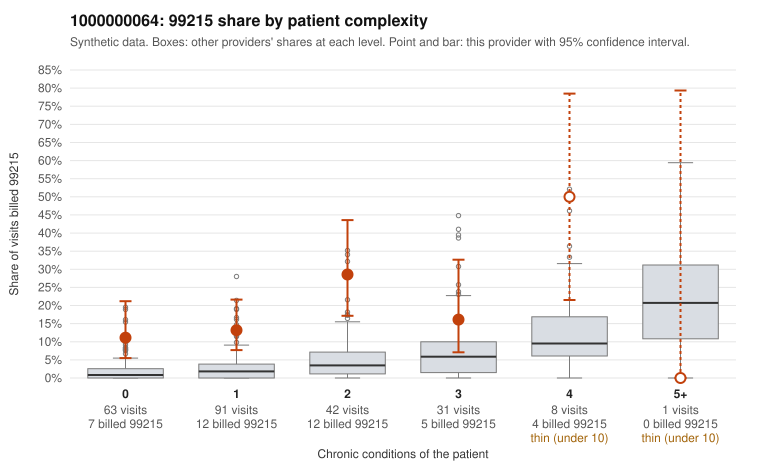

# 1000000064: Provider 1000000064 bills 99215 well above its risk-adjusted expectation, with nearly half of those claims on patients with few or no chronic conditions, but the records returned are too thin to confirm or refute the billing pattern.

**Leaning (advisory):** Pattern consistent with upcoding

## Why

1000000064 billed 99215 on 16.9% of 236 claims against an expected 2.9% given patient complexity (risk-adjusted score 5.91; plain z-score vs peers 2.29). 48% of this provider's 99215 claims were on patients with 0 or 1 chronic conditions. Records came back for 21 claims. Of 1 documented 99215 claims, 0 (0%) were documented below the billed level, against 0% for the comparison providers. 1 of 9 notes claiming moderate-or-higher data reviewed had no lab or test line on the claim. The excess 99215 share holds after risk adjustment and appears in every complexity stratum, including patients with zero or one condition. The sampled low-complexity 99215 claims carry simple diagnoses such as upper respiratory infection (C0031862, C0031885), rash (C0031824), low back pain (C0031936) and follow-up codes (C0031929, C0031931), which is the more concerning part of the pattern than a sicker panel would explain. The documentation cannot settle this: only one 99215 claim has records, and it is C0031775, a four-condition patient whose note supports high MDM, so it says nothing about the low-complexity claims. The lower levels look largely supported, with one 99214 documented below billed (C0031854) and one moderate-plus data-reviewed note lacking a lab line, which is weak evidence at most. A reviewer should first request charts for the low-complexity 99215 claims listed above and check whether their MDM and time support level 5, and watch for cloned or templated notes. Examples: C0031854: billed 99214; documented MDM level low, minutes not recorded. C0031708: billed 99215, patient aged 41 with 1 chronic condition(s) (atrial fibrillation). C0031709: billed 99215, patient aged 51 with 0 chronic condition(s). C0031728: billed 99215, patient aged 18 with 1 chronic condition(s) (hypertension).

## Evidence chart

## Cited claims

`C0031854`, `C0031708`, `C0031709`, `C0031728`

## Suggested next steps

- Request the full records for the cited claims and have a certified coder re-score each against current E/M documentation rules (medical decision making or total time).
- If the re-scoring confirms the pattern, use the sampling plan in the recovery packet to review a statistical sample of this provider's 99215 claims.
- Check whether notes for the cited claims look copied forward, and whether documented minutes repeat from visit to visit.

---
Citations checked: 4/4 valid. Synthetic data. The leaning is advisory; the flag comes from the statistical screen, and no clinical documentation is available beyond the sampled records-review facts shown in the packet.
