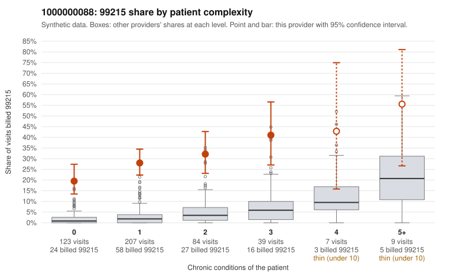

# 1000000088: Provider 1000000088 bills 99215 far above risk-adjusted expectation, mostly on patients with few or no chronic conditions, but the records returned are too few to confirm or rule out upcoding.

**Leaning (advisory):** Pattern consistent with upcoding

## Why

1000000088 billed 99215 on 28.4% of 469 claims against an expected 2.9% given patient complexity (risk-adjusted score 15.27; plain z-score vs peers 4.46). 62% of this provider's 99215 claims were on patients with 0 or 1 chronic conditions. Records came back for 18 claims. Of 5 documented 99215 claims, 1 (20%) were documented below the billed level, against 0% for the comparison providers. 3 of 14 notes claiming moderate-or-higher data reviewed had no lab or test line on the claim. The claims pattern points toward upcoding rather than a sicker panel. The 99215 share is elevated in every complexity band, not just among complex patients, and most 99215s fall on patients with 0 or 1 conditions. Sampled low-complexity examples include claims for follow-up (Z09), UTI (N39.0) or abdominal pain (R10.9) alone, such as C0037661, C0037749 and C0037815. The documentation evidence is thin and mixed. Only 5 documented 99215s came back: one was documented below the billed level (C0037602, moderate MDM), while four supported high MDM, including low-complexity claim C0037818. Three notes claim moderate-plus data review with no lab or test line on the claim, which is weak evidence of templated or inflated notes. A reviewer should first request a larger chart sample focused on the low-complexity 99215s listed in the packet, and check whether the notes contain real independent complexity or cloned text. Examples: C0037602: billed 99215; documented MDM level moderate, minutes not recorded. C0037610: billed 99215, patient aged 49 with 1 chronic condition(s) (obesity). C0037615: billed 99215, patient aged 18 with 1 chronic condition(s) (hypertension). C0037661: billed 99215, patient aged 72 with 0 chronic condition(s).

## Evidence chart

## Cited claims

`C0037602`, `C0037610`, `C0037615`, `C0037661`

## Suggested next steps

- Request the full records for the cited claims and have a certified coder re-score each against current E/M documentation rules (medical decision making or total time).
- If the re-scoring confirms the pattern, use the sampling plan in the recovery packet to review a statistical sample of this provider's 99215 claims.
- Check whether notes for the cited claims look copied forward, and whether documented minutes repeat from visit to visit.

---
Citations checked: 4/4 valid. Synthetic data. The leaning is advisory; the flag comes from the statistical screen, and no clinical documentation is available beyond the sampled records-review facts shown in the packet.
