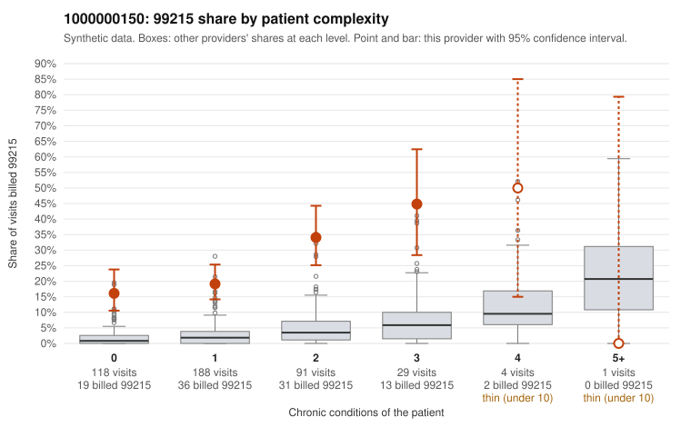

# 1000000150: Provider 1000000150 bills 99215 far above its risk-adjusted expectation, and most of those visits are on patients with few or no chronic conditions, but the documentation sample is too small to confirm or rule out upcoding.

**Leaning (advisory):** Inconclusive

## Why

1000000150 billed 99215 on 23.4% of 431 claims against an expected 2.6% given patient complexity (risk-adjusted score 12.69; plain z-score vs peers 3.52). 54% of this provider's 99215 claims were on patients with 0 or 1 chronic conditions. Records came back for 16 claims. Of 3 documented 99215 claims, 0 (0%) were documented below the billed level, against 0% for the comparison providers. 0 of 7 notes claiming moderate-or-higher data reviewed had no lab or test line on the claim. The claims pattern itself is concerning. The excess 99215 share holds at every complexity tier, and over half of the 99215s fall on patients with zero or one chronic condition. The sampled low-complexity 99215s include routine presentations such as unspecified abdominal pain (C0065981, C0066347), UTI (C0065993, C0066250), rash (C0066101) and an upper respiratory infection (C0066344), which would not usually support high-complexity decision-making. Against that, the few charts that came back all supported the billed level, including the three documented 99215s with high MDM (C0066360, C0066386, C0066388). No data-review inflation was seen on claims without lab or test lines. With only 3 documented 99215s, the records are too thin to judge either way. The reviewer should first request charts for the sampled low-complexity 99215 claims, especially the zero-condition acute-complaint visits listed above, and check whether their MDM and time genuinely support level 5 or show cloned or templated notes. Examples: C0065981: billed 99215, patient aged 35 with 0 chronic condition(s). C0065983: billed 99215, patient aged 49 with 0 chronic condition(s).

## Evidence chart

## Cited claims

`C0065981`, `C0065983`

## Suggested next steps

- Request records for a larger sample of this provider's 99214 and 99215 claims; what came back is too thin to judge.
- Re-screen the provider once the records arrive.

---
Citations checked: 2/2 valid. Synthetic data. The leaning is advisory; the flag comes from the statistical screen, and no clinical documentation is available beyond the sampled records-review facts shown in the packet.
