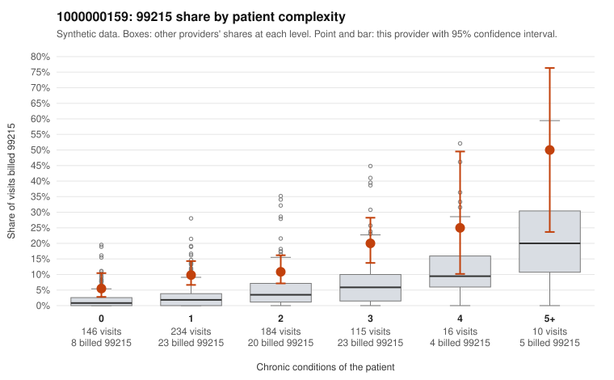

# 1000000159: Elevated 99215 use runs above peers at every complexity level, including many low-complexity patients, but only four documented 99215 claims exist and all were supported, so the records are too thin to call this upcoding.

**Leaning (advisory):** Inconclusive

## Why

1000000159 billed 99215 on 11.8% of 705 claims against an expected 3.3% given patient complexity (risk-adjusted score 5.84; plain z-score vs peers 1.30). 37% of this provider's 99215 claims were on patients with 0 or 1 chronic conditions. Records came back for 22 claims. Of 4 documented 99215 claims, 0 (0%) were documented below the billed level, against 0% for the comparison providers. 2 of 14 notes claiming moderate-or-higher data reviewed had no lab or test line on the claim. The billing pattern leans toward concern. The 99215 share exceeds the all-provider rate in every complexity band, and over a third of 99215s fall on patients with 0 or 1 chronic conditions, many with simple diagnoses such as low back pain (C0071409, C0071806), abdominal pain (C0071410) or URI (C0071710). That is the profile more consistent with upcoding than with a sicker panel. The documentation points the other way but cannot carry much weight: all four documented 99215 claims were supported at high MDM, including low-complexity claim C0071775, and the only below-billed finding was a single 99213 (C0071720). The 2 moderate-plus data-reviewed notes without a lab line are weak evidence of templated notes, not proof. A reviewer should first request charts for the sampled low-complexity 99215 claims and check whether high MDM is genuinely supported or cloned, then expand the records pull beyond the roughly 3% returned so far. Examples: C0071720: billed 99213; documented MDM level straightforward, minutes not recorded. C0071409: billed 99215, patient aged 37 with 0 chronic condition(s). C0071410: billed 99215, patient aged 32 with 0 chronic condition(s).

## Evidence chart

## Cited claims

`C0071720`, `C0071409`, `C0071410`

## Suggested next steps

- Request records for a larger sample of this provider's 99214 and 99215 claims; what came back is too thin to judge.
- Re-screen the provider once the records arrive.

---
Citations checked: 3/3 valid. Synthetic data. The leaning is advisory; the flag comes from the statistical screen, and no clinical documentation is available beyond the sampled records-review facts shown in the packet.
