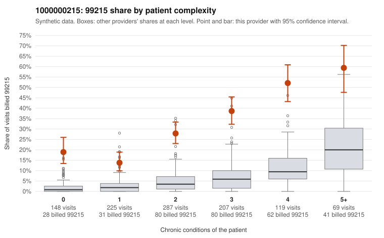

# 1000000215: Provider 1000000215's elevated 99215 rate persists across every complexity tier, including patients with no chronic conditions, which is consistent with upcoding, but the charts returned are too few to confirm it.

**Leaning (advisory):** Pattern consistent with upcoding

## Why

1000000215 billed 99215 on 30.5% of 1,055 claims against an expected 5.1% given patient complexity (risk-adjusted score 17.61; plain z-score vs peers 4.88). 18% of this provider's 99215 claims were on patients with 0 or 1 chronic conditions. Records came back for 19 claims. Of 4 documented 99215 claims, 0 (0%) were documented below the billed level, against 0% for the comparison providers. 2 of 18 notes claiming moderate-or-higher data reviewed had no lab or test line on the claim. The complexity table argues against a sicker-panel explanation: the 99215 share is several times the all-provider rate even for patients with 0 or 1 conditions. Sampled low-complexity 99215 claims carry minor acute or follow-up diagnoses such as upper respiratory infection or follow-up exam (C0095046, C0095258, C0094890, C0095175), and the heavy reliance on 99214 points the same way. The documentation does not confirm this, but it is too thin to judge either way: only 4 documented 99215 claims came back, all supported at high MDM (e.g., C0094596, C0094651), and one 99214 was documented low (C0095286). The 2 notes claiming moderate-or-higher data reviewed with no lab or test line on the claim are only weak evidence. Reviewers should first request charts for the sampled low-complexity 99215 claims, including whether patient M0039833's 99215 (C0094331) and 99214 (C0095430) visits differed clinically, and check notes for cloned or templated MDM language. Examples: C0095286: billed 99214; documented MDM level low, 24 minutes. C0094331: billed 99215, patient aged 76 with 1 chronic condition(s) (type 2 diabetes). C0094355: billed 99215, patient aged 38 with 0 chronic condition(s). C0094398: billed 99215, patient aged 52 with 1 chronic condition(s) (hyperlipidemia).

## Evidence chart

## Cited claims

`C0095286`, `C0094331`, `C0094355`, `C0094398`

## Suggested next steps

- Request the full records for the cited claims and have a certified coder re-score each against current E/M documentation rules (medical decision making or total time).
- If the re-scoring confirms the pattern, use the sampling plan in the recovery packet to review a statistical sample of this provider's 99215 claims.
- Check whether notes for the cited claims look copied forward, and whether documented minutes repeat from visit to visit.

---
Citations checked: 4/4 valid. Synthetic data. The leaning is advisory; the flag comes from the statistical screen, and no clinical documentation is available beyond the sampled records-review facts shown in the packet.
