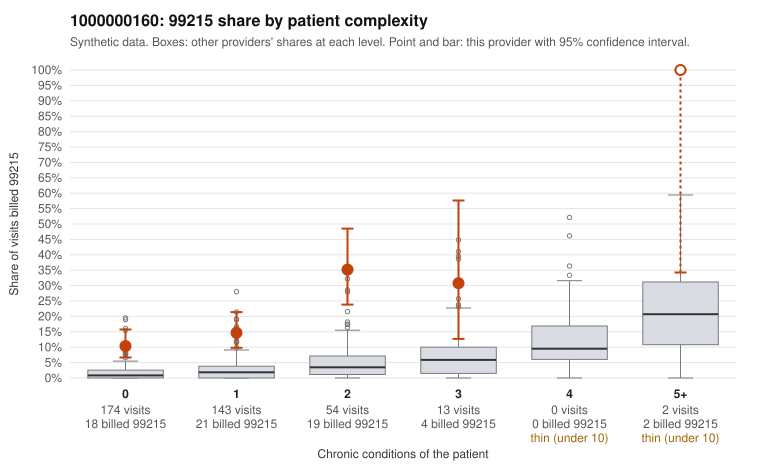

# Payment Integrity dossier: 1000000160

> Draft for human review. Statistical and records-sample evidence only; not a finding. Compliance or legal review is needed before any provider contact, notice or recoupment.

## Provider overview

| | |
|---|---|
| Specialty / state | Family Practice, GA (synthetic) |
| Claims / patients | 386 / 188 |
| Billed mix (99211 to 99215) | 0 / 0 / 77 / 245 / 64 |
| 99215 share | 16.6% |
| Expected 99215 share given patient complexity | 2.2% |
| Screen scores | z vs peers 2.22; risk-adjusted 8.99; flagged by suspicion>=5 |

## Case summary (advisory)

**Elevated 99215 billing is concentrated on low-complexity patients with routine diagnoses, a pattern consistent with upcoding, but documentation is too thin to confirm it.**

Leaning: pattern consistent with upcoding. Citations checked: 4/4 valid.

1000000160 billed 99215 on 16.6% of 386 claims against an expected 2.2% given patient complexity (risk-adjusted score 8.99; plain z-score vs peers 2.22). 61% of this provider's 99215 claims were on patients with 0 or 1 chronic conditions. Records came back for 25 claims. Of 2 documented 99215 claims, 0 (0%) were documented below the billed level, against 0% for the comparison providers. 3 of 15 notes claiming moderate-or-higher data reviewed had no lab or test line on the claim. The complexity breakdown cuts against a sicker-panel explanation: most of this provider's 99215s fall on patients with zero or one chronic condition, and the sampled low-complexity 99215s carry self-limited diagnoses such as rash (C0072186, C0072229), upper respiratory infection (C0072201, C0072325) and urinary tract infection (C0072306, C0072362), which rarely support high-complexity decision-making. Only the few 5+ condition patients (e.g., C0072236, C0072450) look like expected high-level visits. The records review cannot settle the question. Only two 99215 claims were documented, and both support the billed level (C0072308, C0072442). The single below-billed note (C0072228) is a 99214, and a few notes claim moderate-or-higher data reviewed with no lab or test line on the claim, which is weak evidence of possible note inflation, not proof. A reviewer should first request charts for the sampled low-complexity 99215 claims, prioritizing the rash, URI and UTI visits, to check whether documented MDM and time actually reach the high level. Examples: C0072228: billed 99214; documented MDM level low, minutes not recorded. C0072186: billed 99215, patient aged 33 with 0 chronic condition(s). C0072201: billed 99215, patient aged 45 with 0 chronic condition(s). C0072205: billed 99215, patient aged 41 with 1 chronic condition(s) (heart failure).

## Evidence chart

## Records-review sample so far

Documentation is on file for 25 claims (6% of this provider's claims).

| Billed | Documented | Documentation below billed level | Rate | All-provider rate |
|---|---|---|---|---|
| 99213 | 9 | 0 | 0.0% | 2.2% |
| 99214 | 14 | 1 | 7.1% | 3.4% |
| 99215 | 2 | 0 | 0.0% | 0.0% |

## Recommended next steps for Payment Integrity

1. Request records for the sampled claims in `record_request_list.csv` (34 claims across 99215).
2. Review the records against E/M documentation rules and record the supported level for each claim.
3. Run the overpayment estimator on the reviewed sample (`sampling_plan.md` explains how).
4. Notice, appeal rights, recoupment, education or corrective action, and any referral are decisions for the PI team, compliance and counsel. Nothing here drafts those.

Suggested follow-ups from the case summary:

- Request the full records for the cited claims and have a certified coder re-score each against current E/M documentation rules (medical decision making or total time).
- If the re-scoring confirms the pattern, use the sampling plan in the recovery packet to review a statistical sample of this provider's 99215 claims.
- Check whether notes for the cited claims look copied forward, and whether documented minutes repeat from visit to visit.

## Limits

- Synthetic data; no real claims or providers.
- The leaning is advisory. The flag comes from the statistical screen; the summary explains it.
- The records-review sample is partial and was simulated for this project.
- Allowed amounts are GA Family Practice averages from a public CMS file, not this provider's actual payments.
