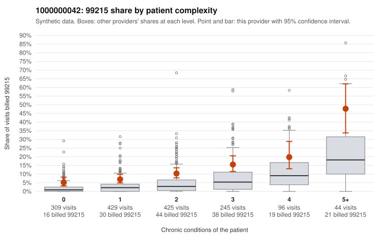

# 1000000042: Provider 1000000042 bills 99215 about three times the complexity-adjusted expectation in every complexity tier, but no 99215 charts came back, so documentation cannot confirm or refute the pattern.

**Leaning (advisory):** Inconclusive

## Why

1000000042 billed 99215 on 10.9% of 1,548 claims against an expected 3.5% given patient complexity (risk-adjusted score 6.22; plain z-score vs peers 1.12). 27% of this provider's 99215 claims were on patients with 0 or 1 chronic conditions. Records came back for 14 claims. No documented 99215 claims came back. 0 of 8 notes claiming moderate-or-higher data reviewed had no lab or test line on the claim. The 99215 share runs roughly double the all-provider rate in every condition-count tier, including patients with zero or one chronic condition. The sampled low-complexity 99215 claims carry simple diagnoses such as back pain, URI and follow-up visits (for example C0020494, C0020912, C0021244, C0021834), which is the pattern of concern for upcoding. The heavy concentration in 99214 may also point to level inflation across the board. Against this, the provider's 99215 share does rise with complexity, high-complexity sampled claims such as C0020772 and C0020860 look appropriate, and the peer z-score is modest. The records review is too thin to judge: only 14 claims came back, none billed as 99215. The few 99213 and 99214 notes that were reviewed all supported their levels, and no data-reviewed notes lacked a lab line. A reviewer should first request charts for the sampled low-complexity 99215 claims to check whether documented MDM and time support the high level, then pull a sample of 99214 notes. Examples: C0020301: billed 99215, patient aged 65 with 1 chronic condition(s) (heart failure). C0020387: billed 99215, patient aged 60 with 0 chronic condition(s).

## Evidence chart

## Cited claims

`C0020301`, `C0020387`

## Suggested next steps

- Request records for a larger sample of this provider's 99214 and 99215 claims; what came back is too thin to judge.
- Re-screen the provider once the records arrive.

---
Citations checked: 2/2 valid. Synthetic data. The leaning is advisory; the flag comes from the statistical screen, and no clinical documentation is available beyond the sampled records-review facts shown in the packet.
