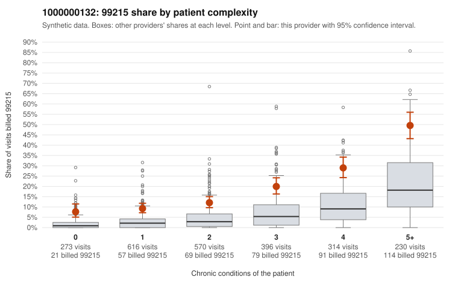

# 1000000132: Provider 1000000132's 99215 rate is elevated within every complexity tier, including patients with no chronic conditions, but records came back for too few claims to show whether the notes support the billed levels.

**Leaning (advisory):** Inconclusive

## Why

1000000132 billed 99215 on 18.0% of 2,399 claims against an expected 5.1% given patient complexity (risk-adjusted score 11.58; plain z-score vs peers 2.44). 18% of this provider's 99215 claims were on patients with 0 or 1 chronic conditions. Records came back for 21 claims. Of 5 documented 99215 claims, 1 (20%) were documented below the billed level, against 0% for the comparison providers. 3 of 18 notes claiming moderate-or-higher data reviewed had no lab or test line on the claim. The claims pattern leans away from a sicker-panel explanation: the excess 99215 share holds at every condition count, not just among multi-morbid patients, and the low-complexity sample includes 99215s for routine-looking problems such as upper respiratory infection, rash, UTI and follow-up visits (e.g., C0063973, C0064384, C0065183, C0064571). The documentation cannot yet confirm or refute this, since only a handful of 99215 charts were reviewed. One chart (C0064985) was documented below the billed level. One chart documented as high MDM (C0062714) is a 22-year-old with no chronic conditions billed for low back pain, which is worth checking for inflated or templated notes, as are the few moderate-plus data-reviewed notes with no lab or test line. A reviewer should first request a larger targeted chart sample of 99215 claims on patients with 0 to 1 conditions, checking whether MDM and time are genuinely recorded. They should also look at the heavy 99214 volume, which the 99215 screen does not address. Examples: C0064985: billed 99215; documented MDM level moderate, minutes not recorded. C0062714: billed 99215, patient aged 22 with 0 chronic condition(s); documented MDM level high, minutes not recorded. C0062830: billed 99215, patient aged 50 with 1 chronic condition(s) (hypertension).

## Evidence chart

## Cited claims

`C0064985`, `C0062714`, `C0062830`

## Suggested next steps

- Request records for a larger sample of this provider's 99214 and 99215 claims; what came back is too thin to judge.
- Re-screen the provider once the records arrive.

---
Citations checked: 3/3 valid. Synthetic data. The leaning is advisory; the flag comes from the statistical screen, and no clinical documentation is available beyond the sampled records-review facts shown in the packet.
