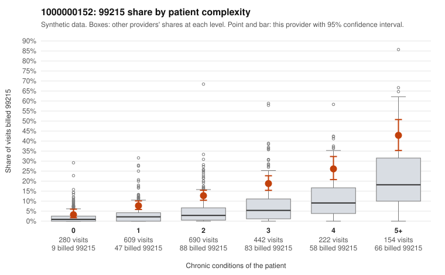

# 1000000152: Provider 1000000152 bills 99215 well above the risk-adjusted expectation in every complexity stratum, but records cover too few claims to tell upcoding from a sicker panel.

**Leaning (advisory):** Inconclusive

## Why

1000000152 billed 99215 on 14.6% of 2,397 claims against an expected 4.5% given patient complexity (risk-adjusted score 9.69; plain z-score vs peers 1.82). 16% of this provider's 99215 claims were on patients with 0 or 1 chronic conditions. Records came back for 14 claims. Of 1 documented 99215 claims, 0 (0%) were documented below the billed level, against 0% for the comparison providers. 0 of 10 notes claiming moderate-or-higher data reviewed had no lab or test line on the claim. The complexity breakdown cuts against a pure sicker-panel explanation: the 99215 share runs roughly two to three times the all-provider share in each condition-count band, including 0- and 1-condition patients. The low-complexity sample includes 99215s on diagnoses that typically support simpler visits, such as follow-up (Z09), rash (R21) and urinary tract infection (N39.0), for example C0077700, C0079571 and C0079740. However, most 99215s still fall on patients with 2 or more conditions, and the overall mix leans heavily toward 99214, which may reflect a consistently high-billing style or a genuinely complex practice. The documentation is too thin to judge: records cover well under 1% of claims, with a single documented 99215 (C0079732, supported). The notes showing moderate-or-higher data reviewed all had a lab or test line on the claim, so there is no cloning signal either way. A reviewer should first request a targeted sample of charts for 99215 claims on 0–1 condition patients, starting with the sampled claim IDs above, and check whether the documented MDM and time support the billed level. Examples: C0077447: billed 99215, patient aged 64 with 1 chronic condition(s) (asthma). C0077488: billed 99215, patient aged 73 with 1 chronic condition(s) (hypertension).

## Evidence chart

## Cited claims

`C0077447`, `C0077488`

## Suggested next steps

- Request records for a larger sample of this provider's 99214 and 99215 claims; what came back is too thin to judge.
- Re-screen the provider once the records arrive.

---
Citations checked: 2/2 valid. Synthetic data. The leaning is advisory; the flag comes from the statistical screen, and no clinical documentation is available beyond the sampled records-review facts shown in the packet.
