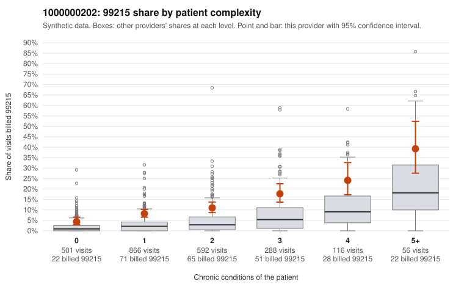

# 1000000202: Provider 1000000202 bills 99215 well above its risk-adjusted expectation in every complexity stratum, but with only one documented 99215 claim the records cannot yet say whether the level is supported.

**Leaning (advisory):** Inconclusive

## Why

1000000202 billed 99215 on 10.7% of 2,419 claims against an expected 3.2% given patient complexity (risk-adjusted score 8.40; plain z-score vs peers 1.09). 36% of this provider's 99215 claims were on patients with 0 or 1 chronic conditions. Records came back for 17 claims. Of 1 documented 99215 claims, 0 (0%) were documented below the billed level, against 0% for the comparison providers. 1 of 11 notes claiming moderate-or-higher data reviewed had no lab or test line on the claim. The claims pattern leans toward concern. The 99215 share runs roughly double the all-provider rate in each complexity band, including patients with 0 or 1 conditions. The low-complexity sample includes visits for nonspecific complaints such as abdominal pain (C0108979, C0109544), back pain (C0109954) and follow-up encounters (C0110339, C0110999), which would not usually need high-complexity decision-making. Against that, the excess is not confined to simple patients: the sampled high-complexity 99215s (e.g., C0108960, C0110939) look clinically plausible. The documentation that did come back shows no unsupported claims at any level, and the one sample with no lab or test line is a weak signal at most. Records cover under 1% of claims and include a single 99215 (C0110495, supported), so the documentation is too thin to confirm or rule out upcoding. A reviewer should first request charts for a targeted sample of low-complexity 99215 claims, starting with the symptom-only and Z09 visits listed here. Check whether the documented decision-making or time genuinely supports level 5 and whether the notes look templated. Examples: C0108979: billed 99215, patient aged 23 with 0 chronic condition(s). C0109036: billed 99215, patient aged 39 with 1 chronic condition(s) (obesity).

## Evidence chart

## Cited claims

`C0108979`, `C0109036`

## Suggested next steps

- Request records for a larger sample of this provider's 99214 and 99215 claims; what came back is too thin to judge.
- Re-screen the provider once the records arrive.

---
Citations checked: 2/2 valid. Synthetic data. The leaning is advisory; the flag comes from the statistical screen, and no clinical documentation is available beyond the sampled records-review facts shown in the packet.
