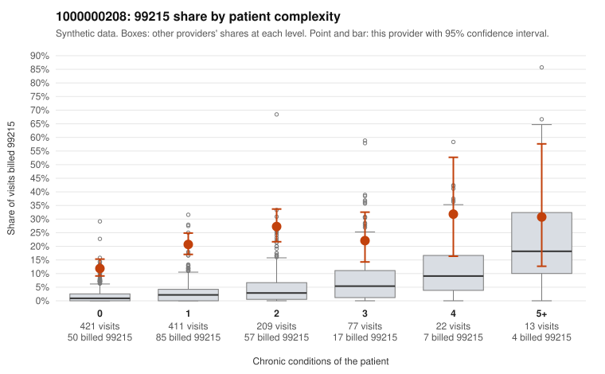

# 1000000208: Provider 1000000208's 99215 billing is concentrated on low-complexity patients, a pattern consistent with upcoding, but the few returned charts support the billed level and are too thin to settle it.

**Leaning (advisory):** Inconclusive

## Why

1000000208 billed 99215 on 19.1% of 1,153 claims against an expected 2.4% given patient complexity (risk-adjusted score 14.57; plain z-score vs peers 2.65). 61% of this provider's 99215 claims were on patients with 0 or 1 chronic conditions. Records came back for 19 claims. Of 3 documented 99215 claims, 0 (0%) were documented below the billed level, against 0% for the comparison providers. 1 of 12 notes claiming moderate-or-higher data reviewed had no lab or test line on the claim. The claims pattern is the main concern. The 99215 share runs well above the all-provider share in every complexity band, and the gap is widest for patients with 0 or 1 conditions. Many sampled low-complexity 99215s carry routine diagnoses such as rash (R21), upper respiratory infection (J06.9), urinary tract infection (N39.0) and follow-up (Z09), as in C0113906, C0114635, C0113888 and C0114847. Against that, all three documented 99215s were supported, including C0113982, a 0-condition abdominal pain visit documented at high MDM and 51 minutes, and only 1 of 12 data-reviewed notes lacked a test line on the claim. That is weak counter-evidence, because records cover under 2% of claims, so the documentation is too thin to judge. A reviewer should first request charts for the sampled low-complexity 99215s with routine diagnoses, then check whether the notes support high MDM or are templated or cloned to match the billed level. Examples: C0113841: billed 99215, patient aged 51 with 1 chronic condition(s) (hypothyroidism). C0113888: billed 99215, patient aged 33 with 0 chronic condition(s).

## Evidence chart

## Cited claims

`C0113841`, `C0113888`

## Suggested next steps

- Request records for a larger sample of this provider's 99214 and 99215 claims; what came back is too thin to judge.
- Re-screen the provider once the records arrive.

---
Citations checked: 2/2 valid. Synthetic data. The leaning is advisory; the flag comes from the statistical screen, and no clinical documentation is available beyond the sampled records-review facts shown in the packet.
