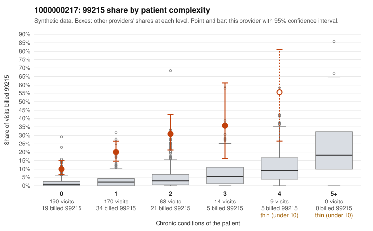

# 1000000217: Elevated 99215 billing concentrated on low-complexity patients is consistent with upcoding, but documentation is too thin to confirm or refute it.

**Leaning (advisory):** Inconclusive

## Why

1000000217 billed 99215 on 18.6% of 451 claims against an expected 2.1% given patient complexity (risk-adjusted score 9.76; plain z-score vs peers 2.56). 63% of this provider's 99215 claims were on patients with 0 or 1 chronic conditions. Records came back for 14 claims. Of 3 documented 99215 claims, 0 (0%) were documented below the billed level, against 0% for the comparison providers. 0 of 9 notes claiming moderate-or-higher data reviewed had no lab or test line on the claim. The claims pattern points toward upcoding: this provider's 99215 share exceeds the all-provider rate in every complexity stratum. It runs roughly five times the peer rate even among patients with zero conditions, and most 99215s fall on patients with 0 or 1 chronic conditions. The sampled low-complexity 99215s (e.g., C0117884 and C0117928 for Z09 follow-up, C0117913 for a rash, C0117984 for an upper respiratory infection) carry diagnoses that rarely support high-complexity decision-making. Against that, the three documented 99215 claims (including C0117878, a zero-condition abdominal-pain visit) were recorded as high MDM with substantial minutes. The one unsupported claim was a 99214 (C0118208), and the data-reviewed check raised no flags. Three documented 99215s out of a small records return is far too few to judge support either way, so the leaning stays inconclusive despite the strong statistical signal. A reviewer should first request records for more of the low-complexity 99215s, starting with the Z09, R21 and J06.9 visits listed. They should also check whether the supported notes, especially C0117878, show templated or cloned language that could inflate the documented MDM. Examples: C0118208: billed 99214; documented MDM level low, minutes not recorded. C0117878: billed 99215, patient aged 42 with 0 chronic condition(s); documented MDM level high, 53 minutes. C0117884: billed 99215, patient aged 39 with 0 chronic condition(s).

## Evidence chart

## Cited claims

`C0118208`, `C0117878`, `C0117884`

## Suggested next steps

- Request records for a larger sample of this provider's 99214 and 99215 claims; what came back is too thin to judge.
- Re-screen the provider once the records arrive.

---
Citations checked: 3/3 valid. Synthetic data. The leaning is advisory; the flag comes from the statistical screen, and no clinical documentation is available beyond the sampled records-review facts shown in the packet.
