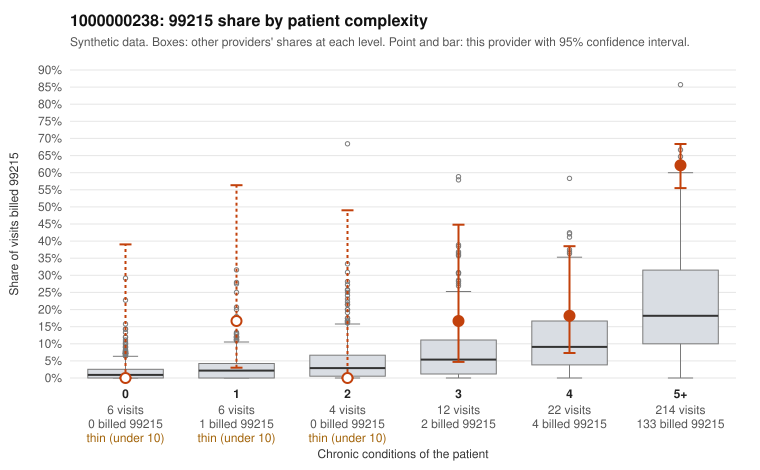

# 1000000238: Provider 1000000238 bills 99215 far above the risk-adjusted expectation even within its very complex panel, but the few charts returned all support the billed level, so the pattern cannot yet be called upcoding or legitimate acuity.

**Leaning (advisory):** Inconclusive

## Why

1000000238 billed 99215 on 53.0% of 264 claims against an expected 15.6% given patient complexity (risk-adjusted score 6.64; plain z-score vs peers 8.95). 1% of this provider's 99215 claims were on patients with 0 or 1 chronic conditions. Records came back for 14 claims. Of 6 documented 99215 claims, 0 (0%) were documented below the billed level, against 0% for the comparison providers. 1 of 10 notes claiming moderate-or-higher data reviewed had no lab or test line on the claim. The panel is genuinely complex: most visits are for patients with 5+ chronic conditions, and almost no 99215s go to low-complexity patients (the one sampled exception is C0125935, a hyperlipidemia patient with a back-pain code). That argues against the classic pattern of high codes on simple patients. However, the excess holds after risk adjustment and appears within the 5+ condition stratum itself, where this provider's 99215 share is well above the all-provider share for the same complexity, so panel acuity alone does not obviously explain it. The documentation shows no unsupported 99215s, and sampled charts such as C0125700 and C0125819 record high MDM, but only 6 documented 99215s out of 140 billed is too thin to judge. Only one moderate-plus data-reviewed note lacked a lab or test line, a weak signal of note inflation. A reviewer should first request a larger, randomly selected set of 99215 charts from the 5+ condition patients and check whether the MDM elements (problems addressed, data, risk) are specific to each visit rather than templated, especially since time is not recorded on any of the supported examples. Examples: C0125935: billed 99215, patient aged 41 with 1 chronic condition(s) (hyperlipidemia).

## Evidence chart

## Cited claims

`C0125935`

## Suggested next steps

- Request records for a larger sample of this provider's 99214 and 99215 claims; what came back is too thin to judge.
- Re-screen the provider once the records arrive.

---
Citations checked: 1/1 valid. Synthetic data. The leaning is advisory; the flag comes from the statistical screen, and no clinical documentation is available beyond the sampled records-review facts shown in the packet.
