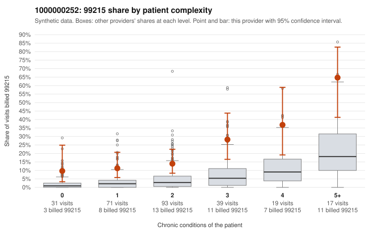

# 1000000252: Provider 1000000252 bills 99215 well above its risk-adjusted expectation across every complexity band, but the few returned charts support the billed levels, so the documentation is too thin to call this upcoding or a legitimately complex panel.

**Leaning (advisory):** Inconclusive

## Why

1000000252 billed 99215 on 19.6% of 270 claims against an expected 4.2% given patient complexity (risk-adjusted score 5.02; plain z-score vs peers 2.75). 21% of this provider's 99215 claims were on patients with 0 or 1 chronic conditions. Records came back for 16 claims. Of 4 documented 99215 claims, 0 (0%) were documented below the billed level, against 0% for the comparison providers. 0 of 10 notes claiming moderate-or-higher data reviewed had no lab or test line on the claim. The elevated 99215 rate is not confined to sicker patients. The provider bills 99215 at several times the all-provider share in every complexity band, including patients with 0 or 1 conditions, and the sampled low-complexity 99215s carry simple diagnoses such as back pain (C0133585, C0133765) or abdominal pain (C0133517). That pattern is consistent with upcoding. Against it, every one of the 16 returned charts supported the billed level, including the 4 documented 99215s (e.g., C0133658, a 5-condition patient). None of the data-reviewed notes lacked a lab or test line, so there is no sign of cloned documentation. Four documented 99215s is far too few to judge, and none of them are low-complexity cases, so the reviewer should first request charts for the low-complexity 99215 claims listed (e.g., C0133517, C0133585, C0133765, C0133771). The reviewer should also note the 99214 claims on 0-condition follow-up visits (C0133752, C0133776, coded Z09), which suggest the elevated coding may extend beyond 99215. Examples: C0133517: billed 99215, patient aged 42 with 0 chronic condition(s). C0133535: billed 99215, patient aged 50 with 1 chronic condition(s) (chronic kidney disease).

## Evidence chart

## Cited claims

`C0133517`, `C0133535`

## Suggested next steps

- Request records for a larger sample of this provider's 99214 and 99215 claims; what came back is too thin to judge.
- Re-screen the provider once the records arrive.

---
Citations checked: 2/2 valid. Synthetic data. The leaning is advisory; the flag comes from the statistical screen, and no clinical documentation is available beyond the sampled records-review facts shown in the packet.
