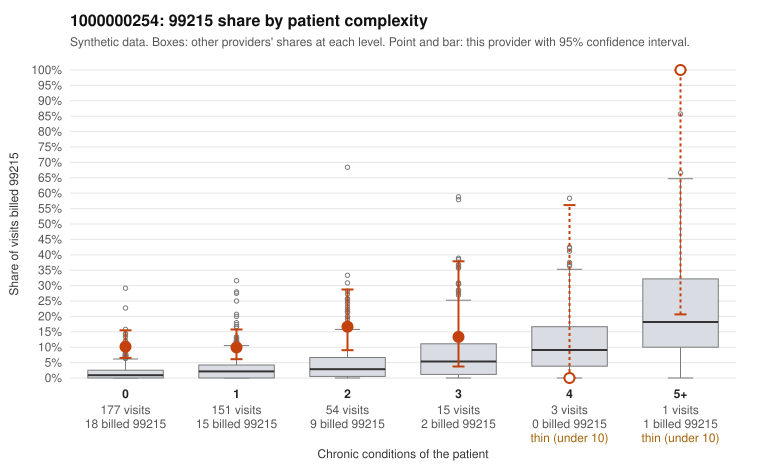

# 1000000254: Provider 1000000254 bills 99215 well above its risk-adjusted expectation, mostly on patients with few or no chronic conditions, but no documented 99215 claims exist to confirm or refute support.

**Leaning (advisory):** Pattern consistent with upcoding

## Why

1000000254 billed 99215 on 11.2% of 401 claims against an expected 2.0% given patient complexity (risk-adjusted score 5.16; plain z-score vs peers 1.19). 73% of this provider's 99215 claims were on patients with 0 or 1 chronic conditions. Records came back for 18 claims. No documented 99215 claims came back. 1 of 13 notes claiming moderate-or-higher data reviewed had no lab or test line on the claim. The claims pattern points away from a sicker panel. The 99215 share runs several times the all-provider rate in the 0- and 1-condition strata, and most sampled 99215 claims carry single acute or nonspecific diagnoses such as low back pain (C0133878, C0133986), abdominal pain (C0133935, C0134161) and UTI (C0133898, C0134254), which would not usually call for high-complexity decision-making. The documentation cannot settle the question because none of the returned charts were 99215 claims. Among the 99214 charts, one claim (C0134093) was documented below its billed level and only one moderate-plus data-review note lacked a lab line, so the records neither strongly support nor contradict the billing. A reviewer should first request records for a targeted sample of 99215 claims on 0–1 condition patients, starting with the listed low-complexity examples, and check whether the documented MDM and time support level 5 or show signs of templated or cloned notes. Examples: C0134093: billed 99214; documented MDM level low, 20 minutes. C0133878: billed 99215, patient aged 60 with 0 chronic condition(s). C0133898: billed 99215, patient aged 66 with 0 chronic condition(s). C0133935: billed 99215, patient aged 55 with 0 chronic condition(s).

## Evidence chart

## Cited claims

`C0134093`, `C0133878`, `C0133898`, `C0133935`

## Suggested next steps

- Request the full records for the cited claims and have a certified coder re-score each against current E/M documentation rules (medical decision making or total time).
- If the re-scoring confirms the pattern, use the sampling plan in the recovery packet to review a statistical sample of this provider's 99215 claims.
- Check whether notes for the cited claims look copied forward, and whether documented minutes repeat from visit to visit.

---
Citations checked: 4/4 valid. Synthetic data. The leaning is advisory; the flag comes from the statistical screen, and no clinical documentation is available beyond the sampled records-review facts shown in the packet.
