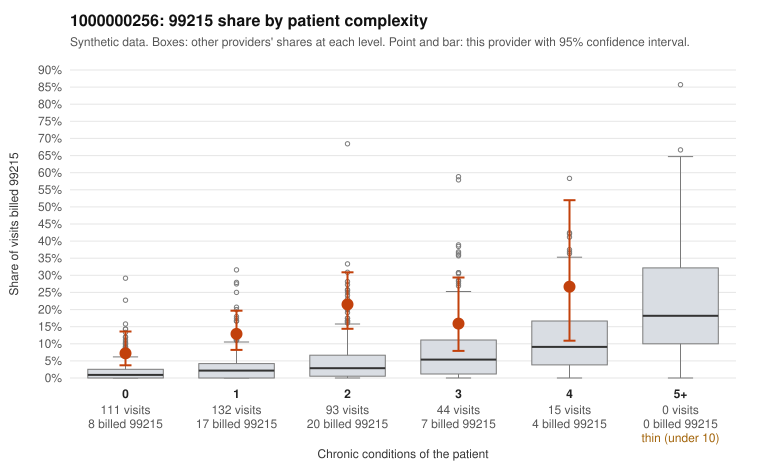

# 1000000256: Provider 1000000256's elevated 99215 billing reaches into low-complexity visits, but with only three documented 99215 claims the records are too thin to say whether this is upcoding or a sicker panel.

**Leaning (advisory):** Inconclusive

## Why

1000000256 billed 99215 on 14.2% of 395 claims against an expected 2.7% given patient complexity (risk-adjusted score 5.61; plain z-score vs peers 1.74). 45% of this provider's 99215 claims were on patients with 0 or 1 chronic conditions. Records came back for 17 claims. Of 3 documented 99215 claims, 0 (0%) were documented below the billed level, against 0% for the comparison providers. 1 of 12 notes claiming moderate-or-higher data reviewed had no lab or test line on the claim. The claims pattern leans toward concern: the excess 99215 share appears in every complexity stratum, including visits for patients with no chronic conditions. Sampled low-complexity 99215s are for routine diagnoses such as upper respiratory infection (C0134390), abdominal pain (C0134574) and back pain (C0134689), which is not what a genuinely complex panel would explain. The documentation does not resolve this either way. All three documented 99215 claims were recorded as high MDM, which nominally supports the billed level, but three charts are too few to judge. Those same three claims are the 0-condition, single-routine-diagnosis visits above, and high MDM on such visits could reflect inflated or templated notes rather than the actual encounter. The single data-reviewed note with no lab line is weak evidence and not decisive. A reviewer should first pull the full charts for C0134390, C0134574 and C0134689 to test whether the high-MDM narrative fits the presenting problem. They should then request a larger, targeted records sample of low-complexity 99215 claims, along with some of the heavy 99214 volume, before drawing any conclusion. Examples: C0134390: billed 99215, patient aged 55 with 0 chronic condition(s); documented MDM level high, minutes not recorded. C0134405: billed 99215, patient aged 31 with 1 chronic condition(s) (type 2 diabetes).

## Evidence chart

## Cited claims

`C0134390`, `C0134405`

## Suggested next steps

- Request records for a larger sample of this provider's 99214 and 99215 claims; what came back is too thin to judge.
- Re-screen the provider once the records arrive.

---
Citations checked: 2/2 valid. Synthetic data. The leaning is advisory; the flag comes from the statistical screen, and no clinical documentation is available beyond the sampled records-review facts shown in the packet.
