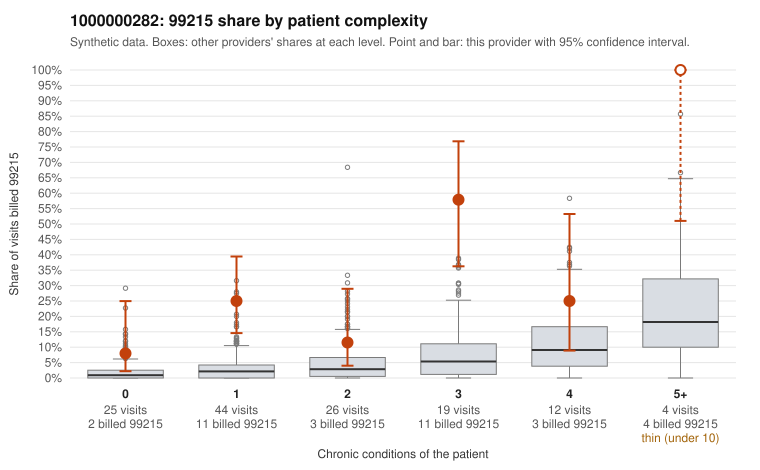

# 1000000282: Provider 1000000282 bills 99215 far above risk-adjusted expectation, with elevated rates even in low-complexity strata, but the documentation sample is too thin to confirm or refute upcoding.

**Leaning (advisory):** Inconclusive

## Why

1000000282 billed 99215 on 26.2% of 130 claims against an expected 3.6% given patient complexity (risk-adjusted score 5.46; plain z-score vs peers 3.96). 38% of this provider's 99215 claims were on patients with 0 or 1 chronic conditions. Records came back for 15 claims. Of 3 documented 99215 claims, 0 (0%) were documented below the billed level, against 0% for the comparison providers. 0 of 10 notes claiming moderate-or-higher data reviewed had no lab or test line on the claim. The billing pattern is consistent with upcoding concerns. The 99215 share exceeds peers in every complexity stratum, and well over a third of 99215 claims fall on patients with 0 or 1 chronic conditions. Sampled examples include single-condition visits for hyperlipidemia, hypothyroidism or diabetes and a few no-condition visits for an 18-year-old patient (C0145068, C0145199). The documentation does not support that reading so far: all 3 documented 99215 claims, including the low-complexity C0145104, recorded high MDM with 40+ minutes. Only one 99214 (C0145110) was documented below billed, and none of the moderate-plus data-reviewed notes lacked a lab or test line. Three documented 99215s is far too few to judge, and part of the high-complexity volume comes from one patient seen repeatedly (M0061143), so the panel may be genuinely sicker in places. A reviewer should first request charts for the low-complexity 99215 claims listed, especially the 0–1 condition visits, to see whether high MDM is actually documented and whether the notes look templated. Examples: C0145110: billed 99214; documented MDM level low, minutes not recorded. C0145065: billed 99215, patient aged 51 with 1 chronic condition(s) (atrial fibrillation). C0145066: billed 99215, patient aged 42 with 1 chronic condition(s) (hyperlipidemia).

## Evidence chart

## Cited claims

`C0145110`, `C0145065`, `C0145066`

## Suggested next steps

- Request records for a larger sample of this provider's 99214 and 99215 claims; what came back is too thin to judge.
- Re-screen the provider once the records arrive.

---
Citations checked: 3/3 valid. Synthetic data. The leaning is advisory; the flag comes from the statistical screen, and no clinical documentation is available beyond the sampled records-review facts shown in the packet.
