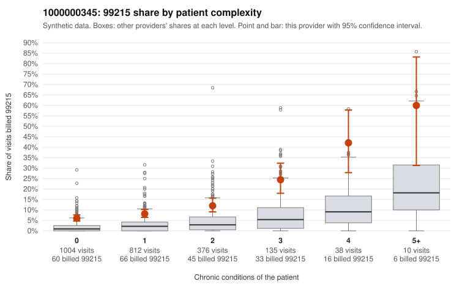

# 1000000345: Provider 1000000345 bills 99215 well above its risk-adjusted expectation, with over half of those visits on patients with 0-1 chronic conditions, but the few charts returned do not show unsupported coding.

**Leaning (advisory):** Inconclusive

## Why

1000000345 billed 99215 on 9.5% of 2,375 claims against an expected 2.2% given patient complexity (risk-adjusted score 9.61; plain z-score vs peers 0.87). 56% of this provider's 99215 claims were on patients with 0 or 1 chronic conditions. Records came back for 17 claims. Of 4 documented 99215 claims, 0 (0%) were documented below the billed level, against 0% for the comparison providers. 0 of 12 notes claiming moderate-or-higher data reviewed had no lab or test line on the claim. The billing pattern leans toward concern. The 99215 share exceeds the all-provider rate in every complexity band, not just among sicker patients. Most 99215 claims fall on low-complexity patients, such as sampled claims C0167910 and C0169280 (upper respiratory infection, no chronic conditions) and C0169398 and C0170028 (follow-up visit codes only). That is the profile a high-acuity panel would not explain. Against this, the records review found no billed level above the documented one, and the documented 99215s (e.g., C0167995, C0168262) show high MDM with appropriate minutes. However, only 4 documented 99215 claims came back, which is too thin to clear or confirm the pattern, and the documented claims may not represent the low-complexity 99215s that drive the concern. A reviewer should first request charts specifically for the low-complexity 99215 claims listed, such as C0167876, C0168414 and C0169506. Those notes should be checked for whether they record genuine high-complexity decision-making or show signs of templated or cloned text. Examples: C0167658: billed 99215, patient aged 37 with 1 chronic condition(s) (asthma). C0167755: billed 99215, patient aged 42 with 1 chronic condition(s) (obesity).

## Evidence chart

## Cited claims

`C0167658`, `C0167755`

## Suggested next steps

- Request records for a larger sample of this provider's 99214 and 99215 claims; what came back is too thin to judge.
- Re-screen the provider once the records arrive.

---
Citations checked: 2/2 valid. Synthetic data. The leaning is advisory; the flag comes from the statistical screen, and no clinical documentation is available beyond the sampled records-review facts shown in the packet.
