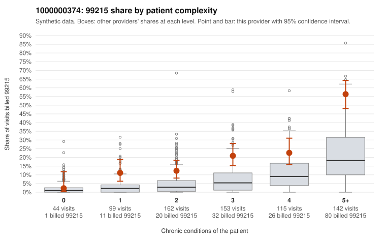

# 1000000374: Elevated 99215 billing persists after risk adjustment, with the excess concentrated in sicker patients, but the documentation is too thin to say whether it reflects upcoding or a genuinely complex panel.

**Leaning (advisory):** Inconclusive

## Why

1000000374 billed 99215 on 23.8% of 715 claims against an expected 7.1% given patient complexity (risk-adjusted score 6.99; plain z-score vs peers 3.52). 7% of this provider's 99215 claims were on patients with 0 or 1 chronic conditions. Records came back for 16 claims. Of 4 documented 99215 claims, 0 (0%) were documented below the billed level, against 0% for the comparison providers. 1 of 10 notes claiming moderate-or-higher data reviewed had no lab or test line on the claim. The 99215 share is above the all-provider rate in every complexity band, including 1-2 condition patients. Most 99215s fall on patients with 5+ conditions, where the sampled claims (e.g., C0183572, C0183677) show multimorbid patients consistent with high-complexity visits. The low-complexity 99215s are a small share but worth a look, since sampled claims such as C0183233 and C0183688 (same patient, diabetes only) and C0183580 (hypertension only) carry little diagnosis support for the highest level. The four documented 99215s all supported high MDM, and only one moderate-plus data note lacked a lab line, but with records for just 16 claims this neither clears nor implicates the provider. A reviewer should first request charts for the low-complexity 99215s and a larger sample of 99214/99215 claims in the 1-3 condition bands, where the gap from peers is widest relative to patient need. Examples: C0183089: billed 99215, patient aged 62 with 1 chronic condition(s) (COPD). C0183123: billed 99215, patient aged 63 with 1 chronic condition(s) (hypertension).

## Evidence chart

## Cited claims

`C0183089`, `C0183123`

## Suggested next steps

- Request records for a larger sample of this provider's 99214 and 99215 claims; what came back is too thin to judge.
- Re-screen the provider once the records arrive.

---
Citations checked: 2/2 valid. Synthetic data. The leaning is advisory; the flag comes from the statistical screen, and no clinical documentation is available beyond the sampled records-review facts shown in the packet.
