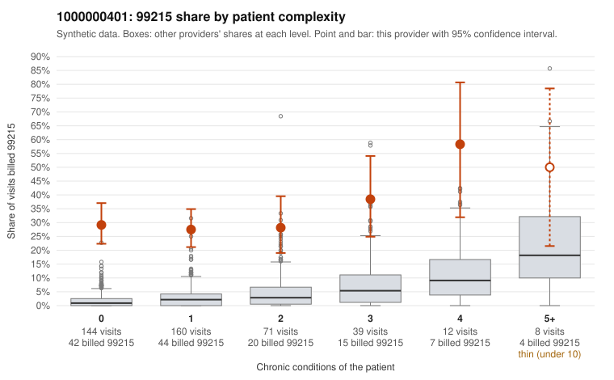

# 1000000401: Provider 1000000401 bills 99215 at nearly the same high rate regardless of patient complexity, but the few charts returned all support the billed level, so documentation neither confirms nor rules out upcoding.

**Leaning (advisory):** Inconclusive

## Why

1000000401 billed 99215 on 30.4% of 434 claims against an expected 2.7% given patient complexity (risk-adjusted score 14.24; plain z-score vs peers 4.75). 65% of this provider's 99215 claims were on patients with 0 or 1 chronic conditions. Records came back for 18 claims. Of 7 documented 99215 claims, 0 (0%) were documented below the billed level, against 0% for the comparison providers. 2 of 14 notes claiming moderate-or-higher data reviewed had no lab or test line on the claim. The claims pattern does not look like a sicker panel. The 99215 share is roughly flat across complexity tiers, including patients with zero chronic conditions, where peers rarely bill 99215, and most of this provider's 99215s fall on low-complexity patients. Against that, every documented 99215 was supported. However, only a small fraction of claims had records, which is too thin to clear the provider, and the documentation itself raises questions. Supported high-MDM notes such as C0194813 (abdominal pain, no chronic conditions) and C0194822 (low back pain, no chronic conditions) record no minutes, and 2 notes claiming moderate-or-higher data review have no lab or test line, which is weak evidence of cloned or inflated notes rather than proof. A reviewer should first pull full charts for the sampled low-complexity 99215 claims (for example C0194641, C0194704, C0195071) and compare note templates across visits for similarity before expanding the records request. Examples: C0194641: billed 99215, patient aged 49 with 0 chronic condition(s). C0194650: billed 99215, patient aged 33 with 0 chronic condition(s).

## Evidence chart

## Cited claims

`C0194641`, `C0194650`

## Suggested next steps

- Request records for a larger sample of this provider's 99214 and 99215 claims; what came back is too thin to judge.
- Re-screen the provider once the records arrive.

---
Citations checked: 2/2 valid. Synthetic data. The leaning is advisory; the flag comes from the statistical screen, and no clinical documentation is available beyond the sampled records-review facts shown in the packet.
