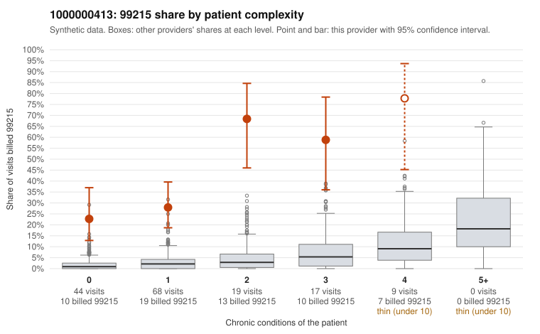

# 1000000413: Provider 1000000413 bills 99215 far above what patient complexity predicts, with about half of those visits on patients with few or no chronic conditions, but documentation is too thin to confirm or refute upcoding.

**Leaning (advisory):** Pattern consistent with upcoding

## Why

1000000413 billed 99215 on 37.6% of 157 claims against an expected 2.6% given patient complexity (risk-adjusted score 10.81; plain z-score vs peers 6.08). 49% of this provider's 99215 claims were on patients with 0 or 1 chronic conditions. Records came back for 15 claims. Of 3 documented 99215 claims, 0 (0%) were documented below the billed level, against 0% for the comparison providers. 3 of 12 notes claiming moderate-or-higher data reviewed had no lab or test line on the claim. The billing pattern is consistent with upcoding: 99215 share is elevated in every complexity stratum, including patients with no chronic conditions, where sampled claims such as C0199902 (R21), C0199955 (M54.50) and C0199950 (J06.9) carry rash, low back pain and upper respiratory diagnoses that would not ordinarily support high-complexity visits. The high-complexity 99215 claims, such as C0199901 and C0199908, look plausible, and all 3 documented 99215 claims (C0199947, C0199985, C0199998) supported the billed level, so the records review offers no direct evidence of unsupported 99215 billing. That review is too small to settle the question in either direction, and two of the three supported claims fall on a 4-condition patient or outside the low-complexity sample. The 3 notes claiming moderate-or-higher data reviewed with no lab or test line on the claim are weak evidence that some notes may be templated or inflated, not proof of it. A reviewer should first request charts for the low-complexity 99215 claims, starting with the zero-condition ones such as C0199902, C0199943 and C0200057, and check whether the documented MDM and time genuinely support level 5 and whether note text looks cloned across visits. Examples: C0199951: billed 99213; documented MDM level straightforward, minutes not recorded. C0200043: billed 99214; documented MDM level low, minutes not recorded. C0199902: billed 99215, patient aged 37 with 0 chronic condition(s). C0199929: billed 99215, patient aged 54 with 0 chronic condition(s). C0199931: billed 99215, patient aged 49 with 1 chronic condition(s) (COPD).

## Evidence chart

## Cited claims

`C0199951`, `C0200043`, `C0199902`, `C0199929`, `C0199931`

## Suggested next steps

- Request the full records for the cited claims and have a certified coder re-score each against current E/M documentation rules (medical decision making or total time).
- If the re-scoring confirms the pattern, use the sampling plan in the recovery packet to review a statistical sample of this provider's 99215 claims.
- Check whether notes for the cited claims look copied forward, and whether documented minutes repeat from visit to visit.

---
Citations checked: 5/5 valid. Synthetic data. The leaning is advisory; the flag comes from the statistical screen, and no clinical documentation is available beyond the sampled records-review facts shown in the packet.
