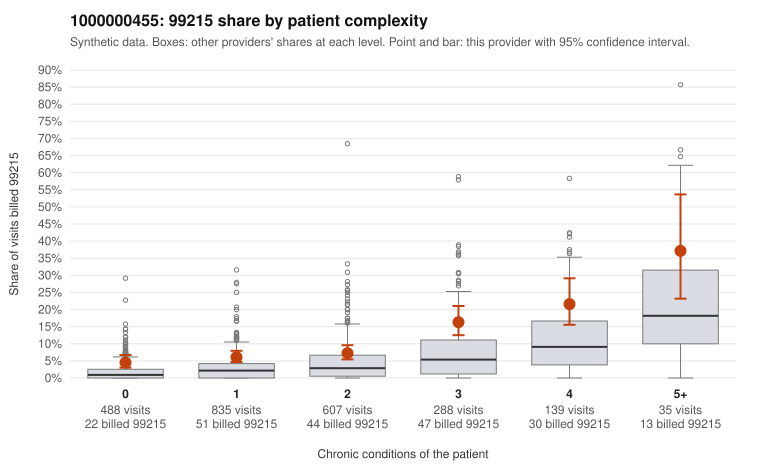

# 1000000455: Provider 1000000455 bills 99215 well above its risk-adjusted expectation in every complexity band, including on simple acute visits, but records are too thin to tell upcoding from a sicker panel.

**Leaning (advisory):** Inconclusive

## Why

1000000455 billed 99215 on 8.7% of 2,392 claims against an expected 3.1% given patient complexity (risk-adjusted score 6.16; plain z-score vs peers 0.71). 35% of this provider's 99215 claims were on patients with 0 or 1 chronic conditions. Records came back for 21 claims. Of 2 documented 99215 claims, 0 (0%) were documented below the billed level, against 0% for the comparison providers. 1 of 17 notes claiming moderate-or-higher data reviewed had no lab or test line on the claim. The elevation is not confined to complex patients. The 99215 share runs roughly double the all-provider rate in every condition-count band, so patient mix alone does not explain it. Visits for 99215 are also heavily weighted toward 99214, which is worth noting as a possible general shift upward. The sampled low-complexity 99215 claims are the main concern: several carry only minor acute or follow-up diagnoses, such as a follow-up exam (C0216557), an upper respiratory infection (C0217111) and a rash (C0217298), which would not usually support high-complexity decision-making. The sampled high-complexity 99215s (for example C0216023 and C0216403) look clinically plausible. Documentation does not settle the question, since only two documented 99215 claims exist (both supported) and the single no-lab data-review note is weak evidence at most. The modest peer z-score adds further ambiguity. A reviewer should first request charts specifically for low-complexity 99215 claims like those listed, to check whether documented MDM and time actually support the billed level. Examples: C0216045: billed 99215, patient aged 43 with 1 chronic condition(s) (hyperlipidemia). C0216236: billed 99215, patient aged 31 with 1 chronic condition(s) (obesity).

## Evidence chart

## Cited claims

`C0216045`, `C0216236`

## Suggested next steps

- Request records for a larger sample of this provider's 99214 and 99215 claims; what came back is too thin to judge.
- Re-screen the provider once the records arrive.

---
Citations checked: 2/2 valid. Synthetic data. The leaning is advisory; the flag comes from the statistical screen, and no clinical documentation is available beyond the sampled records-review facts shown in the packet.
