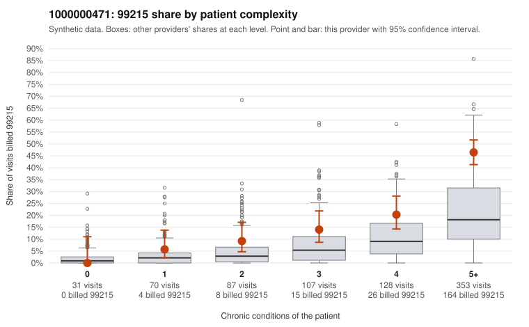

# 1000000471: 1000000471: documented 99215 claims mostly support the level billed (12% below)

**Leaning (advisory):** Pattern consistent with a high-acuity panel

## Why

1000000471 billed 99215 on 28.0% of 776 claims against an expected 10.8% given patient complexity (risk-adjusted score 6.16; plain z-score vs peers 4.30). 2% of this provider's 99215 claims were on patients with 0 or 1 chronic conditions. Records came back for 18 claims. Of 8 documented 99215 claims, 1 (12%) were documented below the billed level, against 0% for the comparison providers. 2 of 15 notes claiming moderate-or-higher data reviewed had no lab or test line on the claim. This pattern is consistent with a high-acuity panel. The sampled documentation supports the billed level. Examples: C0225959: billed 99215; documented MDM level high, 54 minutes. C0225989: billed 99215; documented MDM level high, 46 minutes. C0226221: billed 99215; documented MDM level high, 44 minutes. C0225942: billed 99215, patient aged 85 with 5 chronic condition(s) (hypothyroidism;hyperlipidemia;hypertension;atrial fibrillation;osteoarthritis). C0226005: billed 99215, patient aged 60 with 4 chronic condition(s) (hypothyroidism;type 2 diabetes;obesity;asthma).

## Evidence chart

## Cited claims

`C0225959`, `C0225989`, `C0226221`, `C0225942`, `C0226005`

## Suggested next steps

- Do not pursue recovery on this evidence: the documentation returned supports the level billed.
- Revisit if the provider's 99215 share keeps rising against peers, or if a larger records sample shows unsupported claims.

---
Citations checked: 5/5 valid. Synthetic data. The leaning is advisory; the flag comes from the statistical screen, and no clinical documentation is available beyond the sampled records-review facts shown in the packet.
