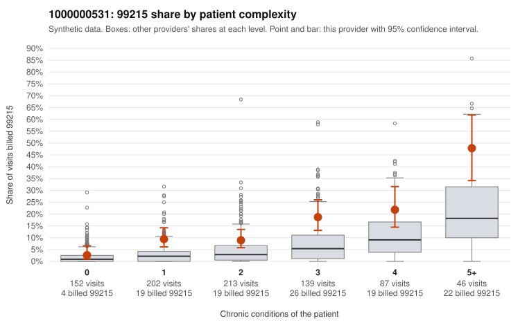

# 1000000531: Provider 1000000531 bills 99215 at roughly three times the complexity-adjusted expectation in every complexity band, but the few returned charts support the billed level, so the evidence is mixed.

**Leaning (advisory):** Inconclusive

## Why

1000000531 billed 99215 on 13.0% of 839 claims against an expected 4.2% given patient complexity (risk-adjusted score 5.04; plain z-score vs peers 1.52). 21% of this provider's 99215 claims were on patients with 0 or 1 chronic conditions. Records came back for 17 claims. Of 5 documented 99215 claims, 0 (0%) were documented below the billed level, against 0% for the comparison providers. 1 of 14 notes claiming moderate-or-higher data reviewed had no lab or test line on the claim. The elevation is not explained by a sicker panel: in the by-complexity table this provider's 99215 share runs about two to three times the all-provider share in every band, including patients with 0 or 1 conditions, and the low-complexity sample shows 99215s on single routine diagnoses such as uncomplicated E11.9, I10 or J06.9 (e.g., C0251638, C0251435, C0251371). Against that, none of the 5 documented 99215 claims were documented below the billed level, but this is too few charts to judge (records cover only about 2% of claims), so the documentation neither confirms nor clears the pattern. There is a possible soft signal in the supported examples: C0251432, a one-condition hypothyroidism visit, is documented at high MDM, and three of the four supported 99215 notes have no time recorded, so a reviewer should check whether these notes are templated or cloned rather than specific to the visit. The first step should be a targeted records request for the low-complexity 99215 claims listed (especially the 0-condition and repeat-patient ones such as C0251876/C0251878), reviewing whether MDM is specific to the visit. Until more charts return, the pattern is consistent with possible upcoding but not established. Examples: C0251318: billed 99215, patient aged 58 with 0 chronic condition(s). C0251371: billed 99215, patient aged 44 with 1 chronic condition(s) (type 2 diabetes).

## Evidence chart

## Cited claims

`C0251318`, `C0251371`

## Suggested next steps

- Request records for a larger sample of this provider's 99214 and 99215 claims; what came back is too thin to judge.
- Re-screen the provider once the records arrive.

---
Citations checked: 2/2 valid. Synthetic data. The leaning is advisory; the flag comes from the statistical screen, and no clinical documentation is available beyond the sampled records-review facts shown in the packet.
