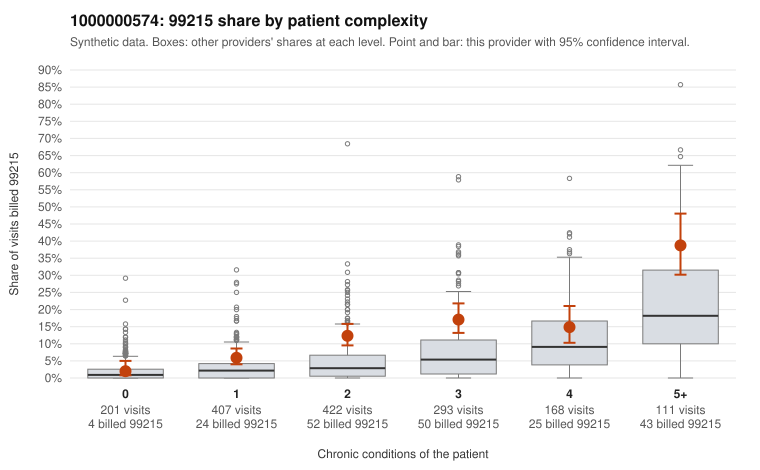

# 1000000574: Provider 1000000574 bills 99215 well above expectation within every complexity tier, but the two charts returned support their billed level, so documentation is too thin to separate upcoding from a complex panel.

**Leaning (advisory):** Inconclusive

## Why

1000000574 billed 99215 on 12.4% of 1,602 claims against an expected 4.6% given patient complexity (risk-adjusted score 5.97; plain z-score vs peers 1.40). 14% of this provider's 99215 claims were on patients with 0 or 1 chronic conditions. Records came back for 18 claims. Of 2 documented 99215 claims, 0 (0%) were documented below the billed level, against 0% for the comparison providers. 1 of 14 notes claiming moderate-or-higher data reviewed had no lab or test line on the claim. The by-complexity table shows this provider's 99215 share running roughly double the all-provider share in the one-, two- and three-condition tiers, so the excess is not explained by a sicker panel. Sampled low-complexity 99215s such as C0270743 and C0271395 (single condition) and C0271172 (no chronic conditions, rash only) fit a pattern consistent with upcoding. Against that, both documented 99215 claims were supported, though one of them, C0270822, is a hypothyroidism-only visit recorded as high MDM with no time noted, which a reviewer should check for cloned or inflated note content. With records for only about 1% of claims and just two documented 99215s, the documentation cannot confirm or refute the statistical signal. A reviewer should first request charts for the low-complexity 99215 sample, starting with the zero-condition claims C0270964, C0271172, C0271204 and C0271946, and compare their MDM and time against the billed level. Examples: C0270712: billed 99215, patient aged 51 with 1 chronic condition(s) (hypothyroidism). C0270743: billed 99215, patient aged 72 with 1 chronic condition(s) (type 2 diabetes).

## Evidence chart

## Cited claims

`C0270712`, `C0270743`

## Suggested next steps

- Request records for a larger sample of this provider's 99214 and 99215 claims; what came back is too thin to judge.
- Re-screen the provider once the records arrive.

---
Citations checked: 2/2 valid. Synthetic data. The leaning is advisory; the flag comes from the statistical screen, and no clinical documentation is available beyond the sampled records-review facts shown in the packet.
